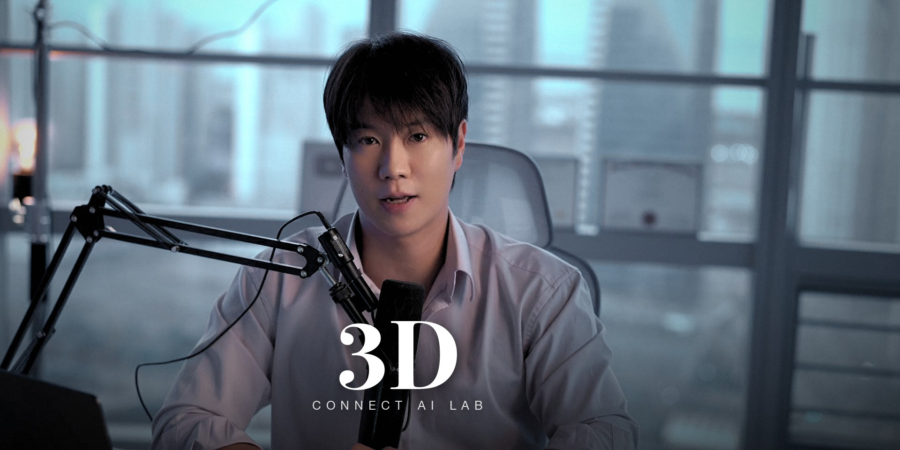
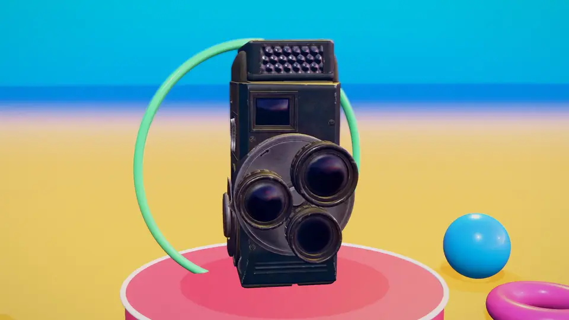
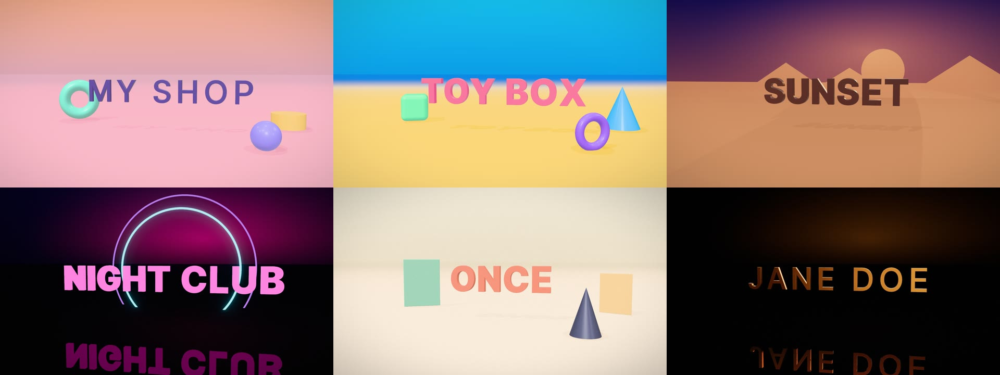

<p align="center"></p>

<p align="center">
  <b>CONNECT AI LAB</b> · AI education for everyone · 모두를 위한 AI 교육<br>
  <a href="https://www.youtube.com/@CONNECT-AI-LAB">YouTube: CONNECT AI LAB</a> · <a href="https://www.aicitybuilders.com/vibecoding">강의: 비주얼 바이브코딩</a> · <a href="README.md">English</a>
</p>

# connect-ai-three

**AI 3D 웹 직원이에요. 보고 싶은 걸 한 문장으로 말하면, 끌어서 돌려 보는 3D 웹 페이지랑 같은 그림의 영상이 같이 나와요.**

[](docs/showcase/v04/hero.mp4)

```bash
npx github:wonseokjung/connect-ai-three
```

이 한 줄이면 데모 장면이 만들어지고 브라우저에서 열려요. 마우스로 끌어서 돌려 보세요. 에이전트(Claude Code, Codex, Antigravity, Cursor)에게 가르치려면 `npx github:wonseokjung/connect-ai-three install` 을 붙여 넣고 설치해 달라고 하세요. 그다음 새 채팅에서 이렇게 말하면 돼요. "connect-ai-three 로 우리 카페 로고 'MY SHOP' 을 3D 로, 끌어서 돌려 보는 웹 페이지랑 6초 영상."

[Node.js](https://nodejs.org) 18 이상이랑 GPU 있는 컴퓨터면 돼요. 유료 API 키는 필요 없어요.

## 예제

그림 하나가 [examples/](examples) 의 폴더 하나예요. 안에 `scene.json`, 짧은 영상, 그걸 만든 문장이 있어요. 눌러 보세요.

<table>
<tr>
<td width="33%" valign="top"><a href="examples/bust"></a><br><a href="examples/bust"><code>bust</code></a> 대리석 흉상, 파스텔 갤러리</td>
<td width="33%" valign="top"><a href="examples/showroom"></a><br><a href="examples/showroom"><code>showroom</code></a> 장난감 세상의 필름 카메라</td>
<td width="33%" valign="top"><a href="examples/flythrough"></a><br><a href="examples/flythrough"><code>flythrough</code></a> 노을 사막의 세 자리</td>
</tr>
<tr>
<td width="33%" valign="top"><a href="examples/toy-studio"></a><br><a href="examples/toy-studio"><code>toy-studio</code></a> 데모, 전부 코드로</td>
<td width="33%" valign="top"><a href="examples/logo-night-city"></a><br><a href="examples/logo-night-city"><code>logo-night-city</code></a> 밤 도시 위 금색 로고</td>
<td width="33%" valign="top"><a href="examples/interactive-hero"></a><br><a href="examples/interactive-hero"><code>interactive-hero</code></a> 돌려 보는 웹 히어로</td>
</tr>
<tr>
<td width="33%" valign="top"><a href="examples/explainer-fly"></a><br><a href="examples/explainer-fly"><code>explainer-fly</code></a> 설명 장면 사이를 나는 카메라</td>
<td width="33%" valign="top"><a href="examples/korean-title"></a><br><a href="examples/korean-title"><code>korean-title</code></a> 한글 3D 글자</td>
<td width="33%" valign="top"><a href="examples/on-my-video"></a><br><a href="examples/on-my-video"><code>on-my-video</code></a> 내 영상 위 3D</td>
</tr>
</table>

## 0.4: 문장마다 다른 세상

예전엔 웬만한 문장은 다 검정에 금색이었어요. 이제는 문장을 읽고 거기 맞는 색이랑 분위기를 골라요. 카페면 파스텔, 장난감이면 쨍한 장난감 세상, 노을이면 사막 노을, 클럽이면 네온, 동화면 종이 공예. 아무 말 안 하면 단어로 하나를 골라서, 두 문장이 같은 방에 들어가는 일이 거의 없어요.



```bash
npx github:wonseokjung/connect-ai-three new "'MY SHOP' logo in a pastel cafe, slow orbit"
npx github:wonseokjung/connect-ai-three new "노을 지는 사막 위 'SUNSET'"
npx github:wonseokjung/connect-ai-three make my-shop          # 검사, 웹 페이지, 영상, 스틸 시트, 보고서
```

**[카탈로그 페이지 열기](docs/index.html)**: 맨 위에 직접 끌어 돌리는 살아 있는 장면, 136개 항목이 전부 살아 있는 클립으로, 완성 데모와 항목마다 복사해 쓰는 한 줄 지시문이 있습니다.

**장면 규격 하나. 결과 둘. 스스로 검사.** 나(또는 코딩 에이전트)는 작은 `scene.json` 하나만 씁니다. 카메라, 조명, 물체, 움직임, 마무리. 도구가 이것을 브라우저에서 돌아가는 인터랙티브 웹 페이지와, 프레임 하나까지 같은 그림인 영상으로 만듭니다. 넘겨주기 전에 직접 검사합니다: 빈 화면, 화면 밖 물체, 가려진 얼굴, 드로콜, 텍스처 크기, 폰 화면, WebGL 누수.

3D 라이브러리를 하나 더 만든 것이 아닙니다. 종합격투기가 여러 무술의 좋은 기술을 한데 묶었듯, three.js 생태계(three 본체, `examples/jsm` 의 로더 · 도형 · 후처리, Rapier 물리, three-mesh-bvh, React Three Fiber, Remotion 렌더러)를 규격 하나 뒤에 놓았습니다. 그래서 무엇이든 한 줄입니다.

```json
{"id": "title", "type": "wordmark", "text": "MY NAME", "split": true, "motion": [{"type": "stagger", "at": 0.5}]}
{"id": "camera", "type": "cinema-camera", "tripod": true}
{"id": "model", "type": "gltf", "src": "assets/robot.glb", "motion": ["turntable"]}
{"id": "word", "type": "text3d", "text": "DROP", "bodyEach": true}
```

> **라이선스.** 이 키트는 MIT 입니다. 만들어지는 웹 페이지에는 MIT / Apache-2.0 코드만 들어갑니다(three.js, 물리를 쓰면 Rapier). 영상 쪽은 [Remotion](https://www.remotion.dev) 위에서 도는데 Remotion 은 MIT 가 아닙니다: 개인과 3명 이하 회사는 무료, 그보다 크면 회사 라이선스가 필요합니다([LICENSE.md](https://github.com/remotion-dev/remotion/blob/main/LICENSE.md)). 쓰인 부품은 전부 [NOTICE.md](NOTICE.md) 에 있습니다.

## 시작

Node 18 이상. GPU 가 있는 macOS, Windows, Linux.

```bash
npx github:wonseokjung/connect-ai-three            # 데모 장면을 만들어 브라우저에서 엽니다: 끌어서 둘러보세요
npx github:wonseokjung/connect-ai-three install    # 코딩 에이전트(Claude Code, Codex, Cursor, Antigravity)에 규격과 카탈로그를 알려 줍니다
```

그다음 에이전트에게 말로 부탁합니다.

> connect-ai-three 로 만들어 줘: 우리 장난감 가게 이름 "TOY BOX" 를 3D 글자로, 쨍한 장난감 세상에. 끌어서 돌려 볼 수 있는 웹 히어로와 6초 영상 둘 다.

에이전트가 없어도 말로 됩니다(한국어도 알아듣습니다).

```bash
npx github:wonseokjung/connect-ai-three new "밤 도시 위에 금색 로고 'JANE DOE', 천천히 도는 카메라, 6초"
npx github:wonseokjung/connect-ai-three make jane-doe                    # 검사, 웹 페이지, 영상, 스틸 시트, 보고서
npx github:wonseokjung/connect-ai-three make jane-doe --short --alpha    # 세로 9:16 과 투명 배경 overlay.mov 도 함께
```

`out/` 에 생기는 것:

| 파일 | 무엇 |
|---|---|
| `web/index.html` | 인터랙티브 페이지. 파일 하나라 더블클릭으로 열리고, 어디든 올리면 됩니다 |
| `video.mp4` | 같은 장면의 영상(H.264) |
| `overlay.mov` | `--alpha`: 배경이 투명한 ProRes 4444. Premiere / CapCut / DaVinci 에 그대로 올립니다 |
| `short_9x16.mp4` | `--short`: 세로 버전(그림이 다 들어오게 카메라가 물러납니다) |
| `sheet.jpg` | 장면 전체에서 뽑은 스틸 8장 |
| `report.md` | 검사 결과: 꼭 고칠 것, 볼 만한 것, 잰 숫자 |

## 규격

```json
{
  "name": "jane-doe",
  "duration": 6,
  "look": "connect-night-city",
  "camera": {"position": [0, 1.2, 7], "target": [0, 1, 0], "fov": 32,
    "motion": [{"type": "orbit", "from": -20, "to": 14, "dur": 6}, {"type": "dolly", "from": 1.3, "to": 1, "dur": 6}]},
  "objects": [
    {"id": "floor", "type": "floor", "kind": "mirror"},
    {"id": "title", "type": "text3d", "text": "JANE DOE", "size": 0.56, "split": true, "position": [0, 1, 0],
      "material": "gold", "motion": [{"type": "stagger", "at": 0.5, "each": 0.08}]}
  ],
  "addPost": [{"type": "dof"}],
  "interact": ["parallax", "orbit"]
}
```

`look` 한 단어가 배경 · 조명 · 반사 · 마무리를 정합니다. 모든 움직임은 시간(`at`, `dur`)만으로 정해집니다. 그래서 앞뒤로 돌려 보고, 반복하고, 프레임을 아무 순서로 렌더해도 같은 그림입니다.

알아 두면 좋은 작은 칸 둘: `"short": {...}` 에는 세로 9:16 버전(`--short`)에서만 달라질 것을 적습니다. `camera` 같은 맨 위 칸이나, 물체 하나하나(`"objects": {"tag": {"size": 0.12}}`). 그리고 물체에 `"reflect": false` 를 주면 거울 바닥에 비치지 않습니다.

## 카탈로그: 136개, 전부 실제로 도는 장면

```bash
npx github:wonseokjung/connect-ai-three catalog            # 목록
npx github:wonseokjung/connect-ai-three catalog motion     # 한 묶음만, 항목마다 말로 부탁하는 문장과 함께
npx github:wonseokjung/connect-ai-three use dof my-scene   # 항목 하나에서 시작
```

| 묶음 | 항목 | 딛고 선 것 |
|---|---|---|
| 물체 (44) | **스튜디오 소품 세트**(워드마크, 모노그램, 내 간판이 달린 스튜디오 건물, 카메라, 마이크, 워크스테이션, 디스플레이, 노트북, 소프트박스, 슬레이트, 교재: 전부 코드로 만든 것, 모델 파일 없음), 글꼴 6종의 3D 글자(통째 · 글자별), 라벨, 유리 카드, 내 이미지, 내 `.glb`, 내 `.svg` 로고 입체화, 바닥(거울 · 그림자만 · 격자), 부드러운 접지 그림자, 둥근 상자와 기본 도형, 보석, 자이로 링, 리본, 굵은 선, 인스턴스 격자 · 구 · 나선, 점 지구본, 3D 막대, 밤 도시, 뒤 조명, 지형, 물결 면, 하늘, 액체 금속, 주전자, 뫼비우스 | three 본체, examples/jsm, 우리 셰이더 |
| 재질 (20) | 금, 헤어라인 금, 크롬, 강철, 피아노 블랙, 아이보리, 클레이, 플라스틱, 자동차 도장, 유리, 서리 유리, 스모크 유리, 벨벳, 무지갯빛, 발광, 와이어, 평면색, 툰, 림, 그라디언트 | three 물리 재질, 우리 셰이더 |
| 움직임 (21) | turntable, spin, float, sway, pop, fade, rise, drop, slide, move, scale, rotate, pulse, orbit, path, explode, stagger, draw, count, typewriter, billboard | 자체 |
| 카메라 (9) | orbit, dolly, crane, truck, zoom, shots(위치 사이를 날아다님), path, handheld, dolly-zoom | 자체 |
| 조명 (12) | 키, 금색 림, 필, 포인트, 스폿, 소프트박스, 해 + 하늘, 조명 돌리기, 숨쉬기, 반사 환경 3종 | three 본체, RoomEnvironment, RGBELoader, RectAreaLight |
| 후처리 (11) | 블룸, 피사계 심도, AO, 외곽선, 픽셀 아트, 망점, SMAA, 비네트, 그레인, 색수차, 그레이드 | three EffectComposer 패스, 우리 마무리 셰이더 |
| 룩 (8) | connect-gold-night, connect-night-city, studio-black, midnight-glass, pale-studio, blueprint, daylight, on-video | 자체 |
| 인터랙션 (6) | 끌어서 돌리기, 포인터 따라 기울기, 올리면 뜨기, 줌, 클릭, 스크롤 | 자체(무거운 모델은 three-mesh-bvh) |
| 물리 (3) | 글자 떨어뜨리기, 도미노, 쌓기와 공 | Rapier. 미리 계산해 두어 돌려 보기 · 반복이 됩니다 |
| 다른 길 (2) | React Three Fiber 어댑터, 내 영상 위 3D | @react-three/fiber, @remotion/three, Remotion |

## 스스로 하는 검사

`make` 와 `check` 는 화면 없는 브라우저에서 장면을 실제로 만들어 잽니다. "FIX" 줄이 있으면 렌더를 멈추고, "look" 줄은 참고입니다.

| 보는 것 | 까닭 |
|---|---|
| 빈 화면 · 거의 검은 화면 | three.js 에서 가장 흔한 실패입니다: 카메라가 엉뚱한 곳을 보거나 조명이 없을 때 |
| 한 번도 화면에 안 들어오는 물체, NaN 위치 | 좌표 오타. NaN 하나가 블룸을 타고 화면 전체를 검게 만듭니다 |
| 얼굴 보호 상자(`keepOut`), `front` 표시 상자 | 내 영상 위에서는 어떤 것도 얼굴을 가리면 안 됩니다. 사람 매트가 있으면 3D 는 전부 내 뒤로 가고, 내 앞의 마이크 암은 앞에 남습니다 |
| 같은 그림이 두 번 나오는가 | 2.0초의 프레임은 어떻게 왔든 같아야 합니다. 이게 웹과 영상을 일치시킵니다 |
| WebGL 누수 | 장면을 여러 번 만들었다 지워 봅니다. 컨텍스트 · 도형 · 텍스처가 남으면 안 됩니다 |
| 드로콜, 삼각형 수, 가장 큰 텍스처, 텍스처 메모리 | 폰에서는 4096px 이 안전한 한계입니다 |
| 프레임 시간(원래 크기, 폰 크기) | 이 컴퓨터에서 후처리까지 다 넣고 잰 값 |
| 폰 화면(390 x 844) | 세로에서 잘리는 것이 있는지 |
| 글자 높이(픽셀) | 폰에서 못 읽을 만큼 작은 라벨 |

## 색: 장면마다 그 장면의 세상

정해진 집 색은 없어요. 문장에 맞는 팔레트랑 분위기를 장면마다 따로 골라요. 파스텔 카페(복숭아에서 라일락으로 가는 하늘, 분홍 클레이 바닥, 민트랑 노랑 장난감), 쨍한 장난감 세상, 노을 사막, 네온 클럽, 종이 공예. 검정에 금색은 "고급", "골드" 라고 했을 때만 나와요. 대부분은 `pale-studio` 나 `daylight` 룩에 `background` 그라데이션이랑 색 있는 `floor` 하나면 돼요.

```json
"look": "pale-studio",
"background": {"type": "gradient", "top": "#2EC4F1", "bottom": "#1B6FE0"},
"objects": [{"id": "floor", "type": "floor", "kind": "matte", "material": {"preset": "clay", "color": "#FFD23F"}, "size": 300}],
"addPost": [{"type": "grade", "whites": 0.95}]
```

색이 밝으면 하얀 부분이 날아가기 쉬워요. `grade` 의 `whites` 를 0.95 쯤 주면 하이라이트가 부드럽게 눌려요. 너무 번들거리거나 어두운 모델은 `gltf` 에 `"surface": {"roughness": 1, "brightness": 1.3}` 을 주면 파일을 안 고치고 잡혀요.

## 3D 글자: 글꼴 6종, 그리고 내 글꼴 파일

`text3d`, `wordmark`, `building` 의 간판은 `"font"` 를 받습니다: `thin`, `light`, `sans`, `bold`(깔끔한 산세리프 네 굵기), `serif`, `serif-bold`(제목용 세리프). 필요한 글자만 남긴 작은 데이터라 하나에 수십 KB 이고, 웹 페이지에는 장면이 쓴 글꼴만 들어갑니다. 글자 사이 간격(커닝)도 적용됩니다.

납작한 글자(`label`, `card`, 페이지 제목)는 준비 없이 한글이 됩니다. 산세리프 글꼴에는 "모두를 위한 AI 교육" 같은 몇 줄의 한글 글자가 들어 있고, 그 밖의 한글 · 일본어 · 한자 등은 내 글꼴 파일을 하나 주면 똑같이 입체가 됩니다.

```json
{"type": "text3d", "text": "안녕하세요, 반갑습니다", "fontFile": "assets/MyFont.otf", "material": "gold", "split": true}
```

글꼴에 없는 글자가 있으면 검사가 알려 줍니다. `examples/korean-title` 을 보세요. 글꼴 데이터는 공개 글꼴에서 만든 것이고 SIL Open Font License 를 그대로 따릅니다([licenses/fonts-OFL.txt](licenses/fonts-OFL.txt)).

## 내 영상 위 3D

2강의 도구([connect-ai-video-motion](https://github.com/wonseokjung/connect-ai-video-motion))가 내 주변에 2D 그래픽을 올렸다면, 이 도구는 같은 영상에 3D 물체를 올립니다.

```bash
npx github:wonseokjung/connect-ai-three on-video talk.mp4 --faces talk-video-motion/work/face.json --matte talk-video-motion/work/matte
```

영상 위에 투명한 3D 층을 올릴 뿐, 내 픽셀은 건드리지 않습니다. `face.json` 과 `matte` 폴더는 connect-ai-video-motion 이 그 영상을 분석하며 만든 것입니다(매트는 프레임마다 한 장인 흑백 그림, 흰색이 사람. macOS 에서는 Apple Vision 이 만들어 내려받을 것이 없습니다).

- **매트가 있으면 모든 3D 가 내 뒤에 그려집니다.** 워드마크가 어깨 뒤에서 올라오고, 카메라가 머리 뒤로 날아가고, 어떤 것도 얼굴이나 손 앞에 올 수 없습니다. 매트 가장자리의 애매한 픽셀은 사람으로 치므로 언제나 원본 영상이 이깁니다.
- **매트가 없으면** 3D 가 위에 올라가고 얼굴 상자가 지킵니다: `--faces` 나 `--face 0.33,0.13,0.25,0.48`. 물체가 상자에 걸치면 검사가 실패하고, 언제 얼마나 걸쳤는지 알려 줍니다.
- 내 앞에 있지만 내가 아닌 것(마이크 암, 스탠드)은 매트에 없습니다. 그 자리를 `keepOut` 에 `{"x": 0, "y": 0.5, "w": 0.46, "h": 0.5, "front": true}` 로 적어 두면 검사가 3D 를 거기서 떼어 놓습니다.
- `make --alpha` 는 사람 자리가 이미 비워진 3D 를 `overlay.mov` 로 씁니다. Premiere, CapCut, DaVinci 에서 영상 위에 그대로 올리면 됩니다.

`examples/on-my-video` 에 완성된 다섯 컷이 있습니다(인사, "3D 모델링", "카메라를 막 움직이니까", "중력", "AI 네이티브 컴퍼니"). 전부 그 테이크에서 실제로 한 말에 맞춘 타이밍입니다.

## 이미 React Three Fiber 를 쓰고 있다면

```tsx
import {ConnectScene} from 'connect-ai-three/src/adapters/r3f';

<Canvas>
  <ConnectScene spec={spec} time={t} />
</Canvas>
```

## 아직 안 되는 것

가우시안 스플랫 · WebGPU / TSL 재질 · 소리 · 키프레임 편집기. 배경이 투명할 때는 피사계 심도와 블룸이 자동으로 빠집니다(투명도를 지키지 못해서). 프레임 시간은 검사를 돌린 컴퓨터에서 잰 값이라, 폰 숫자는 참고용입니다.

## 만든 곳

three.js 와 [NOTICE.md](NOTICE.md) 의 프로젝트들 위에 만들었습니다(버전 · 라이선스 포함). 에셋은 Poly Haven 의 CC0 HDRI 하나, NASA 공개 모델 하나, 그리고 예제 세 개에 쓴 Poly Haven 의 CC0 모델 다섯 개와 HDRI 세 개이고, 출처 표기가 필요한 에셋은 쓰지 않았습니다([licenses/assets.md](licenses/assets.md)). 카탈로그 페이지에서 사람이 나오는 클립은 만든 사람 본인의 영상입니다.

<!-- team:start -->
## CONNECT AI LAB의 AI 직원들

AI 직원을 하나씩 오픈소스로 만들고 있어요. 필요한 직원부터 데려가 쓰세요.

<table>
<tr><td width="34%" valign="top"><b>AI 사업 해부 직원</b><br><a href="https://github.com/wonseokjung/reversebusiness"><code>reversebusiness</code></a></td><td valign="top">사업 웹사이트 주소 하나 주면 그 사업이 어떻게 돈 버는지 읽어 줘요.</td></tr>
<tr><td width="34%" valign="top"><b>AI 영상 편집 직원</b><br><a href="https://github.com/wonseokjung/connect-ai-video-motion"><code>connect-ai-video-motion</code></a></td><td valign="top">내 영상을 주면 몸을 피해서 빈자리에 모션그래픽을 넣어 줘요.</td></tr>
<tr><td width="34%" valign="top"><b>AI 모션그래픽 직원</b><br><a href="https://github.com/wonseokjung/connect-ai-motion"><code>connect-ai-motion</code></a></td><td valign="top">글 몇 줄 주면 모션그래픽 영상을 만들어 줘요. 찍은 영상은 없어도 돼요.</td></tr>
<tr><td width="34%" valign="top"><b>AI 발표 자료 직원</b><br><a href="https://github.com/wonseokjung/connect-ai-slides-web"><code>connect-ai-slides-web</code></a></td><td valign="top">할 말 몇 줄이나 예전 PPT를 주면 움직이는 덱이랑 고칠 수 있는 파워포인트 파일을 만들어 줘요.</td></tr>
<tr><td width="34%" valign="top"><b>AI 3D 웹 직원</b> · <b>지금 보는 직원</b><br><a href="https://github.com/wonseokjung/connect-ai-three"><code>connect-ai-three</code></a></td><td valign="top">한 문장 주면 끌어서 돌려 보는 3D 웹 페이지랑 같은 그림의 영상을 만들어 줘요.</td></tr>
<tr><td width="34%" valign="top"><b>AI 마케터 직원</b><br><a href="https://github.com/wonseokjung/connect-ai-marketer"><code>connect-ai-marketer</code></a></td><td valign="top">내 브라우저에서 24시간 댓글, 리스닝, 업로드를 맡아요.</td></tr>
<tr><td width="34%" valign="top"><b>AI 글쓰기 직원</b><br><a href="https://github.com/wonseokjung/connect-ai-writer"><code>connect-ai-writer</code></a></td><td valign="top">영상 하나 주면 플랫폼마다 내 말투로 글을 쓰고 사진까지 같이 만들어 줘요.</td></tr>
<tr><td width="34%" valign="top"><b>AI XR 직원</b><br><a href="https://github.com/wonseokjung/connect-ai-xr"><code>connect-ai-xr</code></a></td><td valign="top">한 문장 주면 메타 퀘스트에서 열리는 XR 앱을 만들어 줘요. 컴퓨터랑 폰에서도 열려요.</td></tr>
</table>
<!-- team:end -->

---

이런 도구를 내 AI 에이전트로 직접 만드는 법은 [비주얼 바이브코딩](https://www.aicitybuilders.com/vibecoding)에서 가르쳐요.

<table><tr>
<td width="140" valign="top"></td>
<td valign="top"><b>만든 사람: AI 멘토 제이</b> · CONNECT AI LAB<br>
AI 직원을 하나씩 오픈소스로 계속 내놓고, 어떻게 만드는지 유튜브랑 강의에서 보여 드릴게요.<br>
<a href="https://www.youtube.com/@CONNECT-AI-LAB">유튜브</a> · <a href="https://www.aicitybuilders.com/vibecoding">비주얼 바이브코딩</a> · <a href="https://github.com/wonseokjung">오픈소스 더 보기</a></td>
</tr></table>

MIT · CONNECT AI LAB
