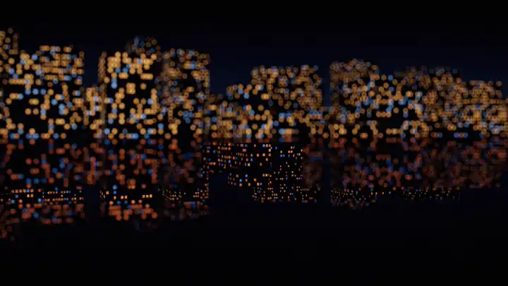

# connect-ai-three

**CONNECT AI LAB 이 만든 오픈소스 · 모두를 위한 AI 교육.** 한 가지 일을 하는 도구입니다: 보고 싶은 것을 말하면 three.js 장면이 나옵니다.

```bash
npx connect-ai-three
```

[](docs/index.html)

**[카탈로그 페이지 열기](docs/index.html)**: 맨 위에 직접 끌어 돌리는 살아 있는 장면, 135개 항목이 전부 살아 있는 클립으로, 완성 데모와 항목마다 복사해 쓰는 한 줄 지시문이 있습니다.

**장면 규격 하나. 결과 둘. 스스로 검사.** 나(또는 코딩 에이전트)는 작은 `scene.json` 하나만 씁니다. 카메라, 조명, 물체, 움직임, 마무리. 도구가 이것을 브라우저에서 돌아가는 인터랙티브 웹 페이지와, 프레임 하나까지 같은 그림인 영상으로 만듭니다. 넘겨주기 전에 직접 검사합니다: 빈 화면, 화면 밖 물체, 가려진 얼굴, 드로콜, 텍스처 크기, 폰 화면, WebGL 누수.

3D 라이브러리를 하나 더 만든 것이 아닙니다. 종합격투기가 여러 무술의 좋은 기술을 한데 묶었듯, three.js 생태계(three 본체, `examples/jsm` 의 로더 · 도형 · 후처리, Rapier 물리, three-mesh-bvh, React Three Fiber, Remotion 렌더러)를 규격 하나 뒤에 놓았습니다. 그래서 무엇이든 한 줄입니다.

```json
{"id": "title", "type": "wordmark", "text": "MY NAME", "split": true, "motion": [{"type": "stagger", "at": 0.5}]}
{"id": "camera", "type": "cinema-camera", "tripod": true}
{"id": "model", "type": "gltf", "src": "assets/robot.glb", "motion": ["turntable"]}
{"id": "word", "type": "text3d", "text": "DROP", "bodyEach": true}
```

> **라이선스.** 이 키트는 MIT 입니다. 만들어지는 웹 페이지에는 MIT / Apache-2.0 코드만 들어갑니다(three.js, 물리를 쓰면 Rapier). 영상 쪽은 [Remotion](https://www.remotion.dev) 위에서 도는데 Remotion 은 MIT 가 아닙니다: 개인과 3명 이하 회사는 무료, 그보다 크면 회사 라이선스가 필요합니다([LICENSE.md](https://github.com/remotion-dev/remotion/blob/main/LICENSE.md)). 쓰인 부품은 전부 [NOTICE.md](NOTICE.md) 에 있습니다.

## 시작

Node 18 이상. GPU 가 있는 macOS, Windows, Linux.

```bash
npx connect-ai-three            # 데모 장면을 만들어 브라우저에서 엽니다: 끌어서 둘러보세요
npx connect-ai-three install    # 코딩 에이전트(Claude Code, Codex, Cursor, Antigravity)에 규격과 카탈로그를 알려 줍니다
```

그다음 에이전트에게 말로 부탁합니다.

> connect-ai-three 로 만들어 줘: 내 이름 "JANE DOE" 를 금색 3D 글자로, 밤 도시 위에. 끌어서 돌려 볼 수 있는 웹 히어로와 6초 영상 둘 다.

에이전트가 없어도 말로 됩니다(한국어도 알아듣습니다).

```bash
npx connect-ai-three new "밤 도시 위에 금색 로고 'JANE DOE', 천천히 도는 카메라, 6초"
npx connect-ai-three make jane-doe                    # 검사, 웹 페이지, 영상, 스틸 시트, 보고서
npx connect-ai-three make jane-doe --short --alpha    # 세로 9:16 과 투명 배경 overlay.mov 도 함께
```

`out/` 에 생기는 것:

| 파일 | 무엇 |
|---|---|
| `web/index.html` | 인터랙티브 페이지. 파일 하나라 더블클릭으로 열리고, 어디든 올리면 됩니다 |
| `video.mp4` | 같은 장면의 영상(H.264) |
| `overlay.mov` | `--alpha`: 배경이 투명한 ProRes 4444. Premiere / CapCut / DaVinci 에 그대로 올립니다 |
| `short_9x16.mp4` | `--short`: 세로 버전(그림이 다 들어오게 카메라가 물러납니다) |
| `sheet.jpg` | 장면 전체에서 뽑은 스틸 8장 |
| `report.md` | 검사 결과: 꼭 고칠 것, 볼 만한 것, 잰 숫자 |

## 규격

```json
{
  "name": "jane-doe",
  "duration": 6,
  "look": "connect-night-city",
  "camera": {"position": [0, 1.2, 7], "target": [0, 1, 0], "fov": 32,
    "motion": [{"type": "orbit", "from": -20, "to": 14, "dur": 6}, {"type": "dolly", "from": 1.3, "to": 1, "dur": 6}]},
  "objects": [
    {"id": "floor", "type": "floor", "kind": "mirror"},
    {"id": "title", "type": "text3d", "text": "JANE DOE", "size": 0.56, "split": true, "position": [0, 1, 0],
      "material": "gold", "motion": [{"type": "stagger", "at": 0.5, "each": 0.08}]}
  ],
  "addPost": [{"type": "dof"}],
  "interact": ["parallax", "orbit"]
}
```

`look` 한 단어가 배경 · 조명 · 반사 · 마무리를 정합니다. 모든 움직임은 시간(`at`, `dur`)만으로 정해집니다. 그래서 앞뒤로 돌려 보고, 반복하고, 프레임을 아무 순서로 렌더해도 같은 그림입니다.

알아 두면 좋은 작은 칸 둘: `"short": {...}` 에는 세로 9:16 버전(`--short`)에서만 달라질 것을 적습니다. `camera` 같은 맨 위 칸이나, 물체 하나하나(`"objects": {"tag": {"size": 0.12}}`). 그리고 물체에 `"reflect": false` 를 주면 거울 바닥에 비치지 않습니다.

## 카탈로그: 135개, 전부 실제로 도는 장면

```bash
npx connect-ai-three catalog            # 목록
npx connect-ai-three catalog motion     # 한 묶음만, 항목마다 말로 부탁하는 문장과 함께
npx connect-ai-three use dof my-scene   # 항목 하나에서 시작
```

| 묶음 | 항목 | 딛고 선 것 |
|---|---|---|
| 물체 (43) | **스튜디오 소품 세트**(워드마크, 모노그램, 내 간판이 달린 스튜디오 건물, 카메라, 마이크, 워크스테이션, 디스플레이, 노트북, 소프트박스, 슬레이트, 교재: 전부 코드로 만든 것, 모델 파일 없음), 글꼴 6종의 3D 글자(통째 · 글자별), 라벨, 유리 카드, 내 이미지, 내 `.glb`, 내 `.svg` 로고 입체화, 바닥(거울 · 그림자만 · 격자), 둥근 상자와 기본 도형, 보석, 자이로 링, 리본, 굵은 선, 인스턴스 격자 · 구 · 나선, 점 지구본, 3D 막대, 밤 도시, 뒤 조명, 지형, 물결 면, 하늘, 액체 금속, 주전자, 뫼비우스 | three 본체, examples/jsm, 우리 셰이더 |
| 재질 (20) | 금, 헤어라인 금, 크롬, 강철, 피아노 블랙, 아이보리, 클레이, 플라스틱, 자동차 도장, 유리, 서리 유리, 스모크 유리, 벨벳, 무지갯빛, 발광, 와이어, 평면색, 툰, 림, 그라디언트 | three 물리 재질, 우리 셰이더 |
| 움직임 (21) | turntable, spin, float, sway, pop, fade, rise, drop, slide, move, scale, rotate, pulse, orbit, path, explode, stagger, draw, count, typewriter, billboard | 자체 |
| 카메라 (9) | orbit, dolly, crane, truck, zoom, shots(위치 사이를 날아다님), path, handheld, dolly-zoom | 자체 |
| 조명 (12) | 키, 금색 림, 필, 포인트, 스폿, 소프트박스, 해 + 하늘, 조명 돌리기, 숨쉬기, 반사 환경 3종 | three 본체, RoomEnvironment, RGBELoader, RectAreaLight |
| 후처리 (11) | 블룸, 피사계 심도, AO, 외곽선, 픽셀 아트, 망점, SMAA, 비네트, 그레인, 색수차, 그레이드 | three EffectComposer 패스, 우리 마무리 셰이더 |
| 룩 (8) | connect-gold-night, connect-night-city, studio-black, midnight-glass, pale-studio, blueprint, daylight, on-video | 자체 |
| 인터랙션 (6) | 끌어서 돌리기, 포인터 따라 기울기, 올리면 뜨기, 줌, 클릭, 스크롤 | 자체(무거운 모델은 three-mesh-bvh) |
| 물리 (3) | 글자 떨어뜨리기, 도미노, 쌓기와 공 | Rapier. 미리 계산해 두어 돌려 보기 · 반복이 됩니다 |
| 다른 길 (2) | React Three Fiber 어댑터, 내 영상 위 3D | @react-three/fiber, @remotion/three, Remotion |

## 스스로 하는 검사

`make` 와 `check` 는 화면 없는 브라우저에서 장면을 실제로 만들어 잽니다. "FIX" 줄이 있으면 렌더를 멈추고, "look" 줄은 참고입니다.

| 보는 것 | 까닭 |
|---|---|
| 빈 화면 · 거의 검은 화면 | three.js 에서 가장 흔한 실패입니다: 카메라가 엉뚱한 곳을 보거나 조명이 없을 때 |
| 한 번도 화면에 안 들어오는 물체, NaN 위치 | 좌표 오타. NaN 하나가 블룸을 타고 화면 전체를 검게 만듭니다 |
| 얼굴 보호 상자(`keepOut`), `front` 표시 상자 | 내 영상 위에서는 어떤 것도 얼굴을 가리면 안 됩니다. 사람 매트가 있으면 3D 는 전부 내 뒤로 가고, 내 앞의 마이크 암은 앞에 남습니다 |
| 같은 그림이 두 번 나오는가 | 2.0초의 프레임은 어떻게 왔든 같아야 합니다. 이게 웹과 영상을 일치시킵니다 |
| WebGL 누수 | 장면을 여러 번 만들었다 지워 봅니다. 컨텍스트 · 도형 · 텍스처가 남으면 안 됩니다 |
| 드로콜, 삼각형 수, 가장 큰 텍스처, 텍스처 메모리 | 폰에서는 4096px 이 안전한 한계입니다 |
| 프레임 시간(원래 크기, 폰 크기) | 이 컴퓨터에서 후처리까지 다 넣고 잰 값 |
| 폰 화면(390 x 844) | 세로에서 잘리는 것이 있는지 |
| 글자 높이(픽셀) | 폰에서 못 읽을 만큼 작은 라벨 |

## 색: 검정과 금색 위에 내 색 두세 개

룩 8종이 방을 정하고, 그림의 색은 그 안의 물건이 정합니다. 카탈로그 예제는 항목마다 다른 물건이 다른 색 구성(금색, 청록, 딥블루, 아이보리, 빨강 포인트 하나)으로 나와서 이웃한 두 칸이 닮지 않습니다. 색 구성을 바꾸려면 주인공 뒤의 빛 웅덩이와 림 라이트 하나만 바꿉니다.

```json
"backdrop": [{"type": "backglow", "color": "#2F8F9D", "intensity": 0.2}],
"lights": [{"type": "key", "intensity": 2.5, "position": [-3.2, 4.2, 4.5]}, {"type": "rim", "color": "#2F8F9D", "intensity": 8, "position": [3.6, 2.6, -4.2]}]
```

## 3D 글자: 글꼴 6종, 그리고 내 글꼴 파일

`text3d`, `wordmark`, `building` 의 간판은 `"font"` 를 받습니다: `thin`, `light`, `sans`, `bold`(깔끔한 산세리프 네 굵기), `serif`, `serif-bold`(제목용 세리프). 필요한 글자만 남긴 작은 데이터라 하나에 수십 KB 이고, 웹 페이지에는 장면이 쓴 글꼴만 들어갑니다. 글자 사이 간격(커닝)도 적용됩니다.

납작한 글자(`label`, `card`, 페이지 제목)는 준비 없이 한글이 됩니다. 산세리프 글꼴에는 「모두를 위한 AI 교육」 같은 몇 줄의 한글 글자가 들어 있고, 그 밖의 한글 · 일본어 · 한자 등은 내 글꼴 파일을 하나 주면 똑같이 입체가 됩니다.

```json
{"type": "text3d", "text": "안녕하세요, 반갑습니다", "fontFile": "assets/MyFont.otf", "material": "gold", "split": true}
```

글꼴에 없는 글자가 있으면 검사가 알려 줍니다. `examples/korean-title` 을 보세요. 글꼴 데이터는 공개 글꼴에서 만든 것이고 SIL Open Font License 를 그대로 따릅니다([licenses/fonts-OFL.txt](licenses/fonts-OFL.txt)).

## 내 영상 위 3D

2강의 도구([connect-ai-video-motion](https://github.com/wonseokjung/connect-ai-video-motion))가 내 주변에 2D 그래픽을 올렸다면, 이 도구는 같은 영상에 3D 물체를 올립니다.

```bash
npx connect-ai-three on-video talk.mp4 --faces talk-video-motion/work/face.json --matte talk-video-motion/work/matte
```

영상 위에 투명한 3D 층을 올릴 뿐, 내 픽셀은 건드리지 않습니다. `face.json` 과 `matte` 폴더는 connect-ai-video-motion 이 그 영상을 분석하며 만든 것입니다(매트는 프레임마다 한 장인 흑백 그림, 흰색이 사람. macOS 에서는 Apple Vision 이 만들어 내려받을 것이 없습니다).

- **매트가 있으면 모든 3D 가 내 뒤에 그려집니다.** 워드마크가 어깨 뒤에서 올라오고, 카메라가 머리 뒤로 날아가고, 어떤 것도 얼굴이나 손 앞에 올 수 없습니다. 매트 가장자리의 애매한 픽셀은 사람으로 치므로 언제나 원본 영상이 이깁니다.
- **매트가 없으면** 3D 가 위에 올라가고 얼굴 상자가 지킵니다: `--faces` 나 `--face 0.33,0.13,0.25,0.48`. 물체가 상자에 걸치면 검사가 실패하고, 언제 얼마나 걸쳤는지 알려 줍니다.
- 내 앞에 있지만 내가 아닌 것(마이크 암, 스탠드)은 매트에 없습니다. 그 자리를 `keepOut` 에 `{"x": 0, "y": 0.5, "w": 0.46, "h": 0.5, "front": true}` 로 적어 두면 검사가 3D 를 거기서 떼어 놓습니다.
- `make --alpha` 는 사람 자리가 이미 비워진 3D 를 `overlay.mov` 로 씁니다. Premiere, CapCut, DaVinci 에서 영상 위에 그대로 올리면 됩니다.

`examples/on-my-video` 에 완성된 다섯 컷이 있습니다(인사, 「3D 모델링」, 「카메라를 막 움직이니까」, 「중력」, 「AI 네이티브 컴퍼니」). 전부 그 테이크에서 실제로 한 말에 맞춘 타이밍입니다.

## 이미 React Three Fiber 를 쓰고 있다면

```tsx
import {ConnectScene} from 'connect-ai-three/src/adapters/r3f';

<Canvas>
  <ConnectScene spec={spec} time={t} />
</Canvas>
```

## 아직 안 되는 것

가우시안 스플랫 · WebGPU / TSL 재질 · 소리 · 키프레임 편집기. 배경이 투명할 때는 피사계 심도와 블룸이 자동으로 빠집니다(투명도를 지키지 못해서). 프레임 시간은 검사를 돌린 컴퓨터에서 잰 값이라, 폰 숫자는 참고용입니다.

## 만든 곳

three.js 와 [NOTICE.md](NOTICE.md) 의 프로젝트들 위에 만들었습니다(버전 · 라이선스 포함). 에셋은 Poly Haven 의 CC0 HDRI 하나와 NASA 공개 모델 하나뿐이고, 출처 표기가 필요한 에셋은 쓰지 않았습니다([licenses/assets.md](licenses/assets.md)). 카탈로그 페이지에서 사람이 나오는 클립은 만든 사람 본인의 영상입니다.

오픈소스 도구와 무료 강의 더 보기: [CONNECT AI LAB 유튜브](https://www.youtube.com/@CONNECT-AI-LAB) · [aicitybuilders.com](https://www.aicitybuilders.com)

MIT · CONNECT AI LAB
