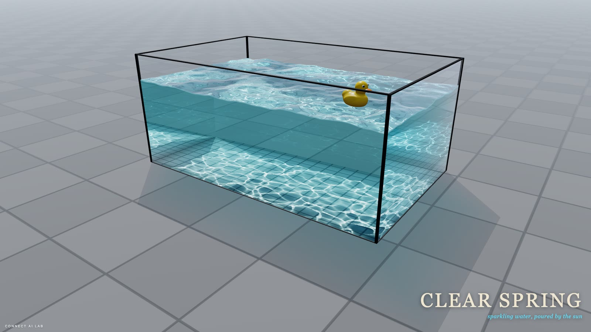
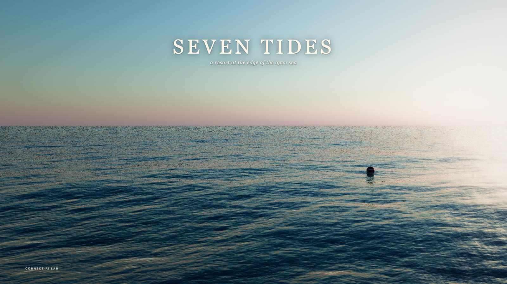
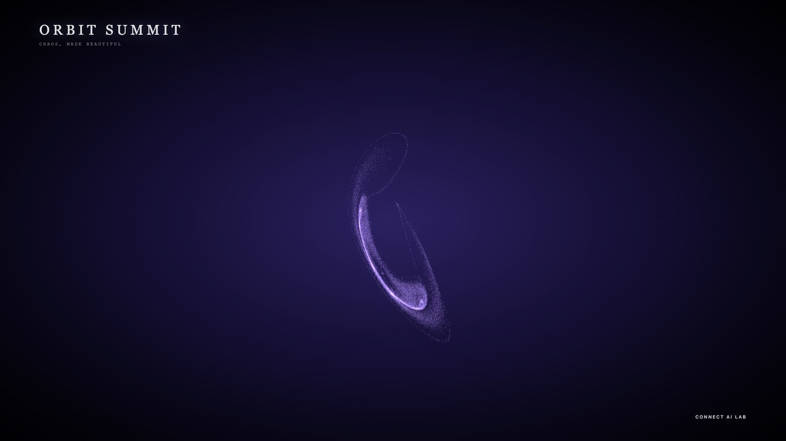
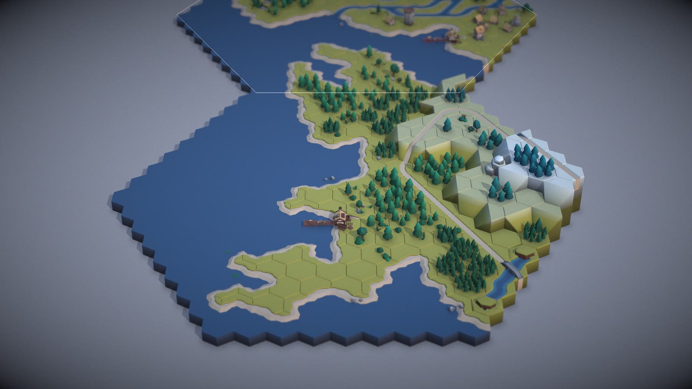
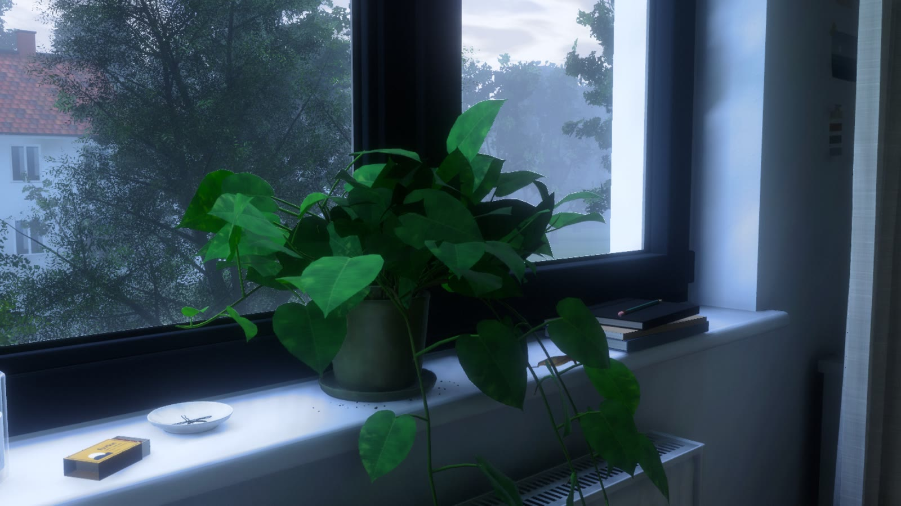
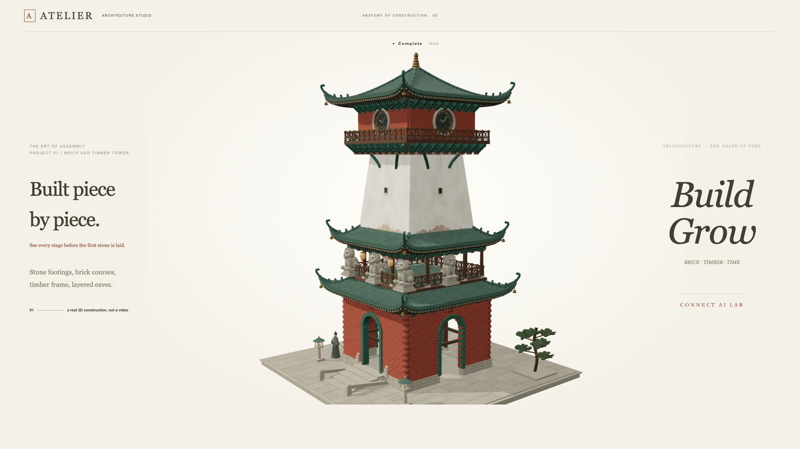
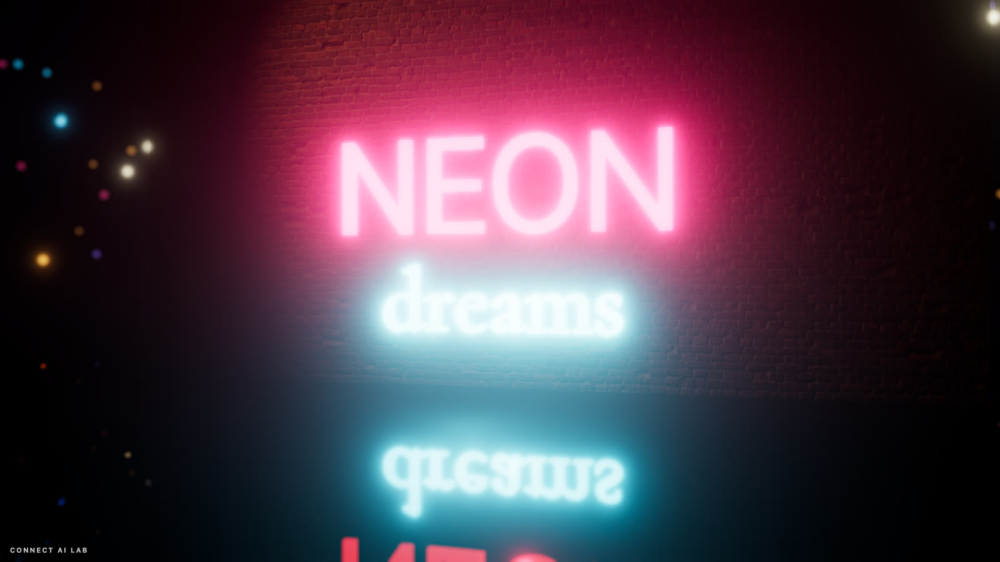
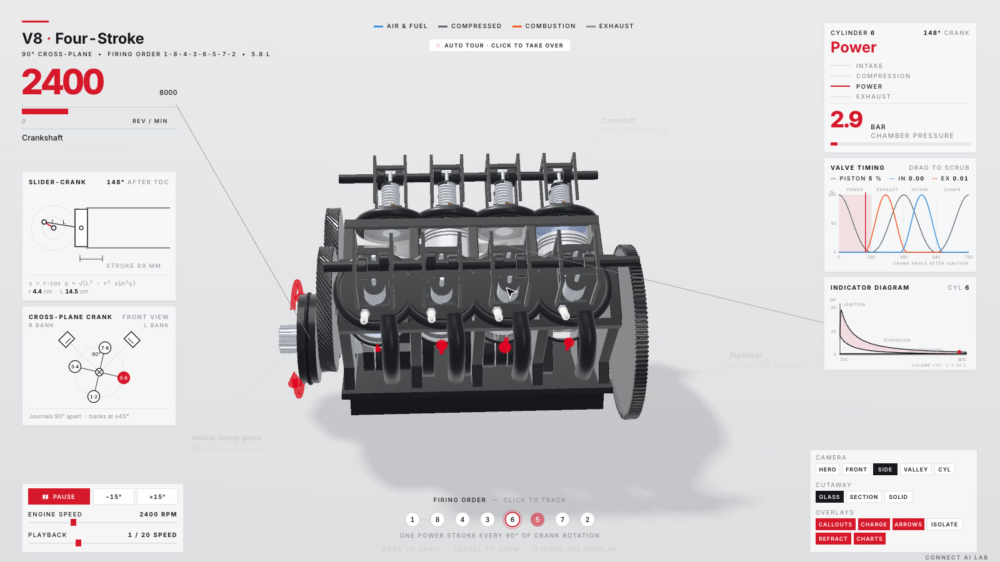

<p align="center">
  <b>CONNECT AI LAB</b> · AI education for everyone · 모두를 위한 AI 교육<br>
  <a href="https://www.youtube.com/@CONNECT-AI-LAB">YouTube: CONNECT AI LAB</a> · <a href="https://www.aicitybuilders.com/vibecoding">강의: 비주얼 바이브코딩</a> · <a href="README.md">English</a>
</p>

# connect-ai-three

**AI Web 3D 에이전트예요. 한 문장만 말하면 커뮤니티에서 반응이 제일 좋았던 three.js 작품까지 찾아보고, 그걸 출발점으로 영상을 만들어 줘요.**

엑스랑 스레드에서 사람들이 만든 three.js 작품 중에 라이선스를 확인해서 가져다 쓸 수 있는 74개랑, 만든 사람이 공개한 프롬프트 10개를 모아 뒀어요. 말할 때마다 우리 것보다 더 좋은 새 작품이 있는지도 다시 찾아봐요. 제일 좋은 걸 골라서 내 문장에 맞게 고치고, 프레임 하나 빠지지 않게 16:9랑 9:16 영상으로 뽑고, 스스로 검사한 다음, 만든 사람 출처까지 적어 줘요. 웹 페이지는 무대고, 결과물은 영상이에요.

아래 15개는 커뮤니티에서 온 예제예요. 12개는 엑스에서 뜬 작품을 라이선스 확인하고 옮겼고, 3개는 만든 사람이 엑스에 공개한 프롬프트를 보고 우리가 처음부터 새로 짰어요. 누르면 폴더랑 코드, 원작 링크, 그 영상을 만든 문장이 나와요.

<!-- community-examples:start -->
<table>
<tr><td width="33%" valign="top"><a href="examples/13-caustic-water"></a><br><b>13</b> <a href="examples/13-caustic-water">음료 페이지용 물빛 코스틱</a><br><sub>Scottie (ScottieFox) · <a href="https://x.com/ScottieFoxTTV/status/2103869371869212740">X ♥5,189 · 52.2만 · RT537</a></sub></td><td width="33%" valign="top"><a href="examples/14-deep-ocean"></a><br><b>14</b> <a href="examples/14-deep-ocean">노을 지는 넓은 바다</a><br><sub>Sacha (squall01337)</sub></td><td width="33%" valign="top"><a href="examples/15-attractor-particles"></a><br><b>15</b> <a href="examples/15-attractor-particles">모양이 바뀌는 파티클 65,536개</a><br><sub>Alexandru DAN (danlex)</sub></td></tr>
<tr><td width="33%" valign="top"><a href="examples/16-ai-face"></a><br><b>16</b> <a href="examples/16-ai-face">빛의 점으로 만든 말하는 AI 비서 얼굴</a><br><sub>ptakaya</sub></td><td width="33%" valign="top"><a href="examples/17-tower-defense"></a><br><b>17</b> <a href="examples/17-tower-defense">AI 사령관이 대신 싸우는 타워 디펜스</a><br><sub>kevintngo · <a href="https://x.com/kevin_t_ngo/status/2125119969109418333">X ♥2.4k</a></sub></td><td width="33%" valign="top"><a href="examples/18-hex-island"></a><br><b>18</b> <a href="examples/18-hex-island">스스로 지어지는 섬 지도</a><br><sub>felixturner · <a href="https://x.com/felixturner/status/2031010332391751908">X ♥2,241 · 12.1만 · RT199</a></sub></td></tr>
<tr><td width="33%" valign="top"><a href="examples/19-dragon-film"></a><br><b>19</b> <a href="examples/19-dragon-film">코드만으로 만든 90초 드래곤 영화</a><br><sub>0xCodez · <a href="https://x.com/0xMovez/status/2121721290687983906">X ♥138</a></sub></td><td width="33%" valign="top"><a href="examples/20-room-at-dawn"></a><br><b>20</b> <a href="examples/20-room-at-dawn">코드로만 만든 새벽의 방</a><br><sub>Leonxlnx · <a href="https://x.com/LexnLin/status/2120910879361548565">X ♥857</a></sub></td><td width="33%" valign="top"><a href="examples/21-landing-hero"></a><br><b>21</b> <a href="examples/21-landing-hero">살아 있는 3D 세계가 깔린 랜딩 페이지</a><br><sub>Meng To · <a href="https://x.com/MengTo/status/2125995984400654658">X ♥4,599 · 21.9만 · RT393</a></sub></td></tr>
<tr><td width="33%" valign="top"><a href="examples/22-cinema-seat"></a><br><b>22</b> <a href="examples/22-cinema-seat">3D 극장에서 좌석 고르기</a><br><sub>Codrops</sub></td><td width="33%" valign="top"><a href="examples/23-police-chase"></a><br><b>23</b> <a href="examples/23-police-chase">붉은 흙길 경찰 추격 게임</a><br><sub>noclipepe · <a href="https://x.com/noclipepe/status/2124805085393813586">X ♥848 (목록 값)</a></sub></td><td width="33%" valign="top"><a href="examples/24-self-building"></a><br><b>24</b> <a href="examples/24-self-building">스스로 지어지는 건물</a><br><sub>Hailey (lhlGitHub)</sub></td></tr>
<tr><td width="33%" valign="top"><a href="examples/25-solar-system"></a><br><b>25</b> <a href="examples/25-solar-system">빨리 감은 태양계</a><br><sub>프롬프트에서 새로 만듦 · cb_doge · <a href="https://x.com/cb_doge/status/2074920311896879359">X ♥1,976 · 12.8만 · RT285</a></sub></td><td width="33%" valign="top"><a href="examples/26-mechanical-butterfly"></a><br><b>26</b> <a href="examples/26-mechanical-butterfly">스스로 태엽을 감는 기계 나비</a><br><sub>프롬프트에서 새로 만듦 · thtbee_ · <a href="https://x.com/thtbee_/status/2101304547876700627">X ♥3,410 · 62.2만 · RT310</a></sub></td><td width="33%" valign="top"><a href="examples/27-black-hole-music"></a><br><b>27</b> <a href="examples/27-black-hole-music">자기 음악을 트는 블랙홀</a><br><sub>프롬프트에서 새로 만듦 · chetaslua · <a href="https://x.com/chetaslua/status/2080534915494645997">X ♥1,105 · 10.9만 · RT66</a></sub></td></tr>
</table>

| | 예제 | 이렇게 말하면 이 영상이 나와요 | 원작 · 라이선스 |
|---|---|---|---|
| 13 | [`caustic-water`](examples/13-caustic-water) | 우리 탄산수 페이지 첫 화면을 만들어 줘. 유리 수조 속 물에 햇빛이 비쳐서 바닥에 물빛 무늬가 일렁이고, 고무 오리가 둥둥 떠 있고, 클릭하면 물결이 퍼지고, 오른쪽에 우리 브랜드 이름이 있게 해 줘. | [ScottieFox/caustic-volume](https://github.com/ScottieFox/caustic-volume) · MIT |
| 14 | [`deep-ocean`](examples/14-deep-ocean) | 우리 바닷가 리조트 사이트 첫 화면을 만들어 줘. 노을 지는 끝없는 바다에 진짜 같은 파도랑 거품이 있고, 해가 수평선에 낮게 걸려 있고, 위에 리조트 이름이 있고, 방문자가 바다 위를 날다가 물속으로 들어갈 수도 있게 해 줘. | [squall01337/abyssal-ocean](https://github.com/squall01337/abyssal-ocean) · MIT |
| 15 | [`attractor-particles`](examples/15-attractor-particles) | 우리 행사 무대 배경을 만들어 줘. 빛나는 입자 수만 개가 신비한 끌개 모양을 따라 흐르다가 천천히 다른 모양으로 바뀌고, 마우스를 대면 밀려나고, 구석에 행사 이름이 있게 해 줘. | [danlex/particles](https://github.com/danlex/particles) · MIT |
| 16 | [`ai-face`](examples/16-ai-face) | 우리 가게 AI 비서에게 얼굴을 만들어 줘. 빛나는 입자로 된 사람 얼굴이 눈을 깜빡이고 두리번거리고, 말할 때 입술이 움직이고, 아래에 하는 말이 자막으로 나오고, 마우스로 끌어서 돌려 볼 수 있게 해 줘. | [ptakaya/claude-face](https://github.com/ptakaya/claude-face) · CC0-1.0 |
| 17 | [`tower-defense`](examples/17-tower-defense) | 페이지를 열자마자 AI 사령관이 혼자 플레이하는 3D 타워 디펜스 게임을 만들어 줘. 탑이랑 몰려오는 몬스터, 다섯 번째 판마다 보스가 나오고, 내가 클릭 한 번 하면 내가 지휘하게 해 줘. | [kevintngo/cinderwatch](https://github.com/kevintngo/cinderwatch) · MIT |
| 18 | [`hex-island`](examples/18-hex-island) | 우리 체인점들이 있는 작은 섬 지도를 육각 타일로 만들어 줘. 타일이 떨어지면서 저절로 맞물리고, 길이랑 강, 마을, 풍차가 있고, 내가 누르는 곳마다 새 섬 조각이 자라나게 해 줘. | [felixturner/hex-map-wfc](https://github.com/felixturner/hex-map-wfc) · MIT |
| 19 | [`dragon-film`](examples/19-dragon-film) | 에셋 파일 하나 없이 브라우저에서 바로 재생되는 90초 영화를 만들어 줘. 돌기둥 사이 절벽 사원에서 용 두 마리가 불과 번개로 싸우고, 음악도 코드로 만들고, 끝에는 해 질 녘에 비, 무지개, 하늘 등불이 나오게 해 줘. | [0xCodez/thousand-peaks](https://github.com/0xCodez/thousand-peaks) · MIT |
| 20 | [`room-at-dawn`](examples/20-room-at-dawn) | 우리 숙소 예약 페이지에 쓸 새벽 호텔 방을 사진처럼 만들어 줘. 창으로 낮은 아침 해가 들어오고, 침대랑 책상에 빛이 부드럽게 닿고, 화분이랑 자잘한 물건이 있게. 모델 파일 없이 전부 코드로 만들고, 손님이 방 안을 걸어 다닐 수 있게 해 줘. | [Leonxlnx/room-at-dawn](https://github.com/Leonxlnx/room-at-dawn) · MIT |
| 21 | [`landing-hero`](examples/21-landing-hero) | 내 제품 랜딩 페이지를 영화처럼 만들어 줘. 글 뒤에 3D 밤 정원이 있고, 스크롤하면 카메라가 안으로 걸어 들어가고, 등불이랑 떨어지는 잎, 하늘에는 내 브랜드 이름이 크게 떠 있게 해 줘. | [MengTo/threeui](https://github.com/MengTo/threeui) · MIT |
| 22 | [`cinema-seat`](examples/22-cinema-seat) | 우리 강의장 좌석 예약 페이지를 3D 공간으로 만들어 줘. 자리를 누르면 그 자리로 날아가서 거기서 무대가 어떻게 보이는지 보여 주고, 화면 빛이 객석을 비추고, 고른 자리는 티켓으로 쌓여서 합계가 나오게 해 줘. | [codrops/CinemaSeatPreview](https://github.com/codrops/CinemaSeatPreview) · MIT |
| 23 | [`police-chase`](examples/23-police-chase) | 브라우저에서 하는 자동차 추격 게임 만들어 줘. 구불구불한 붉은 흙길을 오픈카로 달리고, 경찰차들이 쫓아와서 앞뒤로 막고, 수배 별이 올라가고, 부딪히면 차가 부서지게 해 줘. 모델 파일 없이 전부 코드로. | [noclipepe/red-clay-chase](https://github.com/noclipepe/red-clay-chase) · MIT |
| 24 | [`self-building`](examples/24-self-building) | 우리 건축 사무소 홈페이지 첫 화면을 만들어 줘. 3D 건물이 기초부터 벽돌 한 줄씩, 마지막에 지붕까지 스스로 지어지고, 타임라인을 끌어서 앞뒤로 볼 수 있고, 버튼을 누르면 카메라가 디테일 쪽으로 날아가게 해 줘. | [lhlGitHub/threejs-architecture-effects](https://github.com/lhlGitHub/threejs-architecture-effects) · MIT |
| 25 | [`solar-system`](examples/25-solar-system) | 과학 채널 인트로로 아름다운 태양계를 만들어 줘. 빛나는 태양, 진짜 같은 표면의 행성들이 실제 궤도를 빠르게 돌고, 별이 가득하고, 시간 조절 막대가 있는 깔끔한 정보창, 마지막엔 토성 고리 옆을 천천히 지나가게 해 줘. | 영감: [cb_doge](https://x.com/cb_doge/status/2074920311896879359) · 우리 코드 |
| 26 | [`mechanical-butterfly`](examples/26-mechanical-butterfly) | 우리 시계 브랜드 영상으로 아름다운 기계 나비를 만들어 줘. 금빛 톱니와 섬세한 금속 날개 틀, 에나멜 판, 태엽 심장이 있고, 어둠 속에서 부품이 모여 조립된 다음 날개가 움직이기 시작하고, 카메라가 가까이서 천천히 돌게 해 줘. | 영감: [thtbee_](https://x.com/thtbee_/status/2101304547876700627) · 우리 코드 |
| 27 | [`black-hole-music`](examples/27-black-hole-music) | 한 페이지짜리 3D 오디오 비주얼라이저 만들어 줘. 빛나는 강착원반과 중력 렌즈 효과가 있는 블랙홀, 주변의 별들, 그리고 SINGULARITY 라는 EDM 곡 박자에 맞춰 뛰는 입자들. 음악은 코드로 만들고 재생 버튼으로 시작하게 하고, 드롭이 터질 때 원반이 확 타오르게 해 줘. | 영감: [chetaslua](https://x.com/chetaslua/status/2080534915494645997) · 우리 코드 |
<!-- community-examples:end -->

## 한 문장에서 영상까지

```bash
npx github:wonseokjung/connect-ai-three find "우리 리조트 영상, 노을 진 바다 위를 천천히 날아가게"
```

1. **찾기**: 우리 예제, 커뮤니티 작품 모음(74개 + 공개 프롬프트 10개), 최근 GitHub에 새로 올라온 것까지 한 표로 순위를 매겨요. 순위 기준은 영상으로 찍었을 때 얼마나 멋진지(빛, 움직임, 카메라)예요. 눌러 봐야 좋은 UI 키트나 에디터는 아래로 가요.
2. **고르기**: 제일 좋은 출발점을 하나 골라요. 우리 예제면 `example <이름> --copy <폴더>`, 남의 저장소면 `fetch <소유자/저장소> --to <폴더>`로 가져와요.
3. **만들기**: 내 이름, 내 제품, 내 색으로 바꿔요. 원작의 구조랑 주석은 그대로 둬요. 제목 글자는 16:9에서도 9:16에서도 안전 영역 안에 들어가게 해요.
4. **영상으로 뽑기**: `film <폴더>`는 16:9(1920x1080), `--9x16`은 세로(1080x1920), `--4k`는 3840x2160이에요. 카메라가 천천히 돌거나 다가가는 움직임도 넣을 수 있어요(`--orbit 30`).
5. **검사**: 프레임 수, 색 정보(BT.709), 크기, 까만 화면이나 멈춘 구간, 페이지 오류를 보고 PASS나 FIX로 알려 줘요. 정지 화면도 하나 저장해서 눈으로 확인해요.
6. **출처**: 만든 사람, 저장소나 글 링크, 라이선스를 `NOTICE.md`랑 `SOURCES.md`에 적고 라이선스 원문을 코드 옆에 둬요.

예제 하나를 바로 영상으로 뽑아 보려면 이렇게 해요.

```bash
npx github:wonseokjung/connect-ai-three example dragon-film --video dragon.mp4            # 16:9
npx github:wonseokjung/connect-ai-three example dragon-film --video dragon-9x16.mp4 --9x16  # 9:16
```

에이전트(Claude Code, Codex, Antigravity, Cursor)한테 가르치려면 `npx github:wonseokjung/connect-ai-three install`을 붙여 넣고 설치해 달라고 하세요. 그다음 새 채팅에서 위 표의 문장 하나를 말하면 돼요. 에이전트는 이 순서(찾기, 고르기, 만들기, 영상 뽑기, 검사, 출처)대로 일해요.

[Node.js](https://nodejs.org) 18 이상이랑 GPU 있는 컴퓨터면 돼요. 유료 API 키는 필요 없어요.

## 영상은 어떻게 뽑나요

페이지를 화면 녹화하지 않아요. 페이지가 다 뜨고 몇 초 동안 자리 잡은 다음에는 페이지의 시계(`performance.now`, `Date.now`, `requestAnimationFrame`, 타이머)를 멈추고, 한 프레임마다 정확히 1/30초씩만 넘겨요. 그래서 무거운 장면은 뽑는 데 시간이 더 걸릴 뿐이고, 프레임이 빠지거나 두 번 찍히지 않아요. 영상은 H.264, yuv420p, 제한 색 범위(limited range), BT.709로 나와요. 영상을 찍는 동안 페이지 안에서는 `window.__FILM__`이 true라서, 해상도를 자동으로 낮추는 기능이나 버튼, 소리는 꺼 둘 수 있어요. 소리는 넣는다면 코드로 만든 소리만 써요.

## 작품을 찾아오는 에이전트

`find`는 브라우저 없이도 돌아가요(GitHub 전용 모드). 화제가 된 글을 직접 보려면 에이전트가 브라우저를 써요.

- **GitHub 전용 모드**: 조사 때 실제로 잘 걸린 검색어(`topic:threejs`, `topic:webgpu`, `three.js ... in:name,description,readme`)로 찾고, 라이선스는 GitHub 표시가 아니라 라이선스 본문을 읽어서 확인해요. 라이선스가 없거나, GPL·AGPL이거나, 비상업 이용 조건이거나, README에 팬 프로젝트나 비상업용이라고 적혀 있으면 건너뛰어요. 모델이나 소리 같은 파일은 따로 표시해서 CC0이나 내 것만 쓰게 해요. GitHub 검색은 1분에 30번까지라 그 이상이면 몇 초 뒤에 다시 하라고 깔끔하게 알려 줘요.
- **브라우저 모드**: [ELDO 브라우저](https://eldobrowser.com)를 먼저 쓰고, 없으면 Ego Lite를 써요. 에이전트 전용 공간에서 내가 로그인한 계정으로 엑스랑 스레드를 검색하고, 좋아요랑 조회수를 읽고, 단축 링크를 따라가서 저장소나 데모를 찾아요. 읽기만 해요. 좋아요, 팔로우, 답글, DM, 게시는 절대 안 해요. 로그인은 내가 직접 하고, 끝나면 그 공간을 닫아요.
- **프롬프트 모드**: 크게 화제가 된 작품 중에는 코드가 비공개인 것도 많지만, 만든 사람이 글이나 답글에 프롬프트를 적어 두는 경우도 꽤 있어요. 그 프롬프트를 읽어서 우리 코드로 처음부터 새로 만들어요. 원작의 코드, 모델, 텍스처, 소리는 하나도 안 가져오고, "inspired by"로 출처를 적어요.
- **가져오기**: `fetch <소유자/저장소> --to <폴더>`는 라이선스 검사를 통과한 코드만 복사하고, 라이선스 원문 파일을 같이 넣은 다음 복사한 것과 뺀 것, 그 이유를 `SOURCES.md`에 적어 줘요. 가져온 저장소 안의 스크립트는 하나도 실행하지 않아요.

```bash
npx github:wonseokjung/connect-ai-three library                      # 작품 모음 전체
npx github:wonseokjung/connect-ai-three find "네온 간판" --offline    # 작품 모음이랑 우리 예제만
npx github:wonseokjung/connect-ai-three fetch felixturner/hex-map-wfc --to my-island
```

## 커뮤니티 작품 모음

<!-- library:start -->
작품 74개(코드) + 프롬프트 10개. 라이선스는 GitHub 표시가 아니라 라이선스 본문을 읽어서 확인했어요(2026-11-28). 바이럴 숫자는 조사한 날 화면에 보인 값이고, (list value)는 공개 바이럴 목록에 적힌 값이에요. 영상 칸은 영상으로 찍었을 때 얼마나 좋은지 우리가 매긴 값이에요(★★★ 빛 · 움직임 · 카메라가 좋은 것, ★ 눌러 봐야 좋은 것).

| 분야 | 개수 | 예제로 실은 것 |
|---|---|---|
| 제품 · 브랜드 | 10 | [13-caustic-water](examples/13-caustic-water), [21-landing-hero](examples/21-landing-hero), [22-cinema-seat](examples/22-cinema-seat) |
| 글자 · 로고 · 간판 | 2 | - |
| 파티클 · 셰이더 · 유체 | 8 | [15-attractor-particles](examples/15-attractor-particles) |
| 물리 · 게임 | 10 | [17-tower-defense](examples/17-tower-defense), [18-hex-island](examples/18-hex-island), [23-police-chase](examples/23-police-chase) |
| 스크롤 · 사이트 연출 | 6 | [24-self-building](examples/24-self-building) |
| 데이터 · 디지털 트윈 | 9 | - |
| 캐릭터 · 아바타 | 1 | [16-ai-face](examples/16-ai-face) |
| 스플랫 · 스캔 | 1 | - |
| 코드로 만든 세계 · 필름 | 21 | [20-room-at-dawn](examples/20-room-at-dawn), [19-dragon-film](examples/19-dragon-film), [14-deep-ocean](examples/14-deep-ocean) |
| 에이전트 스킬 | 6 | - |
| 프롬프트(코드 없음) | 10 | [25-solar-system](examples/25-solar-system), [26-mechanical-butterfly](examples/26-mechanical-butterfly), [27-black-hole-music](examples/27-black-hole-music) |

<details><summary><b>제품 · 브랜드</b> (10)</summary>

| # | 작품 | 무엇 | 이렇게 말해요 | 바이럴 | 저장소 · 라이선스 | 에셋 | 영상 |
|---|---|---|---|---|---|---|---|
| A1 | **[Caustic Volume](examples/13-caustic-water)** | 수조 속 물빛이 바닥에 일렁이는 실시간 물이에요. HTML 한 파일이에요. | 우리 탄산수 브랜드 영상 만들어 줘. 햇빛 드는 유리 수조, 바닥에 일렁이는 물빛, 카메라가 천천히 돌게. | [X ♥5,189 · 52.2만 · RT537](https://x.com/ScottieFoxTTV/status/2103869371869212740) | [ScottieFox/caustic-volume](https://github.com/ScottieFox/caustic-volume) · MIT | 코드만 | ★★★ |
| A2 | **[ThreeUI community](examples/21-landing-hero)** | 3D 랜딩 히어로 모음이에요. 카게, 끝없는 주행 같은 장면을 이미지까지 MIT 로 줘요. | 우리 브랜드 히어로 영상 만들어 줘. 겹겹이 쌓인 풍경 위 하늘에 우리 이름이 뜨게. | [X ♥4,599 · 21.9만 · RT393](https://x.com/MengTo/status/2125995984400654658) | [MengTo/threeui](https://github.com/MengTo/threeui) · MIT | MIT(저장소 안) | ★★ |
| A3 | Shaders (shaders.com) | WebGPU 셰이더 효과 200여 개를 컴포넌트로 묶었어요. | 인트로 배경을 우리 브랜드 색으로 움직이는 셰이더로 깔아 줘. | [X ♥6,393 · 79.9만 · RT660](https://x.com/npm_i_shaders/status/2107467668009963819) | [shader-effects-inc/shaders](https://github.com/shader-effects-inc/shaders) · MIT | 코드만 | ★★ |
| A4 | Orb | 실시간으로 빛이 굴절되는 액체 유리 구슬 에디터예요. | 우리 AI 비서 얼굴로 숨 쉬듯 빛나는 유리 구슬 만들어 줘. | - | [LerSent001/orb](https://github.com/LerSent001/orb) · MIT | 코드만 | ★★ |
| A5 | Sticker Forge | 글자나 사진으로 스티커를 만들고 손으로 떼어 내요. | 우리 로고가 스티커처럼 벗겨지는 장면 만들어 줘. | - | [CatsJuice/sticker-forge](https://github.com/CatsJuice/sticker-forge) · MIT | 일부 빼고 | ★ |
| A6 | Leafthrough | 페이지가 실물처럼 휘며 넘어가는 3D 잡지예요. | 우리 메뉴판이 진짜 잡지처럼 넘어가게 해 줘. | - | [dmtrbrl/leafthrough](https://github.com/dmtrbrl/leafthrough) · MIT | 확인 필요 | ★★ |
| A7 | Paperlab | 벗겨지고 접히고 걸리는 종이 컴포넌트예요. | 초대장이 진짜 종이처럼 펼쳐지게 해 줘. | - | [NourMtir0722/Paperlab](https://github.com/NourMtir0722/Paperlab) · Apache-2.0 | 확인 필요 | ★★ |
| A8 | **[Cinema Seat Preview](examples/22-cinema-seat)** | 3D 극장에서 좌석을 고르면 그 자리로 날아가 화면을 봐요. | 우리 공연장 F7 좌석에서 본 화면을 영상으로 보여 줘. 화면 빛이 객석을 비추게. | - | [codrops/CinemaSeatPreview](https://github.com/codrops/CinemaSeatPreview) · MIT | 일부 빼고 | ★★★ |
| A9 | Powershot | 아날로그 · 디지털 카메라 질감 후처리예요. | 내 3D 장면에 진짜 필름 카메라 질감을 입혀 줘. | [X ♥1,335 · 5.5만](https://x.com/cl0ne2k/status/2064512681688629386) | [cl0nazepamm/powershot-threejs](https://github.com/cl0nazepamm/powershot-threejs) · MIT | 코드만 | ★★ |
| A10 | Prism Liquid Glass | 유리 카드가 빛을 굴절시키는 캐러셀이에요. | 우리 상품을 리퀴드 글래스 캐러셀로 보여 줘. | - | [enabled404/prism-liquid-glass](https://github.com/enabled404/prism-liquid-glass) · MIT | 확인 필요 | ★ |

</details>

<details><summary><b>글자 · 로고 · 간판</b> (2)</summary>

| # | 작품 | 무엇 | 이렇게 말해요 | 바이럴 | 저장소 · 라이선스 | 에셋 | 영상 |
|---|---|---|---|---|---|---|---|
| B1 | pmndrs glyph | 3D 속 글자를 아주 선명하게 그리는 엔진이에요. 아직 출시 전이에요. | 우리 가게 간판 글자를 3D 로 아주 선명하게 만들어 줘. | - | [pmndrs/glyph](https://github.com/pmndrs/glyph) · MIT | 확인 필요 | ★ |
| B2 | Papercraft skill | 종이 공예 스타일로 장면을 만드는 에이전트 스킬이에요. 팝업북 템플릿이 있어요. | 우리 가게 이름이 종이 팝업 카드처럼 솟게 해 줘. | - | [xikhar/papercraft](https://github.com/xikhar/papercraft) · MIT | 코드만 | ★★ |

</details>

<details><summary><b>파티클 · 셰이더 · 유체</b> (8)</summary>

| # | 작품 | 무엇 | 이렇게 말해요 | 바이럴 | 저장소 · 라이선스 | 에셋 | 영상 |
|---|---|---|---|---|---|---|---|
| C1 | Particle Fluids (PBF) | 꿀 · 젤리처럼 움직이는 진짜 입자 유체예요. WebGPU 전용이에요. | 우리 디저트 위로 꿀이 천천히 흘러내리게 해 줘. | - | [dgreenheck/threejs-particle-fluids](https://github.com/dgreenheck/threejs-particle-fluids) · MIT | 일부 빼고 | ★★★ |
| C2 | **[GPU Particles](examples/15-attractor-particles)** | 이상한 끌개 · 프랙탈 · 물리 같은 GPU 파티클 모음이에요. | 행사 영상 첫 장면을 모양이 바뀌는 빛 입자로 열어 줘. | - | [danlex/particles](https://github.com/danlex/particles) · MIT | 코드만 | ★★★ |
| C3 | Three Fluid FX | 마우스를 따라 번지는 유체 효과 모음이에요. | 우리 제품 사진이 액체처럼 일렁이게 해 줘. | - | [artcodev/three-fluid-fx](https://github.com/artcodev/three-fluid-fx) · MIT | 확인 필요 | ★ |
| C4 | Three VFX | 게임급 이펙트를 만드는 WebGPU 파티클 시스템이에요. | 로고가 나타날 때 불꽃과 마법 효과를 넣어 줘. | - | [mustache-dev/Three-VFX](https://github.com/mustache-dev/Three-VFX) · MIT | 확인 필요 | ★★ |
| C5 | CRT Shader | 여러 단계로 재현한 브라운관 화면이에요. | 내 영상을 옛날 브라운관 TV 화면처럼 보여 줘. | - | [OutThisLife/crt-shader](https://github.com/OutThisLife/crt-shader) · MIT | CC0 | ★★ |
| C6 | Sketch Material | 3D 가 볼펜 스케치처럼 보이는 재질이에요. | 우리 제품을 볼펜 스케치처럼 그려서 돌려 줘. | - | [abhishekmill/R3FSketchMaterial](https://github.com/abhishekmill/R3FSketchMaterial) · MIT | 확인 필요 | ★★ |
| C7 | Phase Viz | 음악에 반응하는 3D 비주얼라이저예요. | 내 음악에 맞춰 움직이는 영상 만들어 줘. | - | [7g3n/phase-viz](https://github.com/7g3n/phase-viz) · MIT | 코드만 | ★★ |
| C8 | Aeronautic | 제트 애프터버너와 로켓 불꽃을 레이마칭으로 그려요. | 출시 카운트다운으로 로켓이 불을 뿜는 장면 만들어 줘. | - | [Romainlg29/aeronautic](https://github.com/Romainlg29/aeronautic) · MIT | 확인 필요 | ★★★ |

</details>

<details><summary><b>물리 · 게임</b> (10)</summary>

| # | 작품 | 무엇 | 이렇게 말해요 | 바이럴 | 저장소 · 라이선스 | 에셋 | 영상 |
|---|---|---|---|---|---|---|---|
| D1 | **[Cinderwatch](examples/17-tower-defense)** | HTML 한 파일 아이소메트릭 타워 디펜스예요. AI 사령관이 대신 지휘하고 에셋 파일이 없어요. | 우리 AI 가 혼자 타워 디펜스를 하는 장면을 영상으로 만들어 줘. | [X ♥2.4k (list value)](https://x.com/kevin_t_ngo/status/2125119969109418333) | [kevintngo/cinderwatch](https://github.com/kevintngo/cinderwatch) · MIT | 코드만 | ★★ |
| D2 | Brushwild | 펜 · 색연필처럼 그린 오픈월드 RPG 예요. 약 300kB. | 색연필로 그린 동화책 세상을 만들어 줘. | [X ♥2.7k](https://x.com/kevin_t_ngo/status/2125321244686029289) | [kevintngo/procedural-rpg](https://github.com/kevintngo/procedural-rpg) · MIT | 코드만 | ★★★ |
| D3 | **[Hex Map WFC](examples/18-hex-island)** | 육각 타일 4,100칸 섬을 WFC 로 자동 생성해요. 누를 때마다 새 섬이에요. | 타일이 하나씩 놓이며 스스로 지어지는 작은 섬을 영상으로 만들어 줘. 우리 가게들이 있게. | [X ♥2,241 · 12.1만 · RT199](https://x.com/felixturner/status/2031010332391751908) | [felixturner/hex-map-wfc](https://github.com/felixturner/hex-map-wfc) · MIT | 일부 빼고 | ★★★ |
| D4 | **[Red Clay Chase](examples/23-police-chase)** | 붉은 흙길 경찰 추격 게임이에요. 엔진도 에셋 파일도 없어요. | 노을 진 붉은 흙길 자동차 추격 장면을 영상으로 만들어 줘. | [X ♥848 (list value)](https://x.com/noclipepe/status/2124805085393813586) | [noclipepe/red-clay-chase](https://github.com/noclipepe/red-clay-chase) · MIT | 코드만 | ★★★ |
| D5 | Claude of Duty | 한 프롬프트로 만든 FPS 예요. 텍스처와 소리가 모두 코드예요. | 코드만으로 1인칭 게임 한 판 만들어 줘. | - | [mshumer/Claude-of-Duty](https://github.com/mshumer/Claude-of-Duty) · MIT | 코드만 | ★★ |
| D6 | Little City | 블록 몇 개 놓으면 손그림 도시가 돼요. | 우리 동네 가게들을 아기자기한 작은 도시로 지어 줘. | [X ♥1.0k (list value)](https://x.com/sprezzyyy/status/2125321545665192054) | [yaoderek/littlecity.io](https://github.com/yaoderek/littlecity.io) · MIT | 확인 필요 | ★★★ |
| D7 | OpenCityMaker | 3D 도시를 짓는 2048 퍼즐이에요. | 하면서 도시가 지어지는 퍼즐 만들어 줘. | - | [derek-wangpch/OpenCityMaker](https://github.com/derek-wangpch/OpenCityMaker) · MIT | 확인 필요 | ★ |
| D8 | Procedural Dungeon | 시드로 만드는 던전이에요. 매번 달라요. | 방탈출용으로 매번 다른 던전 지도를 만들어 줘. | - | [majidmanzarpour/threejs-procedural-dungeon](https://github.com/majidmanzarpour/threejs-procedural-dungeon) · MIT | 코드만 | ★★ |
| D9 | Sims House Builder | 층 · 가구 · 지붕으로 집을 짓는 심즈 풍 빌더예요. | 고객에게 새집을 층별로 보여 주는 영상 만들어 줘. | - | [ch-bas/threejs-sims-house-builder](https://github.com/ch-bas/threejs-sims-house-builder) · MIT | 확인 필요 | ★★ |
| D10 | Mint Playground | 브라우저 3D 게임 · 데모 모음이에요. 실험마다 소스와 라이선스가 따로 있어요. | 시작점으로 쓸 작은 3D 게임 찾아 줘. | - | [mintdotgg/mint-playground](https://github.com/mintdotgg/mint-playground) · MIT | 확인 필요 | ★ |

</details>

<details><summary><b>스크롤 · 사이트 연출</b> (6)</summary>

| # | 작품 | 무엇 | 이렇게 말해요 | 바이럴 | 저장소 · 라이선스 | 에셋 | 영상 |
|---|---|---|---|---|---|---|---|
| E1 | Cinematic World Zoom | 지구에서 한 장소로 시네마틱하게 줌인해요. | 우주에서 우리 가게까지 줌인하는 영상 만들어 줘. | - | [Makio64/threejs-cinematic-world-zoom](https://github.com/Makio64/threejs-cinematic-world-zoom) · MIT | 확인 필요 | ★★★ |
| E2 | Rotating On Scroll (Codrops) | 스크롤하면 이미지가 3D 로 돌아요. | 내 포트폴리오 이미지들이 3D 로 돌게 보여 줘. | - | [codrops/RotatingOnScrollAnimations](https://github.com/codrops/RotatingOnScrollAnimations) · MIT | 확인 필요 | ★★ |
| E3 | Depth Gallery (Codrops) | 사진마다 주변 공간 분위기가 바뀌는 갤러리예요. | 내 작품들을 사진마다 다른 분위기로 보여 줘. | - | [houmahani/codrops-depth-gallery](https://github.com/houmahani/codrops-depth-gallery) · MIT | 확인 필요 | ★★ |
| E4 | Jungle Cursor Canopy | 마우스를 따라 흔들리는 정글 잎 캐노피예요. | 빛 속에 잎이 흔들리는 초록 히어로 장면 만들어 줘. | - | [kaolti/jungle-cursor-canopy](https://github.com/kaolti/jungle-cursor-canopy) · MIT | CC0 | ★★ |
| E5 | Infinity Castle | 스스로 조립되는 끝없는 일본 성을 까마귀로 날아요. | 끝없는 성 사이를 날아가는 장면으로 브랜드 영상을 열어 줘. | - | [Thre4dripper/Infinity-Castle-ThreeJs](https://github.com/Thre4dripper/Infinity-Castle-ThreeJs) · MIT | 일부 빼고 | ★★★ |
| E6 | **[Self-assembling Architecture skill](examples/24-self-building)** | 건물이 스스로 쌓여 올라가는 3D 건축을 만드는 에이전트 스킬이에요. | 우리 건물이 한 층씩 스스로 지어지는 장면 만들어 줘. | - | [lhlGitHub/threejs-architecture-effects](https://github.com/lhlGitHub/threejs-architecture-effects) · MIT | 코드만 | ★★★ |

</details>

<details><summary><b>데이터 · 디지털 트윈</b> (9)</summary>

| # | 작품 | 무엇 | 이렇게 말해요 | 바이럴 | 저장소 · 라이선스 | 에셋 | 영상 |
|---|---|---|---|---|---|---|---|
| F1 | Pascal Editor | 브라우저 3D 건축 에디터예요. 에이전트가 로컬 MCP 로 직접 고쳐요. | 우리 집 평면을 그려서 안을 걸어 다니는 영상 만들어 줘. | [X ♥8,580 · 54.6만 · RT1,157](https://x.com/ErickSky/status/2035711577219833975) | [pascalorg/editor](https://github.com/pascalorg/editor) · MIT | 확인 필요 | ★ |
| F2 | Globe Studio | 점 지도와 3D 지구 21가지 룩이에요. PNG · GLB · MP4 로 내보내요. | 우리 고객이 있는 곳을 도는 지구 위에 보여 줘. | - | [alevizio/globestudio](https://github.com/alevizio/globestudio) · MIT | 확인 필요 | ★★ |
| F3 | WareTwin | 로봇 20대가 일하는 자율 창고 디지털 트윈이에요. | 우리 AI 회사 본사를 로봇들이 일하는 모습으로 보여 줘. | - | [WayneChou-bot/WareTwin](https://github.com/WayneChou-bot/WareTwin) · MIT | 코드만 | ★ |
| F4 | Solar Wanderer | NASA JPL 궤도력으로 만든 실시간 태양계예요. | 오늘 실제 궤도로 지구에서 목성까지 날아가 줘. | - | [hyqzz/Solar-Wanderer](https://github.com/hyqzz/Solar-Wanderer) · MIT | 확인 필요 | ★★★ |
| F5 | Mini Macau | 마카오 버스 · 페리 · 항공을 3D 로 보여 줘요. | 우리 도시 버스가 3D 지도 위를 달리게 보여 줘. | - | [asdfghj1237890/mini-macau](https://github.com/asdfghj1237890/mini-macau) · MIT | 확인 필요 | ★★ |
| F6 | Valdrada | 공공 데이터로 만든 뉴욕 디지털 트윈이에요. | 우리 동네를 디지털 트윈으로 보여 줘. | - | [mkturkcan/valdrada](https://github.com/mkturkcan/valdrada) · MIT | 확인 필요 | ★★ |
| F7 | Insect World | 곤충 63종을 절차로 만든 3D 도감이에요. | 곤충마다 돌려 보는 3D 도감 만들어 줘. | - | [xr843/insect-world](https://github.com/xr843/insect-world) · MIT | 일부 빼고 | ★★ |
| F8 | Parastore | 매장 배치를 그리면 LLM 손님들이 쇼핑해요. | 가상 손님들로 우리 매장 동선을 실험해 줘. | - | [intellicia-public/parastore](https://github.com/intellicia-public/parastore) · MIT | 확인 필요 | ★ |
| F9 | Starlink Viz | 실시간 스타링크 위성 추적이에요. | 지금 우리 도시 위 위성들을 보여 줘. | - | [juliensimon/starlink-viz](https://github.com/juliensimon/starlink-viz) · MIT | 코드만 | ★★ |

</details>

<details><summary><b>캐릭터 · 아바타</b> (1)</summary>

| # | 작품 | 무엇 | 이렇게 말해요 | 바이럴 | 저장소 · 라이선스 | 에셋 | 영상 |
|---|---|---|---|---|---|---|---|
| G1 | **[Claude Face (community)](examples/16-ai-face)** | 점 80만 개로 만든 말하는 얼굴이에요. 비공식 커뮤니티 작품이에요. | 우리 AI 비서에게 빛으로 된 말하는 얼굴을 만들어 줘. | - | [ptakaya/claude-face](https://github.com/ptakaya/claude-face) · CC0-1.0 | CC0 | ★★★ |

</details>

<details><summary><b>스플랫 · 스캔</b> (1)</summary>

| # | 작품 | 무엇 | 이렇게 말해요 | 바이럴 | 저장소 · 라이선스 | 에셋 | 영상 |
|---|---|---|---|---|---|---|---|
| I1 | Gaussian Splat Lite | three.js 용 가벼운 3D 가우시안 스플랫 렌더러예요. | 폰으로 찍은 우리 가게 스캔 사이를 날아가 줘. | - | [WilliamLiu-1997/Gaussian-Splat-Lite](https://github.com/WilliamLiu-1997/Gaussian-Splat-Lite) · Apache-2.0 | 확인 필요 | ★★★ |

</details>

<details><summary><b>코드로 만든 세계 · 필름</b> (21)</summary>

| # | 작품 | 무엇 | 이렇게 말해요 | 바이럴 | 저장소 · 라이선스 | 에셋 | 영상 |
|---|---|---|---|---|---|---|---|
| J1 | Papertrails | 종이 인형이 걸으면 나무 · 집 · 언덕이 팝업북처럼 솟아요. | 우리 브랜드 이야기를 팝업북 종이 세상으로 보여 줘. | [X ♥2.4k (list value)](https://x.com/xikhar/status/2122682962647122403) | [xikhar/papertrails](https://github.com/xikhar/papertrails) · MIT | 확인 필요 | ★★★ |
| J2 | **[Room at Dawn](examples/20-room-at-dawn)** | 모델 · 텍스처 없이 코드만으로 만든 포토리얼 새벽 침실이에요. | 우리 객실 새벽 장면을 영상으로 만들어 줘. 빛이 침대 위로 천천히 지나가게. | [X ♥857 (list value)](https://x.com/LexnLin/status/2120910879361548565) | [Leonxlnx/room-at-dawn](https://github.com/Leonxlnx/room-at-dawn) · MIT | 일부 빼고 | ★★★ |
| J3 | Casa Ocaso | 노을 지는 절벽 거실이에요. | 바다 위 절벽 거실의 노을 장면 만들어 줘. | - | [Leonxlnx/casa-ocaso](https://github.com/Leonxlnx/casa-ocaso) · MIT | 확인 필요 | ★★★ |
| J4 | Athenaion | 에셋 없이 만든 고대 그리스 세계예요. | 해 뜨는 고대 신전 위를 날아가 줘. | - | [Leonxlnx/athenaion](https://github.com/Leonxlnx/athenaion) · MIT | 코드만 | ★★★ |
| J5 | Walking Block | 다리 8개로 걷는 아파트예요. | 건물이 걸어가는 초현실 장면 만들어 줘. | [X ♥416](https://x.com/LexnLin/status/2122359035751989341) | [Leonxlnx/walking-block](https://github.com/Leonxlnx/walking-block) · MIT | 일부 빼고 | ★★★ |
| J6 | One Sweep | three.js 코드만으로 만든 78초 애니 결투 필름이에요. | 코드로 짧은 애니 스타일 필름 만들어 줘. | [X ♥251](https://x.com/anstapnever/status/2119772039037014524) | [anstapnever/one-sweep](https://github.com/anstapnever/one-sweep) · MIT | 코드만 | ★★★ |
| J7 | **[Dragon of a Thousand Peaks](examples/19-dragon-film)** | 에셋 0, 음악까지 코드인 90초 드래곤 결투 필름이에요. | 오프닝으로 안개 낀 봉우리 사이 드래곤 필름 만들어 줘. | [X ♥138](https://x.com/0xMovez/status/2121721290687983906) | [0xCodez/thousand-peaks](https://github.com/0xCodez/thousand-peaks) · MIT | 코드만 | ★★★ |
| J8 | LanternTown | 랜턴 켜진 밤 광장이에요. 에셋 130개가 모두 파라메트릭이에요. | 랜턴 불빛 야시장 장면 만들어 줘. | [X ♥191](https://x.com/makeshifted/status/2125331267512377844) | [zalo/LanternTown](https://github.com/zalo/LanternTown) · MIT | 코드만 | ★★★ |
| J9 | Procedural Terrains | 무한 세계 · 행성 · 구름 · 물을 만드는 지형 스튜디오예요. | 아웃도어 브랜드용으로 끝없는 산맥 위를 날아가 줘. | - | [ZyFou/ProceduralTerrains](https://github.com/ZyFou/ProceduralTerrains) · MIT | 확인 필요 | ★★★ |
| J10 | Nanites | 나무 100만 그루, 삼각형 1조 개 숲이에요. | 거대한 숲 위를 날아가 줘. | - | [VictorZakharov/threejs-nanites](https://github.com/VictorZakharov/threejs-nanites) · MIT | 일부 빼고 | ★★★ |
| J11 | Rainy Cyberpunk Alley | 비 오는 네온 골목이에요. | 비 오는 밤 골목에 우리 네온 간판이 빛나는 장면 만들어 줘. | - | [ektogamat/threejs-conference](https://github.com/ektogamat/threejs-conference) · MIT | 일부 빼고 | ★★★ |
| J12 | **[Abyssal Ocean](examples/14-deep-ocean)** | HTML 한 파일 스펙트럼 FFT 바다예요. | 우리 리조트 영상으로 노을 진 바다 장면 만들어 줘. | [X ♥3,717 · 89.6만](https://x.com/jurlycat/status/2111306207239557288) | [squall01337/abyssal-ocean](https://github.com/squall01337/abyssal-ocean) · MIT | 코드만 | ★★★ |
| J13 | Ultra Water | 해안 쇄파 · 거품 · 코스틱 · 수중 바다예요. | 우리 해변에 파도가 부서지는 장면 만들어 줘. | - | [Humpalumps/Ultra-Water](https://github.com/Humpalumps/Ultra-Water) · MIT | 코드만 | ★★★ |
| J14 | Poseidon | GPU FFT 바다예요. | 폭풍 치는 바다 만들어 줘. | [not recorded](https://x.com/owenyuwono/status/2064260229207142583) | [owenyuwono/poseidon](https://github.com/owenyuwono/poseidon) · MIT | 코드만 | ★★★ |
| J15 | Stylized Water | 툰 스타일 물이에요. | 우리 게임용 만화풍 물 만들어 줘. | - | [norio/three-stylized-water](https://github.com/norio/three-stylized-water) · MIT | 확인 필요 | ★★ |
| J16 | WebGPU Ocean | 잔잔한 바다와 거친 바다 프리셋이에요. | 제목 뒤에 잔잔한 바다를 깔아 줘. | - | [iodiot/webgpu-ocean](https://github.com/iodiot/webgpu-ocean) · MIT | 코드만 | ★★ |
| J17 | Field Grass | 몸이 지나가면 눕는 풀밭이에요. | 바람에 눕는 풀밭 장면 만들어 줘. | - | [matthew-kissinger/threejs-field-grass](https://github.com/matthew-kissinger/threejs-field-grass) · MIT | CC0 | ★★★ |
| J18 | Sakura Crossing | 작은 행성 위 일본 철길 건널목 마을이에요. | 셀 셰이딩 작은 마을 속 우리 가게를 보여 줘. | - | [Kenton-GMI/sakura-crossing](https://github.com/Kenton-GMI/sakura-crossing) · MIT | 일부 빼고 | ★★★ |
| J19 | Laas (Fable 5 world) | Fable 5 능력 시험용 큰 3D 세계예요. | 코드로 만든 큰 세계를 보여 줘. | - | [Braffolk/fable5-world-demo](https://github.com/Braffolk/fable5-world-demo) · MIT | 확인 필요 | ★★ |
| J20 | Fable 5.1 Worlds | 실제 도시를 코드로 다시 만들었어요(교토 히가시야마 등). | 우리 옛 동네를 코드로 다시 지어 줘. | - | [PhiloLabs/fable51-worlds](https://github.com/PhiloLabs/fable51-worlds) · MIT | 일부 빼고 | ★★★ |
| J21 | Stylized Scene | 꽃 · 풀 · 나무가 있는 툰 숲이에요. | 아이 브랜드용 포근한 만화 숲 만들어 줘. | - | [dedekpo/stylized-scene](https://github.com/dedekpo/stylized-scene) · MIT | 확인 필요 | ★★★ |

</details>

<details><summary><b>에이전트 스킬</b> (6)</summary>

| # | 작품 | 무엇 | 이렇게 말해요 | 바이럴 | 저장소 · 라이선스 | 에셋 | 영상 |
|---|---|---|---|---|---|---|---|
| K1 | img2threejs | 사진 한 장을 코드로 만든 three.js 모델로 바꾸는 스킬이에요. | 이 제품 사진을 영상으로 찍을 수 있는 3D 모델로 만들어 줘. | [X ♥5,437 · 44.3만](https://x.com/HeLi8866/status/2123655255720378860) | [img2threejs/img2threejs](https://github.com/img2threejs/img2threejs) · Apache-2.0 | 코드만 | ★ |
| K2 | Cutaway | 사진 한 장으로 스스로 분해되는 3D 물체를 만드는 스킬이에요. | 우리 기기가 스스로 분해되는 장면 만들어 줘. | - | [Nyxera0x/cutaway](https://github.com/Nyxera0x/cutaway) · MIT | 확인 필요 | ★★ |
| K3 | Machine Skill | 기계를 한 줄로 말하면 물리 시뮬레이션이 돼요. | 한 문장으로 돌아가는 기어박스 만들어 줘. | - | [AirsupHQ/machine-skill](https://github.com/AirsupHQ/machine-skill) · MIT | 코드만 | ★★ |
| K4 | threejs-game-skills | 브라우저 게임용 에이전트 스킬이에요. QA 포함. | 작은 3D 게임 만들고 테스트까지 해 줘. | - | [majidmanzarpour/threejs-game-skills](https://github.com/majidmanzarpour/threejs-game-skills) · MIT | 코드만 | ★ |
| K5 | Threejs Awesome Graphics Skills | 장면 · 게임 그래픽용 에이전트 스킬이에요. | 내 장면을 AAA 게임처럼 보이게 해 줘. | - | [scottstts/Threejs-Awesome-Graphics-Agent-Skills](https://github.com/scottstts/Threejs-Awesome-Graphics-Agent-Skills) · MIT | 확인 필요 | ★ |
| K6 | MengTo Skills (3d) | 스크롤 피시아이 돌리줌 같은 3D 랜딩 스킬과 데모예요. | 내 랜딩 페이지에 스크롤 돌리줌을 넣어 줘. | - | [MengTo/Skills](https://github.com/MengTo/Skills) · MIT | 확인 필요 | ★ |

</details>

<details><summary><b>프롬프트: 코드는 안 열렸지만 만든 사람이 프롬프트를 공개한 것</b> (10)</summary>

우리는 이 코드나 모델을 가져오지 않아요. 공개된 프롬프트만 읽고, 우리 코드로 처음부터 새로 만들고, "inspired by" 로 출처를 적어요.

| # | 작품 | 무엇 | 공개 프롬프트(줄임) | 바이럴 | 만든 사람 | 영상 |
|---|---|---|---|---|---|---|
| P1 | **[Solar system simulation](examples/25-solar-system)** | 태양, 행성, 궤도, 별이 빨라진 시간 속에서 돌고, 화면 정보창이 깔끔해요. Grok 4.5가 프롬프트 하나로 만들었어요. | Make a beautiful simulation of the universe and solar system. should be sped up with adjustable time, realistic motion, orbits, stars. use threejs. Make the HUD… | [X ♥1,976 · 12.8만 · RT285](https://x.com/cb_doge/status/2074920311896879359) | cb_doge | ★★★ |
| P2 | **[Mechanical butterfly](examples/26-mechanical-butterfly)** | 톱니와 금속 날개로 된 태엽 나비예요. 작성자 말로는 아레나에서 Gemini 4 Pro가 프롬프트 한 번으로 만들었어요. | create a beautiful mechanical butterfly in three.js | [X ♥3,410 · 62.2만 · RT310](https://x.com/thtbee_/status/2101304547876700627) | thtbee_ | ★★★ |
| P3 | Riverboat through a Japanese valley | 벚꽃 핀 계곡을 거슬러 올라가는 나룻배예요. 날씨, 낮과 밤, 절과 마을 사람들까지 있어요. Opus 5.5로 만들었고, 작성자가 답글에 프롬프트 전문을 공개했어요. | Create from scratch a fully interactive 3D scene of a traditional wooden riverboat being poled upstream through a mountain river valley in feudal Japan during c… | [X ♥6,555 · 49.0만 · RT499](https://x.com/MengTo/status/2102760783344189761) | MengTo | ★★★ |
| P4 | Living landing page prompts | 랜딩 페이지를 살아 있는 3D 세계로 바꾼 짧은 후속 프롬프트들이에요. 마우스 궤도, 포인터 파티클, 나비, 와이어프레임 스캔 인트로. | "Recreate this in Three.js in a single HTML file. Self-verify until perfect." Then: "orbit using mouse" · "add particles to pointer" · "Add a butterfly that fli… | [X ♥4,734 · 53.9만 · RT392](https://x.com/MengTo/status/2089252548473688076) | MengTo | ★★ |
| P5 | A dragon as one signed distance function | 메시가 아니라 GLSL 27 kB짜리 수식 하나로 된 용이에요. 참고 그림 한 장에서 시작해 27번 피드백으로 다듬었어요. | Make a 3D model based on this image, represented as a procedural signed distance function a la Inigo Quilez. Build a library of basic shapes and shape combinati… | [X ♥6,236 · 69.4만 · RT548](https://x.com/keenanisalive/status/2108708523236602056) | keenanisalive | ★★ |
| P6 | Investigation board master prompt | 증거 사진이 꽂히고 빨간 실이 진짜 줄처럼 늘어지는 3D 수사 보드예요. 작성자가 긴 마스터 프롬프트를 답글에 공개했어요. | You are a **Principal Creative Technologist, Senior Graphics Engineer, Three.js/WebGL Architect, and Interaction Designer** with deep expertise in **Three.js, W… | [X ♥1,613 · 10.6만 · RT123](https://x.com/thebuggeddev/status/2075910029686022517) | thebuggeddev | ★ |
| P7 | **[Black hole audio visualizer](examples/27-black-hole-music)** | 블랙홀 주위에서 춤추는 3D 오디오 비주얼라이저예요. 음악, 소리, 화면이 전부 코드로 만들어졌어요. Opus 5. | Please develop a single, self-contained HTML file featuring an extraordinary 3D audio visualizer. The visualizer should be driven by a full-length, highly catch… | [X ♥1,105 · 10.9만 · RT66](https://x.com/chetaslua/status/2080534915494645997) | chetaslua | ★★★ |
| P8 | AAA ocean, prompt by prompt | three.js 바다를 만든 프롬프트 목록 전체예요. FFT 파도, 물 위아래 전환, 물빛, 해안 거품과 젖은 모래까지. | - i want you to build me an ocean simulation with three.js. this should be the best AAA experience you can deliver. your goal is Unreal level graphics and capab… | [X ♥824 · 12.3만 · RT65](https://x.com/dangreenheck/status/2102911556296052788) | dangreenheck | ★★★ |
| P9 | One-shot FPS prompt | Claude of Duty(코드는 D5)를 만든 짧은 프롬프트예요. 서브 에이전트, 깐깐한 화면 검사 담당, 트리플 A처럼 보일 때까지 /loop. | I want you to build a first-person shooter at the level of the most recent Call of Duty games. It should be utterly perfect, visually beautiful, with every sing… | [X ♥1,906 · 72.9만 · RT157](https://x.com/mattshumer_/status/2081100592689324502) | mattshumer_ | ★★ |
| P10 | Robot octopus from one picture | 그림 한 장이랑 "make the model" 한마디로 만든 로봇 문어예요. 부품이 하나씩 열리고, 턴테이블 위에서 분해됐다가 다시 붙어요. Opus 5.5와 스킬. | make the model | [X ♥6,831 · 69.4만 · RT749](https://x.com/0x_fokki/status/2116289885870981296) | 0x_fokki | ★★★ |

</details>
<!-- library:end -->

빠진 작품도 있어요. 엄청 뜬 작품 중에 닫힌 사이트, 라이선스 없음, GPL · AGPL, 비상업 조건, 남의 게임이나 영화 IP 팬 작품은 코드로는 못 써요. 이런 것 중에 만든 사람이 프롬프트를 공개한 것만 프롬프트 칸에 넣었어요. 라이선스가 없는데 정말 좋은 작품은 만든 사람에게 라이선스를 물어보는 게 좋아요.

## 공식 예제 13개

강의 4강에서 쓴, 공식 three.js 예제를 바탕으로 만든 페이지들이에요. 이것도 전부 `--video`를 붙이면 영상으로 뽑을 수 있어요.

<table>
<tr><td colspan="3"><a href="examples/00-opening"></a><br><b>00</b> <a href="examples/00-opening">이게 다 코드예요</a>: 아래 예제 12개가 브라우저 탭 하나에서 실시간으로 하나씩 지나가요</td></tr>
<tr><td width="33%" valign="top"><a href="examples/01-miniature-world"></a><br><b>01</b> <a href="examples/01-miniature-world">미니어처 세상</a></td><td width="33%" valign="top"><a href="examples/02-glass-materials"></a><br><b>02</b> <a href="examples/02-glass-materials">유리, 무지개, 비눗방울</a></td><td width="33%" valign="top"><a href="examples/03-neon-text"></a><br><b>03</b> <a href="examples/03-neon-text">빛나는 네온 글자와 후처리</a></td></tr>
<tr><td width="33%" valign="top"><a href="examples/04-shader-worlds"></a><br><b>04</b> <a href="examples/04-shader-worlds">셰이더로 그린 세상: 은하, 바다, 행성, 불꽃</a></td><td width="33%" valign="top"><a href="examples/05-particles"></a><br><b>05</b> <a href="examples/05-particles">입자 26만 개</a></td><td width="33%" valign="top"><a href="examples/06-physics"></a><br><b>06</b> <a href="examples/06-physics">진짜 물리</a></td></tr>
<tr><td width="33%" valign="top"><a href="examples/07-teardown"></a><br><b>07</b> <a href="examples/07-teardown">기계 분해 시뮬레이터</a></td><td width="33%" valign="top"><a href="examples/08-scroll-site"></a><br><b>08</b> <a href="examples/08-scroll-site">스크롤 웹사이트</a></td><td width="33%" valign="top"><a href="examples/09-many-styles"></a><br><b>09</b> <a href="examples/09-many-styles">한 장면, 스타일만 바꾸기</a></td></tr>
<tr><td width="33%" valign="top"><a href="examples/10-flight-game"></a><br><b>10</b> <a href="examples/10-flight-game">비행 게임</a></td><td width="33%" valign="top"><a href="examples/11-gaussian-splat"></a><br><b>11</b> <a href="examples/11-gaussian-splat">가우시안 스플랫</a></td><td width="33%" valign="top"><a href="examples/12-xr"></a><br><b>12</b> <a href="examples/12-xr">XR 롤러코스터</a></td></tr>
</table>

```bash
npx github:wonseokjung/connect-ai-three examples           # 목록
npx github:wonseokjung/connect-ai-three example physics    # 하나 골라서 브라우저로 열기
npx github:wonseokjung/connect-ai-three example physics --copy my-page   # 고쳐 쓸 복사본 만들기
```

| | 예제 | AI한테 이렇게 말해요 |
|---|---|---|
| 00 | [`opening`](examples/00-opening) | 내 three.js 예제들을 하나씩 바로바로 바꿔 가며 실시간으로 보여 주는 오프닝 페이지 만들어 줘. 처음엔 크게 '이게 다 코드예요'라고 써 줘. |
| 01 | [`miniature-world`](examples/01-miniature-world) | 작은 섬 위에 미니어처 마을을 만들어 줘. 풍차랑 물레방아는 돌아가고 구름은 흘러가고, 섬 전체가 천천히 돌게 해 줘. |
| 02 | [`glass-materials`](examples/02-glass-materials) | 내 제품을 유리처럼 보여 줘. 빛이 무지개로 갈라지는 보석, 뒤가 휘어 보이는 유리구슬, 주변에 둥둥 떠다니는 비눗방울까지. 천천히 돌아가게. |
| 03 | [`neon-text`](examples/03-neon-text) | 우리 가게 이름을 3D 네온 글자로 만들어 줘. 글자가 하나씩 켜지면서 빛나고, 젖은 바닥에 비치고, 뒤쪽 도시 불빛은 초점이 흐려지게 해 줘. |
| 04 | [`shader-worlds`](examples/04-shader-worlds) | 소용돌이 은하, 거친 바다, 밤이 된 쪽에 도시 불빛이 켜지는 행성, 흔들리는 촛불을 셰이더로만 만들어 줘. 이미지 파일 없이, 네 칸으로 나눠서. |
| 05 | [`particles`](examples/05-particles) | 입자 수십만 개가 보이지 않는 자석을 따라 소용돌이치게 만들어 줘. GPU로 계산하고, 빨라질수록 보라색에서 복숭아색으로 빛나게. 자석은 내가 끌어서 옮길 수 있게. |
| 06 | [`physics`](examples/06-physics) | 내 로고 글자들이 위에서 떨어져서 바닥에 부딪혀 튕기게 해 줘. 그 위로 알록달록한 공이랑 블록 수백 개가 진짜 물리 법칙대로 쏟아지고, 더블클릭하면 다 튀어 오르게. |
| 07 | [`teardown`](examples/07-teardown) | 분해해 볼 수 있는 V8 엔진 시뮬레이터 만들어 줘. 단면으로 잘라서 실린더 하나가 네 박자로 움직이는 걸 보여 주고, 속도랑 카메라도 바꿀 수 있게 해 줘. 가만히 두면 자동 투어가 돌아가게 해 줘. |
| 08 | [`scroll-site`](examples/08-scroll-site) | 글 뒤에 3D 스피커가 떠 있는 제품 소개 페이지 만들어 줘. 스크롤하면 스피커가 돌면서 반대편으로 옮겨 가고, 앞면이 박자에 맞춰 빛나게 해 줘. |
| 09 | [`many-styles`](examples/09-many-styles) | 춤추는 로봇을 일곱 가지 스타일로 보여 줘. 스튜디오, 툰, 스테인드글라스, 라이다 스캔, 픽셀 아트, 만화 망점, 홀로그램. 처음엔 화면을 비스듬하게 나눠서 나란히 보여 주고, 그다음엔 하나씩 버튼으로 고를 수 있게 해 줘. |
| 10 | [`flight-game`](examples/10-flight-game) | 노을 지는 바다 위 링을 통과하는 비행 게임 만들어 줘. 링을 지나가면 점수가 오르고, 키를 안 누르면 자동 조종으로 날게 해 줘. |
| 11 | [`gaussian-splat`](examples/11-gaussian-splat) | 내가 폰으로 찍은 3D 스캔을 웹에서 둘러보게 해 줘. 가우시안 스플랫으로 보여 주고, 처음엔 마법처럼 나타나게 해 줘. 내 파일을 끌어다 놓으면 바로 보여 주고. |
| 12 | [`xr`](examples/12-xr) | 퀘스트에서 타 볼 수 있게 VR 롤러코스터로 만들어 줘. 노을 지는 공원에 나무랑 매점이 있고, 맨 앞 칸에 앉아서 타게 해 줘. |

다 오픈소스에서 시작했어요. mrdoob이랑 three.js 만든 사람들의 공식 예제, 그리고
[teardown](https://github.com/elvarofficial/teardown), [awwwards-3d](https://github.com/tsogjavklann/awwwards-3d),
[Spark](https://github.com/sparkjsdev/spark)예요. 전부 MIT고, 모델이랑 텍스처는 모두 CC0(Poly Haven, Kenney, KayKit,
Quaternius, Khronos)예요. 폴더마다 출처가 적혀 있고, 전체 목록은 [NOTICE.md](NOTICE.md)에 있어요.

복사본은 버전이 고정된 CDN에서 three.js 0.187을 불러와서, 정적 호스팅이면 어디서나 돌아가요. 오프닝 페이지는
다른 예제를 틀어 주는 거라 이 키트 안에서만 돌아가요. 04 셰이더랑 05 입자는 WebGPU(Chrome, Edge, Safari 26)를 써요. 12 XR은 메타
퀘스트에서 VR로 열려요.

에이전트가 설치하는 스킬에는 three.js r186 레퍼런스가 같이 들어 있어요
([CloudAI-X/threejs-skills](https://github.com/CloudAI-X/threejs-skills), MIT). 그래서 옛날 방식 말고 최신 three.js
(`HDRLoader`, `Timer`, WebGPU, TSL)로 코드를 짜 줘요.

## 시작할 페이지가 없을 때: scene.json 하나로 웹 페이지와 영상

페이지 말고 영상이 필요하면, 작은 `scene.json` 하나만 쓰면 돼요. 웹 페이지랑, 프레임 하나까지 같은 그림의 영상이
같이 나오고, 넘기기 전에 스스로 검사해요. 이쪽의 예전 예제는 [examples/scene-json](examples/scene-json)에 있어요.

### 문장마다 다른 세상

예전엔 웬만한 문장은 다 검정에 금색이었어요. 이제는 문장을 읽고 거기 맞는 색이랑 분위기를 골라요. 카페면 파스텔, 장난감이면 쨍한 장난감 세상, 노을이면 사막 노을, 클럽이면 네온, 동화면 종이 공예. 아무 말 안 하면 단어로 하나를 골라서, 두 문장이 같은 방에 들어가는 일이 거의 없어요.


```bash
npx github:wonseokjung/connect-ai-three new "'MY SHOP' logo in a pastel cafe, slow orbit"
npx github:wonseokjung/connect-ai-three new "노을 지는 사막 위 'SUNSET'"
npx github:wonseokjung/connect-ai-three make my-shop          # 검사, 웹 페이지, 영상, 스틸 시트, 보고서
```

**[카탈로그 페이지 열기](docs/index.html)**: 맨 위에 직접 끌어 돌리는 살아 있는 장면, 136개 항목이 전부 살아 있는 클립으로, 완성 데모와 항목마다 복사해 쓰는 한 줄 지시문이 있어요.

**장면 규격 하나. 결과 둘. 스스로 검사.** 나(또는 코딩 에이전트)는 작은 `scene.json` 하나만 써요. 카메라, 조명, 물체, 움직임, 마무리. 도구가 이걸 브라우저에서 돌아가는 인터랙티브 웹 페이지와, 프레임 하나까지 같은 그림인 영상으로 만들어요. 넘겨주기 전에 직접 검사해요: 빈 화면, 화면 밖 물체, 가려진 얼굴, 드로콜, 텍스처 크기, 폰 화면, WebGL 누수.

3D 라이브러리를 하나 더 만든 게 아니에요. 종합격투기가 여러 무술의 좋은 기술을 한데 묶었듯, three.js 생태계(three 본체, `examples/jsm` 의 로더 · 도형 · 후처리, Rapier 물리, three-mesh-bvh, React Three Fiber, Remotion 렌더러)를 규격 하나 뒤에 놓았어요. 그래서 무엇이든 한 줄이에요.

```json
{"id": "title", "type": "wordmark", "text": "MY NAME", "split": true, "motion": [{"type": "stagger", "at": 0.5}]}
{"id": "camera", "type": "cinema-camera", "tripod": true}
{"id": "model", "type": "gltf", "src": "assets/robot.glb", "motion": ["turntable"]}
{"id": "word", "type": "text3d", "text": "DROP", "bodyEach": true}
```

> **라이선스.** 이 키트는 MIT 예요. 만들어지는 웹 페이지에는 MIT / Apache-2.0 코드만 들어가요(three.js, 물리를 쓰면 Rapier). 영상 쪽은 [Remotion](https://www.remotion.dev) 위에서 도는데 Remotion 은 MIT 가 아니에요: 개인과 3명 이하 회사는 무료, 그보다 크면 회사 라이선스가 필요해요([LICENSE.md](https://github.com/remotion-dev/remotion/blob/main/LICENSE.md)). 쓰인 부품은 전부 [NOTICE.md](NOTICE.md) 에 있어요.

### 시작

Node 18 이상. GPU 가 있는 macOS, Windows, Linux.

```bash
npx github:wonseokjung/connect-ai-three            # 데모 장면을 만들어 브라우저에서 열어요: 끌어서 둘러보세요
npx github:wonseokjung/connect-ai-three install    # 코딩 에이전트(Claude Code, Codex, Cursor, Antigravity)에 규격과 카탈로그를 알려 줘요
```

그다음 에이전트에게 말로 부탁해요.

> connect-ai-three 로 만들어 줘: 우리 장난감 가게 이름 "TOY BOX" 를 3D 글자로, 쨍한 장난감 세상에. 끌어서 돌려 볼 수 있는 웹 히어로와 6초 영상 둘 다.

에이전트가 없어도 말로 돼요(한국어도 알아들어요).

```bash
npx github:wonseokjung/connect-ai-three new "밤 도시 위에 금색 로고 'JANE DOE', 천천히 도는 카메라, 6초"
npx github:wonseokjung/connect-ai-three make jane-doe                    # 검사, 웹 페이지, 영상, 스틸 시트, 보고서
npx github:wonseokjung/connect-ai-three make jane-doe --short --alpha    # 세로 9:16 과 투명 배경 overlay.mov 도 함께
```

`out/` 에 생기는 것:

| 파일 | 무엇 |
|---|---|
| `web/index.html` | 인터랙티브 페이지. 파일 하나라 더블클릭으로 열리고, 어디든 올리면 돼요 |
| `video.mp4` | 같은 장면의 영상(H.264) |
| `overlay.mov` | `--alpha`: 배경이 투명한 ProRes 4444. Premiere / CapCut / DaVinci 에 그대로 올려요 |
| `short_9x16.mp4` | `--short`: 세로 버전(그림이 다 들어오게 카메라가 물러나요) |
| `sheet.jpg` | 장면 전체에서 뽑은 스틸 8장 |
| `report.md` | 검사 결과: 꼭 고칠 것, 볼 만한 것, 잰 숫자 |

### 규격

```json
{
  "name": "jane-doe",
  "duration": 6,
  "look": "connect-night-city",
  "camera": {"position": [0, 1.2, 7], "target": [0, 1, 0], "fov": 32,
    "motion": [{"type": "orbit", "from": -20, "to": 14, "dur": 6}, {"type": "dolly", "from": 1.3, "to": 1, "dur": 6}]},
  "objects": [
    {"id": "floor", "type": "floor", "kind": "mirror"},
    {"id": "title", "type": "text3d", "text": "JANE DOE", "size": 0.56, "split": true, "position": [0, 1, 0],
      "material": "gold", "motion": [{"type": "stagger", "at": 0.5, "each": 0.08}]}
  ],
  "addPost": [{"type": "dof"}],
  "interact": ["parallax", "orbit"]
}
```

`look` 한 단어가 배경 · 조명 · 반사 · 마무리를 정해요. 모든 움직임은 시간(`at`, `dur`)만으로 정해져요. 그래서 앞뒤로 돌려 보고, 반복하고, 프레임을 아무 순서로 렌더해도 같은 그림이에요.

알아 두면 좋은 작은 칸 둘: `"short": {...}` 에는 세로 9:16 버전(`--short`)에서만 달라질 것을 적어요. `camera` 같은 맨 위 칸이나, 물체 하나하나(`"objects": {"tag": {"size": 0.12}}`). 그리고 물체에 `"reflect": false` 를 주면 거울 바닥에 비치지 않아요.

### 카탈로그: 136개, 전부 실제로 도는 장면

```bash
npx github:wonseokjung/connect-ai-three catalog            # 목록
npx github:wonseokjung/connect-ai-three catalog motion     # 한 묶음만, 항목마다 말로 부탁하는 문장과 함께
npx github:wonseokjung/connect-ai-three use dof my-scene   # 항목 하나에서 시작
```

| 묶음 | 항목 | 딛고 선 것 |
|---|---|---|
| 물체 (44) | **스튜디오 소품 세트**(워드마크, 모노그램, 내 간판이 달린 스튜디오 건물, 카메라, 마이크, 워크스테이션, 디스플레이, 노트북, 소프트박스, 슬레이트, 교재: 전부 코드로 만든 것, 모델 파일 없음), 글꼴 6종의 3D 글자(통째 · 글자별), 라벨, 유리 카드, 내 이미지, 내 `.glb`, 내 `.svg` 로고 입체화, 바닥(거울 · 그림자만 · 격자), 부드러운 접지 그림자, 둥근 상자와 기본 도형, 보석, 자이로 링, 리본, 굵은 선, 인스턴스 격자 · 구 · 나선, 점 지구본, 3D 막대, 밤 도시, 뒤 조명, 지형, 물결 면, 하늘, 액체 금속, 주전자, 뫼비우스 | three 본체, examples/jsm, 우리 셰이더 |
| 재질 (20) | 금, 헤어라인 금, 크롬, 강철, 피아노 블랙, 아이보리, 클레이, 플라스틱, 자동차 도장, 유리, 서리 유리, 스모크 유리, 벨벳, 무지갯빛, 발광, 와이어, 평면색, 툰, 림, 그라디언트 | three 물리 재질, 우리 셰이더 |
| 움직임 (21) | turntable, spin, float, sway, pop, fade, rise, drop, slide, move, scale, rotate, pulse, orbit, path, explode, stagger, draw, count, typewriter, billboard | 자체 |
| 카메라 (9) | orbit, dolly, crane, truck, zoom, shots(위치 사이를 날아다님), path, handheld, dolly-zoom | 자체 |
| 조명 (12) | 키, 금색 림, 필, 포인트, 스폿, 소프트박스, 해 + 하늘, 조명 돌리기, 숨쉬기, 반사 환경 3종 | three 본체, RoomEnvironment, RGBELoader, RectAreaLight |
| 후처리 (11) | 블룸, 피사계 심도, AO, 외곽선, 픽셀 아트, 망점, SMAA, 비네트, 그레인, 색수차, 그레이드 | three EffectComposer 패스, 우리 마무리 셰이더 |
| 룩 (8) | connect-gold-night, connect-night-city, studio-black, midnight-glass, pale-studio, blueprint, daylight, on-video | 자체 |
| 인터랙션 (6) | 끌어서 돌리기, 포인터 따라 기울기, 올리면 뜨기, 줌, 클릭, 스크롤 | 자체(무거운 모델은 three-mesh-bvh) |
| 물리 (3) | 글자 떨어뜨리기, 도미노, 쌓기와 공 | Rapier. 미리 계산해 둬서 돌려 보기 · 반복이 돼요 |
| 다른 길 (2) | React Three Fiber 어댑터, 내 영상 위 3D | @react-three/fiber, @remotion/three, Remotion |

### 스스로 하는 검사

`make` 와 `check` 는 화면 없는 브라우저에서 장면을 실제로 만들어 재요. "FIX" 줄이 있으면 렌더를 멈추고, "look" 줄은 참고예요.

| 보는 것 | 까닭 |
|---|---|
| 빈 화면 · 거의 검은 화면 | three.js 에서 가장 흔한 실패예요: 카메라가 엉뚱한 곳을 보거나 조명이 없을 때 |
| 한 번도 화면에 안 들어오는 물체, NaN 위치 | 좌표 오타. NaN 하나가 블룸을 타고 화면 전체를 검게 만들어요 |
| 얼굴 보호 상자(`keepOut`), `front` 표시 상자 | 내 영상 위에서는 어떤 것도 얼굴을 가리면 안 돼요. 사람 매트가 있으면 3D 는 전부 내 뒤로 가고, 내 앞의 마이크 암은 앞에 남아요 |
| 같은 그림이 두 번 나오는가 | 2.0초의 프레임은 어떻게 왔든 같아야 해요. 이게 웹과 영상을 일치시켜요 |
| WebGL 누수 | 장면을 여러 번 만들었다 지워 봐요. 컨텍스트 · 도형 · 텍스처가 남으면 안 돼요 |
| 드로콜, 삼각형 수, 가장 큰 텍스처, 텍스처 메모리 | 폰에서는 4096px 이 안전한 한계예요 |
| 프레임 시간(원래 크기, 폰 크기) | 이 컴퓨터에서 후처리까지 다 넣고 잰 값 |
| 폰 화면(390 x 844) | 세로에서 잘리는 것이 있는지 |
| 글자 높이(픽셀) | 폰에서 못 읽을 만큼 작은 라벨 |

### 색: 장면마다 그 장면의 세상

정해진 집 색은 없어요. 문장에 맞는 팔레트랑 분위기를 장면마다 따로 골라요. 파스텔 카페(복숭아에서 라일락으로 가는 하늘, 분홍 클레이 바닥, 민트랑 노랑 장난감), 쨍한 장난감 세상, 노을 사막, 네온 클럽, 종이 공예. 검정에 금색은 "고급", "골드" 라고 했을 때만 나와요. 대부분은 `pale-studio` 나 `daylight` 룩에 `background` 그라데이션이랑 색 있는 `floor` 하나면 돼요.

```json
"look": "pale-studio",
"background": {"type": "gradient", "top": "#2EC4F1", "bottom": "#1B6FE0"},
"objects": [{"id": "floor", "type": "floor", "kind": "matte", "material": {"preset": "clay", "color": "#FFD23F"}, "size": 300}],
"addPost": [{"type": "grade", "whites": 0.95}]
```

색이 밝으면 하얀 부분이 날아가기 쉬워요. `grade` 의 `whites` 를 0.95 쯤 주면 하이라이트가 부드럽게 눌려요. 너무 번들거리거나 어두운 모델은 `gltf` 에 `"surface": {"roughness": 1, "brightness": 1.3}` 을 주면 파일을 안 고치고 잡혀요.

### 3D 글자: 글꼴 6종, 그리고 내 글꼴 파일

`text3d`, `wordmark`, `building` 의 간판은 `"font"` 를 받아요: `thin`, `light`, `sans`, `bold`(깔끔한 산세리프 네 굵기), `serif`, `serif-bold`(제목용 세리프). 필요한 글자만 남긴 작은 데이터라 하나에 수십 KB 이고, 웹 페이지에는 장면이 쓴 글꼴만 들어가요. 글자 사이 간격(커닝)도 적용돼요.

납작한 글자(`label`, `card`, 페이지 제목)는 준비 없이 한글이 돼요. 산세리프 글꼴에는 "모두를 위한 AI 교육" 같은 몇 줄의 한글 글자가 들어 있고, 그 밖의 한글 · 일본어 · 한자 등은 내 글꼴 파일을 하나 주면 똑같이 입체가 돼요.

```json
{"type": "text3d", "text": "안녕하세요, 반갑습니다", "fontFile": "assets/MyFont.otf", "material": "gold", "split": true}
```

글꼴에 없는 글자가 있으면 검사가 알려 줘요. `examples/scene-json/korean-title` 을 보세요. 글꼴 데이터는 공개 글꼴에서 만든 것이고 SIL Open Font License 를 그대로 따라요([licenses/fonts-OFL.txt](licenses/fonts-OFL.txt)).

### 내 영상 위 3D

2강의 도구([connect-ai-video-motion](https://github.com/wonseokjung/connect-ai-video-motion))가 내 주변에 2D 그래픽을 올렸다면, 이 도구는 같은 영상에 3D 물체를 올려요.

```bash
npx github:wonseokjung/connect-ai-three on-video talk.mp4 --faces talk-video-motion/work/face.json --matte talk-video-motion/work/matte
```

영상 위에 투명한 3D 층을 올릴 뿐, 내 픽셀은 건드리지 않아요. `face.json` 과 `matte` 폴더는 connect-ai-video-motion 이 그 영상을 분석하며 만든 거예요(매트는 프레임마다 한 장인 흑백 그림, 흰색이 사람. macOS 에서는 Apple Vision 이 만들어서 내려받을 게 없어요).

- **매트가 있으면 모든 3D 가 내 뒤에 그려져요.** 워드마크가 어깨 뒤에서 올라오고, 카메라가 머리 뒤로 날아가고, 어떤 것도 얼굴이나 손 앞에 올 수 없어요. 매트 가장자리의 애매한 픽셀은 사람으로 쳐서 언제나 원본 영상이 이겨요.
- **매트가 없으면** 3D 가 위에 올라가고 얼굴 상자가 지켜요: `--faces` 나 `--face 0.33,0.13,0.25,0.48`. 물체가 상자에 걸치면 검사가 실패하고, 언제 얼마나 걸쳤는지 알려 줘요.
- 내 앞에 있지만 내가 아닌 것(마이크 암, 스탠드)은 매트에 없어요. 그 자리를 `keepOut` 에 `{"x": 0, "y": 0.5, "w": 0.46, "h": 0.5, "front": true}` 로 적어 두면 검사가 3D 를 거기서 떼어 놓아요.
- `make --alpha` 는 사람 자리가 이미 비워진 3D 를 `overlay.mov` 로 써요. Premiere, CapCut, DaVinci 에서 영상 위에 그대로 올리면 돼요.

`examples/scene-json/on-my-video` 에 완성된 네 컷이 있어요("3D 모델링", "카메라를 막 움직이니까", "중력", "AI 네이티브 컴퍼니"). 전부 그 테이크에서 실제로 한 말에 맞춘 타이밍이에요. 영상 파일은 키트에 안 들어 있어요. 내 영상으로 돌려 보세요.

### 이미 React Three Fiber 를 쓰고 있다면

```tsx
import {ConnectScene} from 'connect-ai-three/src/adapters/r3f';

<Canvas>
  <ConnectScene spec={spec} time={t} />
</Canvas>
```

### 아직 안 되는 것

scene.json 쪽에서는 가우시안 스플랫, WebGPU / TSL(예제에는 둘 다 있어요) · 소리 · 키프레임 편집기. 배경이 투명할 때는 피사계 심도와 블룸이 자동으로 빠져요(투명도를 지키지 못해서). 프레임 시간은 검사를 돌린 컴퓨터에서 잰 값이라, 폰 숫자는 참고용이에요.

## 만든 곳

three.js와 [NOTICE.md](NOTICE.md)에 적은 프로젝트들 위에 만들었어요(버전, 라이선스 포함). 예제는 three.js 공식 예제, elvarofficial/teardown, tsogjavklann/awwwards-3d, Spark(전부 MIT)에서 가져와 고쳤어요. 모델, 텍스처, HDRI는 전부 CC0이나 공개 저작물이고, 글꼴은 SIL Open Font License예요([licenses/assets.md](licenses/assets.md)). 출처 표기가 필요한 에셋은 안 썼어요.

<!-- team:start -->
## CONNECT AI LAB의 AI 직원들 (14명) · ELDO 브라우저

AI 직원을 오픈소스로 하나씩 만들고 있어요. 필요한 직원부터 데려가 쓰거나, [ELDO 브라우저](https://eldobrowser.com)와 [`wonseokjung/eldo`](https://github.com/wonseokjung/eldo)로 14명 전체를 한 번에 설치할 수 있어요 (`npx github:wonseokjung/eldo`).

<table>
<tr><td width="34%" valign="top"><b>ELDO 브라우저 · 통합 허브</b><br><a href="https://eldobrowser.com"><code>eldobrowser.com</code></a> · <a href="https://github.com/wonseokjung/eldo"><code>eldo</code></a></td><td valign="top">AI 직원이 일하는 무료 브라우저(macOS 공증 · Windows). 로그인은 한 번, 실행은 AI 직원이 맡고 결제와 인증은 대표님께 넘겨요.</td></tr>
<tr><td width="34%" valign="top"><b>AI 자율 회사 본사</b><br><a href="https://github.com/wonseokjung/connect-ai-autonomous-company"><code>connect-ai-autonomous-company</code></a></td><td valign="top">삶과 AI 직원, 오토메이션, ELDO 브라우저를 하나로 연결하는 로컬 AI 자율 회사 OS예요.</td></tr>
<tr><td width="34%" valign="top"><b>AI 개발 직원</b><br><a href="https://github.com/wonseokjung/connect-ai-developer"><code>connect-ai-developer</code></a></td><td valign="top">한 문장 주면 가입, DB, 테스트 결제까지 붙은 서비스를 만들고 GitHub와 배포까지 연결해요.</td></tr>
<tr><td width="34%" valign="top"><b>AI 세무회계 직원</b><br><a href="https://github.com/wonseokjung/connect-ai-accountant"><code>connect-ai-accountant</code></a></td><td valign="top">홈택스, 카드, 통장, 메일 영수증을 모아 월 비용표와 세무사님께 드릴 폴더를 만들어요.</td></tr>
<tr><td width="34%" valign="top"><b>AI 마케터 직원</b><br><a href="https://github.com/wonseokjung/connect-ai-marketer"><code>connect-ai-marketer</code></a></td><td valign="top">내 브라우저에서 24시간 댓글, 리스닝, 유튜브 업로드 마무리를 맡는 8인 마케팅팀이에요.</td></tr>
<tr><td width="34%" valign="top"><b>AI 글쓰기 직원</b><br><a href="https://github.com/wonseokjung/connect-ai-writer"><code>connect-ai-writer</code></a></td><td valign="top">영상이나 주제 하나로 리서치하고 플랫폼마다 내 말투로 글과 그림 초안을 써 줘요.</td></tr>
<tr><td width="34%" valign="top"><b>AI 사업 분석 직원</b><br><a href="https://github.com/wonseokjung/reversebusiness"><code>reversebusiness</code></a></td><td valign="top">사업 웹사이트 주소 하나 주면 수익 구조를 6칸으로 해부하고 내 버전을 기획해요.</td></tr>
<tr><td width="34%" valign="top"><b>AI 이미지 직원</b><br><a href="https://github.com/wonseokjung/connect-ai-image"><code>connect-ai-image</code></a></td><td valign="top">로컬 ComfyUI + FLUX 무료 우선, 브라우저 Gemini/ChatGPT로 플랫폼별 이미지 시리즈를 그려요.</td></tr>
<tr><td width="34%" valign="top"><b>AI 발표 자료 직원</b><br><a href="https://github.com/wonseokjung/connect-ai-slides-web"><code>connect-ai-slides-web</code></a></td><td valign="top">몇 줄 메모나 기존 PPT를 3D 모션 웹 슬라이드와 실제 파워포인트(.pptx) 파일로 만들어요.</td></tr>
<tr><td width="34%" valign="top"><b>AI Web 3D 에이전트</b> · <b>지금 보는 에이전트</b><br><a href="https://github.com/wonseokjung/connect-ai-three"><code>connect-ai-three</code></a></td><td valign="top">한 문장 주면 커뮤니티 최고 three.js 작품까지 찾아서 16:9와 9:16 영상으로 만들고 출처까지 적어요.</td></tr>
<tr><td width="34%" valign="top"><b>AI 모션그래픽 직원</b><br><a href="https://github.com/wonseokjung/connect-ai-motion"><code>connect-ai-motion</code></a></td><td valign="top">글 몇 줄 주면 촬영 없이 83종 씬으로 16:9와 9:16 모션그래픽 영상을 만들어 줘요.</td></tr>
<tr><td width="34%" valign="top"><b>AI 영상 편집 직원</b><br><a href="https://github.com/wonseokjung/connect-ai-video-motion"><code>connect-ai-video-motion</code></a></td><td valign="top">내 영상을 주면 얼굴과 손을 피해서 빈자리에 80종 모션그래픽을 알아서 넣어 줘요.</td></tr>
<tr><td width="34%" valign="top"><b>AI XR 직원</b><br><a href="https://github.com/wonseokjung/connect-ai-xr"><code>connect-ai-xr</code></a></td><td valign="top">한 문장 주면 메타 퀘스트에서 패스스루 AR과 VR로 열리는 WebXR 앱을 만들어 줘요.</td></tr>
<tr><td width="34%" valign="top"><b>AI 상품 사진 직원</b><br><a href="https://github.com/wonseokjung/connect-ai-product-photo"><code>connect-ai-product-photo</code></a></td><td valign="top">폰 상품 사진 폴더를 넣으면 원본 라벨은 선명하게 살린 플랫폼별 상품컷이 나와요.</td></tr>
<tr><td width="34%" valign="top"><b>AI 번역 직원</b><br><a href="https://github.com/wonseokjung/connect-ai-localizer"><code>connect-ai-localizer</code></a></td><td valign="top">한국어 글과 영상 자막을 내 말투 그대로 영어, 일본어, 스페인어 네이티브 글로 다시 써요.</td></tr>
</table>
<!-- team:end -->

---

이런 도구를 내 AI 에이전트로 직접 만드는 법은 [비주얼 바이브코딩](https://www.aicitybuilders.com/vibecoding)에서 가르쳐요.

<table><tr>
<td width="140" valign="top"></td>
<td valign="top"><b>만든 사람: AI 멘토 제이</b> · CONNECT AI LAB<br>
AI 직원을 하나씩 오픈소스로 계속 내놓고, 어떻게 만드는지 유튜브랑 강의에서 보여 드릴게요.<br>
<a href="https://www.youtube.com/@CONNECT-AI-LAB">유튜브</a> · <a href="https://www.aicitybuilders.com/vibecoding">비주얼 바이브코딩</a> · <a href="https://github.com/wonseokjung">오픈소스 더 보기</a></td>
</tr></table>

MIT · CONNECT AI LAB
