<p align="center">
  <b>CONNECT AI LAB</b> · AI education for everyone · 모두를 위한 AI 교육<br>
  <a href="https://www.youtube.com/@CONNECT-AI-LAB">YouTube: CONNECT AI LAB</a> · <a href="https://www.aicitybuilders.com/vibecoding">Course: Visual Vibe Coding</a> · <a href="README.ko.md">한국어</a>
</p>

# connect-ai-three

**The AI Web 3D Agent. Say one sentence: it looks for the best three.js work the community has made, starts from it and turns it into a video.**

It keeps a library of 74 viral three.js works from X and Threads that we may legally build on, plus 10 prompts their authors shared, and on every prompt it looks again for something newer and better. It picks the best base, adapts it to your sentence, films it frame by frame in 16:9 and 9:16, checks the result and credits the people who made the original. The web page is the stage; the video is what you get.

The 15 below come from the community: 12 works from X, licence-checked and adapted, and 3 written from scratch from prompts their authors shared on X. Click one to see its folder, the code, the original and the sentence that made the video.

<!-- community-examples:start -->
<table>
<tr><td width="33%" valign="top"><a href="examples/13-caustic-water">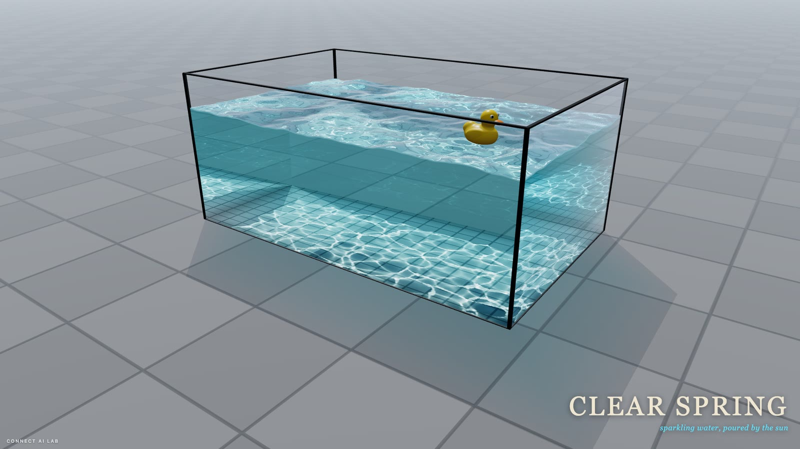</a><br><b>13</b> <a href="examples/13-caustic-water">Caustic water for a drink page</a><br><sub>Scottie (ScottieFox) · <a href="https://x.com/ScottieFoxTTV/status/2103869371869212740">X ♥5,189 · 52.2만 · RT537</a></sub></td><td width="33%" valign="top"><a href="examples/14-deep-ocean">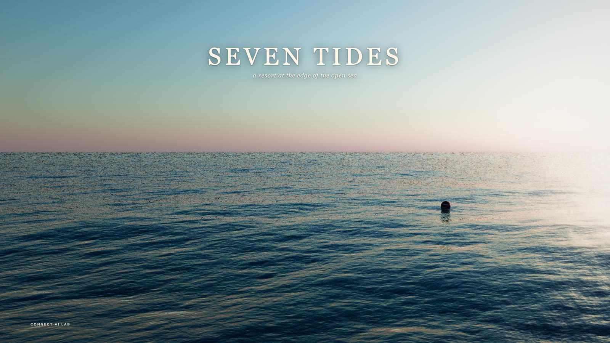</a><br><b>14</b> <a href="examples/14-deep-ocean">Open ocean at golden hour</a><br><sub>Sacha (squall01337)</sub></td><td width="33%" valign="top"><a href="examples/15-attractor-particles">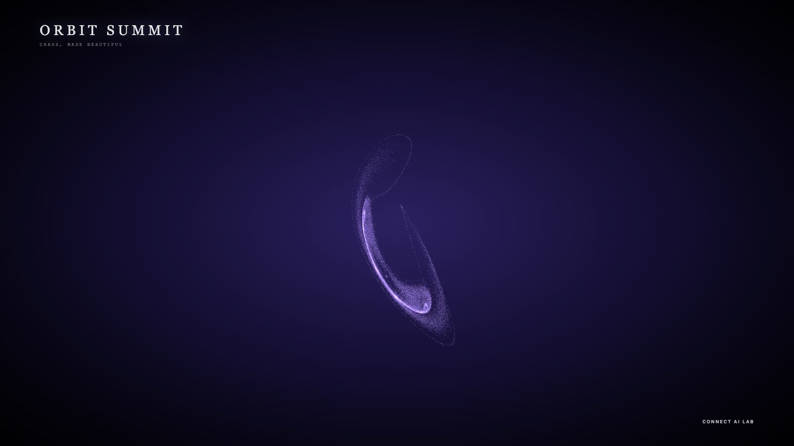</a><br><b>15</b> <a href="examples/15-attractor-particles">65,536 particles morphing between attractors</a><br><sub>Alexandru DAN (danlex)</sub></td></tr>
<tr><td width="33%" valign="top"><a href="examples/16-ai-face">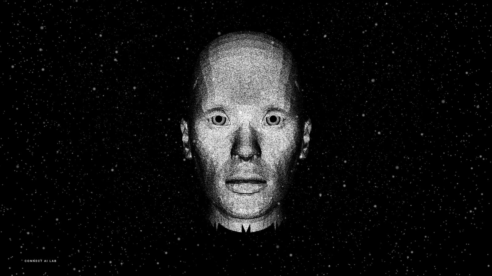</a><br><b>16</b> <a href="examples/16-ai-face">A talking AI assistant face made of light</a><br><sub>ptakaya</sub></td><td width="33%" valign="top"><a href="examples/17-tower-defense">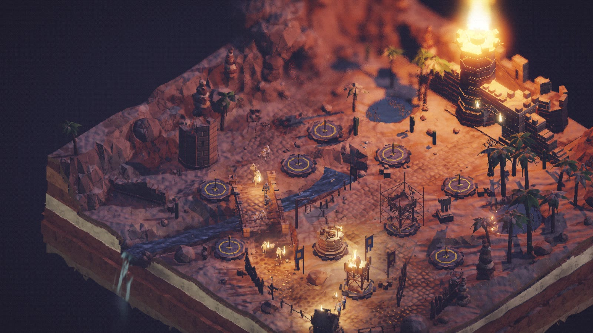</a><br><b>17</b> <a href="examples/17-tower-defense">Tower defense with an AI commander</a><br><sub>kevintngo · <a href="https://x.com/kevin_t_ngo/status/2125119969109418333">X ♥2.4k</a></sub></td><td width="33%" valign="top"><a href="examples/18-hex-island">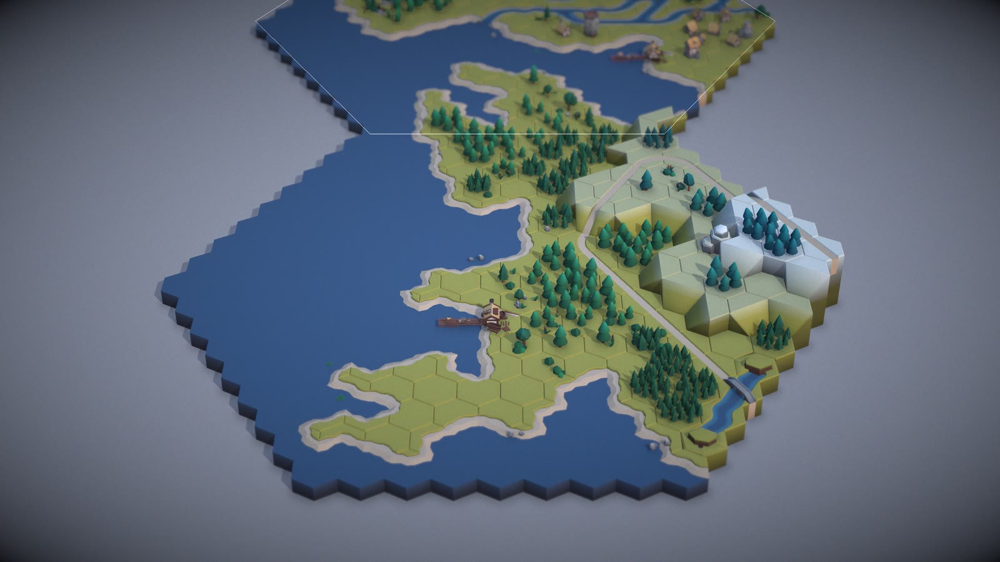</a><br><b>18</b> <a href="examples/18-hex-island">An island map that builds itself</a><br><sub>felixturner · <a href="https://x.com/felixturner/status/2031010332391751908">X ♥2,241 · 12.1만 · RT199</a></sub></td></tr>
<tr><td width="33%" valign="top"><a href="examples/19-dragon-film">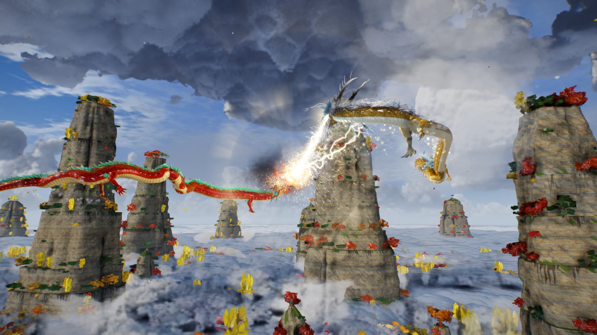</a><br><b>19</b> <a href="examples/19-dragon-film">A 90 second dragon film, all code</a><br><sub>0xCodez · <a href="https://x.com/0xMovez/status/2121721290687983906">X ♥138</a></sub></td><td width="33%" valign="top"><a href="examples/20-room-at-dawn">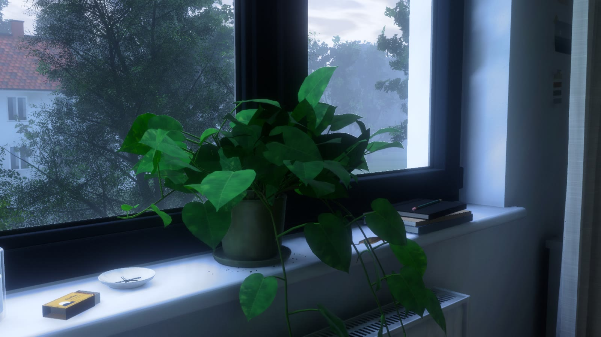</a><br><b>20</b> <a href="examples/20-room-at-dawn">A room at dawn, made of code</a><br><sub>Leonxlnx · <a href="https://x.com/LexnLin/status/2120910879361548565">X ♥857</a></sub></td><td width="33%" valign="top"><a href="examples/21-landing-hero">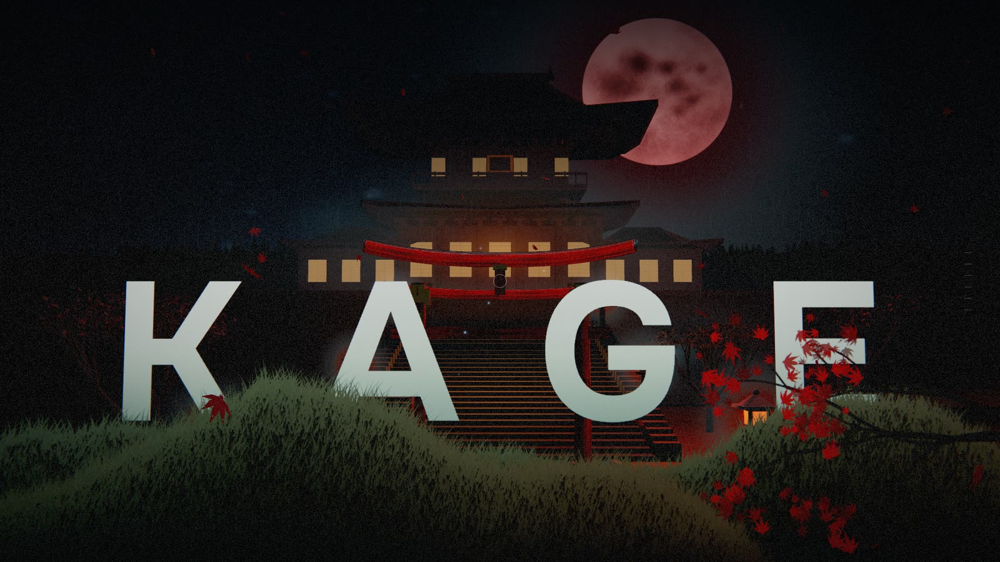</a><br><b>21</b> <a href="examples/21-landing-hero">Cinematic landing page with a live 3D world</a><br><sub>Meng To · <a href="https://x.com/MengTo/status/2125995984400654658">X ♥4,599 · 21.9만 · RT393</a></sub></td></tr>
<tr><td width="33%" valign="top"><a href="examples/22-cinema-seat">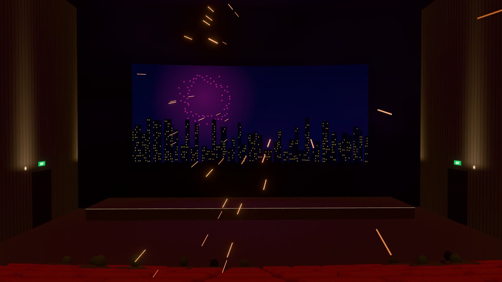</a><br><b>22</b> <a href="examples/22-cinema-seat">Pick a seat in a 3D cinema</a><br><sub>Codrops</sub></td><td width="33%" valign="top"><a href="examples/23-police-chase">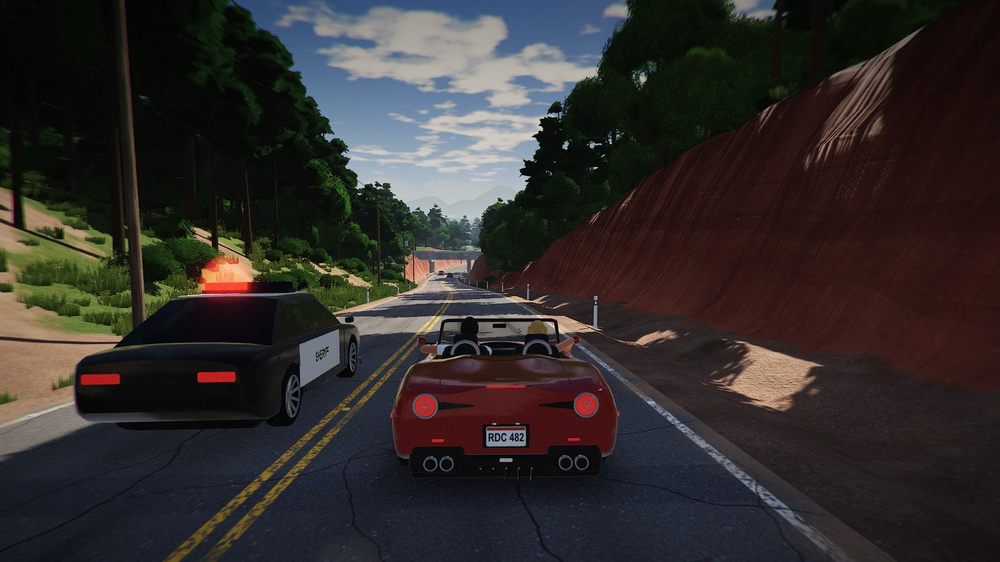</a><br><b>23</b> <a href="examples/23-police-chase">A police chase on a red clay road</a><br><sub>noclipepe · <a href="https://x.com/noclipepe/status/2124805085393813586">X ♥848 (목록 값)</a></sub></td><td width="33%" valign="top"><a href="examples/24-self-building">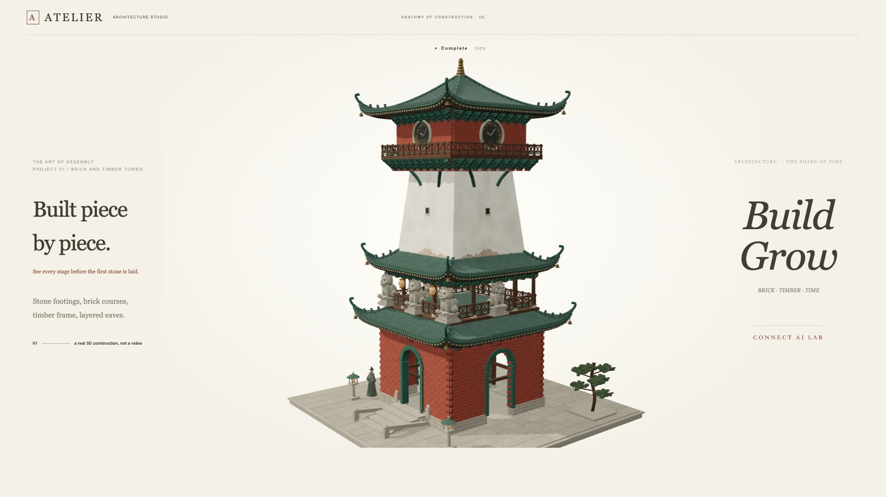</a><br><b>24</b> <a href="examples/24-self-building">A building that builds itself</a><br><sub>Hailey (lhlGitHub)</sub></td></tr>
<tr><td width="33%" valign="top"><a href="examples/25-solar-system">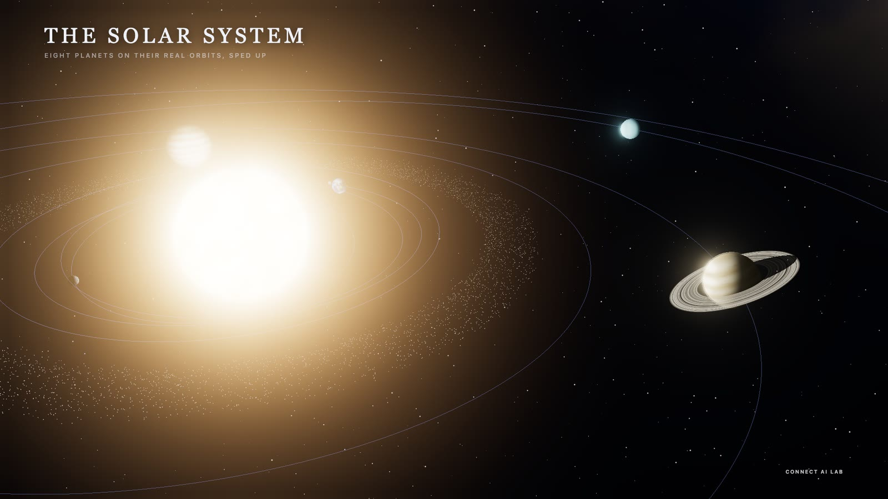</a><br><b>25</b> <a href="examples/25-solar-system">The solar system, sped up</a><br><sub>built from a shared prompt · cb_doge · <a href="https://x.com/cb_doge/status/2074920311896879359">X ♥1,976 · 12.8만 · RT285</a></sub></td><td width="33%" valign="top"><a href="examples/26-mechanical-butterfly">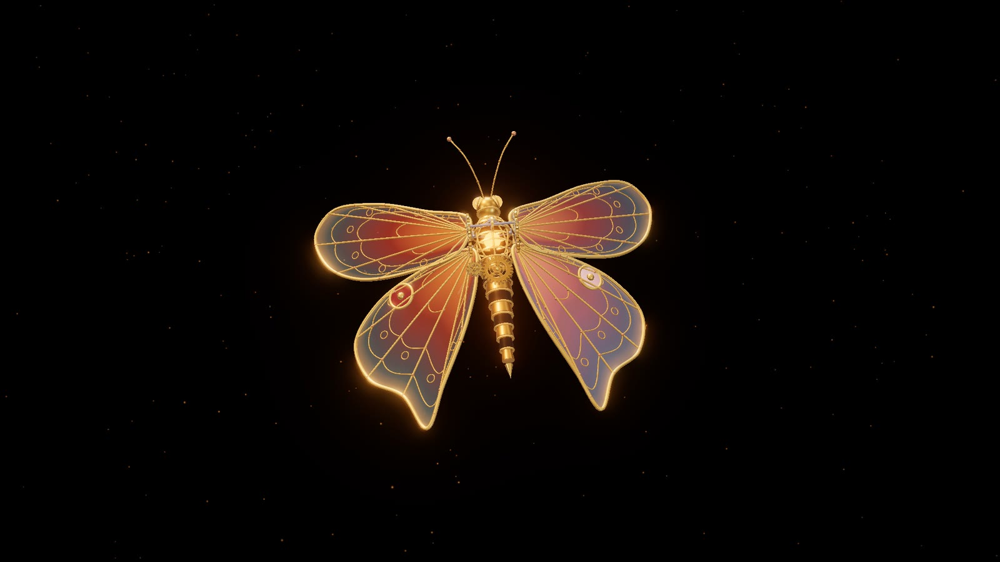</a><br><b>26</b> <a href="examples/26-mechanical-butterfly">A mechanical butterfly that winds itself up</a><br><sub>built from a shared prompt · thtbee_ · <a href="https://x.com/thtbee_/status/2101304547876700627">X ♥3,410 · 62.2만 · RT310</a></sub></td><td width="33%" valign="top"><a href="examples/27-black-hole-music"></a><br><b>27</b> <a href="examples/27-black-hole-music">A black hole that plays its own track</a><br><sub>built from a shared prompt · chetaslua · <a href="https://x.com/chetaslua/status/2080534915494645997">X ♥1,105 · 10.9만 · RT66</a></sub></td></tr>
</table>

| | example | say this, get this video | original · licence |
|---|---|---|---|
| 13 | [`caustic-water`](examples/13-caustic-water) | Make the hero of my sparkling water page: a glass tank of water where sunlight draws moving caustics on the floor, a rubber duck bobbing on the surface, ripples where I click, and my brand name on the right. | [ScottieFox/caustic-volume](https://github.com/ScottieFox/caustic-volume) · MIT |
| 14 | [`deep-ocean`](examples/14-deep-ocean) | Make the first screen of my seaside resort site: an endless open ocean at golden hour with real waves and foam, the sun low over the water, my resort name on top, and let visitors fly over the sea and dive under it. | [squall01337/abyssal-ocean](https://github.com/squall01337/abyssal-ocean) · MIT |
| 15 | [`attractor-particles`](examples/15-attractor-particles) | Make the stage background for my event: tens of thousands of glowing particles that flow along strange attractor shapes and slowly morph from one shape to the next, push away from my mouse, with the event name in the corner. | [danlex/particles](https://github.com/danlex/particles) · MIT |
| 16 | [`ai-face`](examples/16-ai-face) | Give my shop's AI assistant a face: a human head made of glowing particles that blinks, looks around and moves its lips while it talks, with what it says as a caption underneath, and let me drag to turn it. | [ptakaya/claude-face](https://github.com/ptakaya/claude-face) · CC0-1.0 |
| 17 | [`tower-defense`](examples/17-tower-defense) | Make a 3D tower defense game in the browser that an AI commander plays by itself from the moment the page opens, with towers, waves of monsters and a boss every fifth wave, and let me take over with one click. | [kevintngo/cinderwatch](https://github.com/kevintngo/cinderwatch) · MIT |
| 18 | [`hex-island`](examples/18-hex-island) | Make a little island map for our chain stores out of hexagon tiles that drop in and lock together by themselves, with roads, rivers, villages and windmills, and grow a new piece of island wherever I click. | [felixturner/hex-map-wfc](https://github.com/felixturner/hex-map-wfc) · MIT |
| 19 | [`dragon-film`](examples/19-dragon-film) | Make a 90 second film that plays live in the browser with no asset files at all: two dragons fighting with fire and lightning around a cliff monastery among stone pillars, with its own music made by code, then rain, a rainbow and sky lanterns at dusk. | [0xCodez/thousand-peaks](https://github.com/0xCodez/thousand-peaks) · MIT |
| 20 | [`room-at-dawn`](examples/20-room-at-dawn) | Make a photoreal hotel room at dawn for our booking page, with low morning sun through the window, soft light on the bed and the desk, plants and small things around, built entirely in code with no model files, and let guests walk around it. | [Leonxlnx/room-at-dawn](https://github.com/Leonxlnx/room-at-dawn) · MIT |
| 21 | [`landing-hero`](examples/21-landing-hero) | Make a cinematic landing page for my product: a 3D night garden behind the text that the camera walks into as I scroll, lanterns, falling leaves, and my brand name as a giant word in the sky. | [MengTo/threeui](https://github.com/MengTo/threeui) · MIT |
| 22 | [`cinema-seat`](examples/22-cinema-seat) | Make a seat booking page for my lecture hall as a 3D room: I click a seat, fly to it and see the stage from there, the screen lights the room, and my chosen seats add up as tickets with a total. | [codrops/CinemaSeatPreview](https://github.com/codrops/CinemaSeatPreview) · MIT |
| 23 | [`police-chase`](examples/23-police-chase) | Make a car chase game in the browser: I drive a convertible on a winding red clay road, police cars chase me and try to box me in, there are wanted stars, and the car gets damaged when I crash. No model files, everything made in code. | [noclipepe/red-clay-chase](https://github.com/noclipepe/red-clay-chase) · MIT |
| 24 | [`self-building`](examples/24-self-building) | Make the opening of my architecture studio's page: a 3D building that assembles itself, foundations first, then walls brick by brick, then the roof, with a timeline I can scrub and buttons that fly the camera to the details. | [lhlGitHub/threejs-architecture-effects](https://github.com/lhlGitHub/threejs-architecture-effects) · MIT |
| 25 | [`solar-system`](examples/25-solar-system) | Make a beautiful, sped-up solar system for my science channel intro: a glowing sun, planets with real surfaces on their real orbits, a star field, a clean HUD with a time slider, and a slow glide past Saturn's rings. | inspired by: [cb_doge](https://x.com/cb_doge/status/2074920311896879359) · our code |
| 26 | [`mechanical-butterfly`](examples/26-mechanical-butterfly) | Make a beautiful mechanical butterfly for my watch brand film: gold gears and filigree wings with enamel panels, a clockwork heart, the parts assembling out of the dark, then the wings starting to beat as the camera circles close. | inspired by: [thtbee_](https://x.com/thtbee_/status/2101304547876700627) · our code |
| 27 | [`black-hole-music`](examples/27-black-hole-music) | Make a 3D audio visualizer in one page: a black hole with a glowing accretion disk and gravitational lensing, stars around it, and particles that pulse to the beat of an EDM track called SINGULARITY. Make the music in code, start it with a play button, and let the disk flare when the drop hits. | inspired by: [chetaslua](https://x.com/chetaslua/status/2080534915494645997) · our code |
<!-- community-examples:end -->

## From one sentence to a video

```bash
npx github:wonseokjung/connect-ai-three find "a resort film, flying slowly over the sea at golden hour"
```

1. **Find**: one ranked table of our examples, the community library (74 works plus 10 shared prompts) and what is new on GitHub right now. The ranking is about how good it looks as video (light, motion, camera). UI kits and editors that are only good to click go lower.
2. **Pick**: the best base. One of ours: `example <name> --copy <folder>`. Someone else's repository: `fetch <owner/repo> --to <folder>`.
3. **Build**: your name, your product, your colours. The author's structure and comments stay. Titles stay inside the title-safe area in 16:9 and 9:16.
4. **Film**: `film <folder>` for 16:9 (1920x1080), `--9x16` for 1080x1920, `--4k` for 3840x2160, `--orbit 30` for a slow camera move.
5. **Check**: frame count, colour tags (BT.709), size, black or frozen stretches and page errors, as PASS or FIX lines, plus a still to look at.
6. **Credit**: author, repository or post link and licence in `NOTICE.md` and `SOURCES.md`, the licence text next to the code.

To film an example right away:

```bash
npx github:wonseokjung/connect-ai-three example dragon-film --video dragon.mp4            # 16:9
npx github:wonseokjung/connect-ai-three example dragon-film --video dragon-9x16.mp4 --9x16  # 9:16
```

To teach your agent (Claude Code, Codex, Antigravity, Cursor), paste `npx github:wonseokjung/connect-ai-three install` into its chat and ask it to install it. Then open a new chat and say one of the sentences in the table. The agent works in this order every time: find, pick, build, film, check, credit.

You need [Node.js](https://nodejs.org) 18 or newer and a computer with a GPU. No paid API key.

## How the video is made

No screen recording. Once the page has loaded and warmed up for a few seconds, its clock (`performance.now`, `Date.now`, `requestAnimationFrame`, timers) is frozen and moved exactly 1/30 s per frame. A heavy scene takes longer to film, but no frame is dropped or doubled. The video is H.264, yuv420p, limited range, BT.709, like every video the kit makes. While filming, `window.__FILM__` is true in the page, so adaptive resolution, buttons and sound can be switched off. Sound, if any, is made by code.

## The scout

`find` works without a browser (GitHub-only mode). To read viral posts, the agent uses a browser.

- **GitHub-only mode**: the queries that worked when we built the library (`topic:threejs`, `topic:webgpu`, `three.js ... in:name,description,readme`). Licences are read from the licence text, not the GitHub label. No licence, GPL or AGPL, non-commercial terms, or a README that says fan project or non-commercial: skipped. Models and sounds are flagged so that only CC0 or your own end up in the video. GitHub search allows 30 queries a minute; past that, it says when to try again.
- **Browser mode**: [ELDO Browser](https://eldobrowser.com) first, Ego Lite if ELDO is not there. In its own agent space and with your own login, the agent searches X and Threads, reads likes and views, and follows the short links to the repository or demo. Read only: no like, follow, reply, DM or post. You sign in yourself, and the space is closed when it is done.
- **Prompt lane**: the biggest works often have closed code, but many authors share the prompt in the post or a reply. The agent reads the prompt and writes its own version from scratch. No code, models, textures or sound from the original; credited as "inspired by".
- **Fetch**: `fetch <owner/repo> --to <folder>` copies only code under a cleared licence and writes the licence text and `SOURCES.md` (what was copied, what was left out and why). Nothing from the repository is run.

```bash
npx github:wonseokjung/connect-ai-three library                         # the whole library
npx github:wonseokjung/connect-ai-three find "neon sign" --offline       # library and our examples only
npx github:wonseokjung/connect-ai-three fetch felixturner/hex-map-wfc --to my-island
```

## The community library

<!-- library:start -->
74 works with code + 10 prompts. Licences were read from the licence text, not the GitHub label (2026-11-28). Viral numbers are what the post showed on the day we looked; "(list value)" is the number written in a public viral list. The video column is our rating of how good it looks filmed (★★★ light, motion and camera; ★ good only to click).

| category | works | shipped as examples |
|---|---|---|
| Product and brand | 10 | [13-caustic-water](examples/13-caustic-water), [21-landing-hero](examples/21-landing-hero), [22-cinema-seat](examples/22-cinema-seat) |
| Letters and logos | 2 | - |
| Particles, shaders, fluids | 8 | [15-attractor-particles](examples/15-attractor-particles) |
| Games and physics | 10 | [17-tower-defense](examples/17-tower-defense), [18-hex-island](examples/18-hex-island), [23-police-chase](examples/23-police-chase) |
| Scroll and site moves | 6 | [24-self-building](examples/24-self-building) |
| Data and digital twins | 9 | - |
| Characters and avatars | 1 | [16-ai-face](examples/16-ai-face) |
| Splats and scans | 1 | - |
| Code-made worlds and films | 21 | [20-room-at-dawn](examples/20-room-at-dawn), [19-dragon-film](examples/19-dragon-film), [14-deep-ocean](examples/14-deep-ocean) |
| Agent skills | 6 | - |
| prompts (no code) | 10 | [25-solar-system](examples/25-solar-system), [26-mechanical-butterfly](examples/26-mechanical-butterfly), [27-black-hole-music](examples/27-black-hole-music) |

<details><summary><b>Product and brand</b> (10)</summary>

| # | work | what | say | viral | repo · licence | assets | video |
|---|---|---|---|---|---|---|---|
| A1 | **[Caustic Volume](examples/13-caustic-water)** | Real-time water caustics: sunlight through a moving surface draws bright lines on the floor of a glass tank. One HTML file. | Film my sparkling water brand: a glass tank in the sun, light dancing on the floor, a slow camera turn. | [X ♥5,189 · 52.2만 · RT537](https://x.com/ScottieFoxTTV/status/2103869371869212740) | [ScottieFox/caustic-volume](https://github.com/ScottieFox/caustic-volume) · MIT | code only | ★★★ |
| A2 | **[ThreeUI community](examples/21-landing-hero)** | A catalog of 3D landing heroes (Kage, Complete Shelf, endless rides) with their own images under MIT. | Make a cinematic hero shot for my brand: my name in the sky over a layered landscape. | [X ♥4,599 · 21.9만 · RT393](https://x.com/MengTo/status/2125995984400654658) | [MengTo/threeui](https://github.com/MengTo/threeui) · MIT | MIT (in repo) | ★★ |
| A3 | Shaders (shaders.com) | About 200 WebGPU shader effects as components. | Give my intro a moving shader background in our brand colours. | [X ♥6,393 · 79.9만 · RT660](https://x.com/npm_i_shaders/status/2107467668009963819) | [shader-effects-inc/shaders](https://github.com/shader-effects-inc/shaders) · MIT | code only | ★★ |
| A4 | Orb | A WebGPU liquid-glass orb editor that exports to web and SwiftUI. | Make a glowing glass orb that breathes, as the face of my AI assistant. | - | [LerSent001/orb](https://github.com/LerSent001/orb) · MIT | code only | ★★ |
| A5 | Sticker Forge | Make stickers from words or photos and peel them off by hand. | Show my logo as a sticker that peels off the screen. | - | [CatsJuice/sticker-forge](https://github.com/CatsJuice/sticker-forge) · MIT | some left out | ★ |
| A6 | Leafthrough | A 3D magazine whose pages bend and turn like paper. | Turn the pages of my menu like a real magazine. | - | [dmtrbrl/leafthrough](https://github.com/dmtrbrl/leafthrough) · MIT | to check | ★★ |
| A7 | Paperlab | Paper components that peel, fold and hang in 3D. | Fold my invitation open like real paper. | - | [NourMtir0722/Paperlab](https://github.com/NourMtir0722/Paperlab) · Apache-2.0 | to check | ★★ |
| A8 | **[Cinema Seat Preview](examples/22-cinema-seat)** | A 3D theatre: pick a seat and fly to it to see the screen from there. | Film the view from seat F7 in our hall, the screen lighting the room. | - | [codrops/CinemaSeatPreview](https://github.com/codrops/CinemaSeatPreview) · MIT | some left out | ★★★ |
| A9 | Powershot | Analog and digital camera look post effects. | Give my 3D scene a real film camera look. | [X ♥1,335 · 5.5만](https://x.com/cl0ne2k/status/2064512681688629386) | [cl0nazepamm/powershot-threejs](https://github.com/cl0nazepamm/powershot-threejs) · MIT | code only | ★★ |
| A10 | Prism Liquid Glass | A liquid-glass carousel with refracting cards. | Show my products in a liquid-glass carousel. | - | [enabled404/prism-liquid-glass](https://github.com/enabled404/prism-liquid-glass) · MIT | to check | ★ |

</details>

<details><summary><b>Letters and logos</b> (2)</summary>

| # | work | what | say | viral | repo · licence | assets | video |
|---|---|---|---|---|---|---|---|
| B1 | pmndrs glyph | A typography engine for crisp text in 3D (MSDF, Slug). WebGPU, not released yet. | Put my shop sign in 3D with razor sharp letters. | - | [pmndrs/glyph](https://github.com/pmndrs/glyph) · MIT | to check | ★ |
| B2 | Papercraft skill | An agent skill that makes games, scenes and pages in a papercraft style, with pop-up book templates. | Make my shop name pop up like a paper card. | - | [xikhar/papercraft](https://github.com/xikhar/papercraft) · MIT | code only | ★★ |

</details>

<details><summary><b>Particles, shaders, fluids</b> (8)</summary>

| # | work | what | say | viral | repo · licence | assets | video |
|---|---|---|---|---|---|---|---|
| C1 | Particle Fluids (PBF) | GPU particle liquids, soft bodies and smoke for three.js (WebGPU only). | Pour honey over my dessert in slow motion. | - | [dgreenheck/threejs-particle-fluids](https://github.com/dgreenheck/threejs-particle-fluids) · MIT | some left out | ★★★ |
| C2 | **[GPU Particles](examples/15-attractor-particles)** | A collection of GPU particle pieces: strange attractors, fractals, physics. | Open my event film with glowing particles that morph between shapes. | - | [danlex/particles](https://github.com/danlex/particles) · MIT | code only | ★★★ |
| C3 | Three Fluid FX | Fluid effects that follow the mouse over images. | Make my product photo ripple like liquid. | - | [artcodev/three-fluid-fx](https://github.com/artcodev/three-fluid-fx) · MIT | to check | ★ |
| C4 | Three VFX | A WebGPU particle system for R3F, Tres and Threlte. | Add sparks and magic around my logo reveal. | - | [mustache-dev/Three-VFX](https://github.com/mustache-dev/Three-VFX) · MIT | to check | ★★ |
| C5 | CRT Shader | A multi-pass CRT screen. | Show my video on an old CRT TV. | - | [OutThisLife/crt-shader](https://github.com/OutThisLife/crt-shader) · MIT | CC0 | ★★ |
| C6 | Sketch Material | A ballpoint sketch material for R3F. | Draw my product like a pen sketch that turns. | - | [abhishekmill/R3FSketchMaterial](https://github.com/abhishekmill/R3FSketchMaterial) · MIT | to check | ★★ |
| C7 | Phase Viz | A 3D visualizer that reacts to music. | Make a visual that moves to my track. | - | [7g3n/phase-viz](https://github.com/7g3n/phase-viz) · MIT | code only | ★★ |
| C8 | Aeronautic | Raymarched jet afterburner and rocket exhaust (TSL). | Make a rocket launch countdown for my product release. | - | [Romainlg29/aeronautic](https://github.com/Romainlg29/aeronautic) · MIT | to check | ★★★ |

</details>

<details><summary><b>Games and physics</b> (10)</summary>

| # | work | what | say | viral | repo · licence | assets | video |
|---|---|---|---|---|---|---|---|
| D1 | **[Cinderwatch](examples/17-tower-defense)** | An isometric 3D tower defence in one HTML file, with an AI commander that plays for you. No asset files. | Film my AI playing a tower defence game on its own. | [X ♥2.4k (list value)](https://x.com/kevin_t_ngo/status/2125119969109418333) | [kevintngo/cinderwatch](https://github.com/kevintngo/cinderwatch) · MIT | code only | ★★ |
| D2 | Brushwild | A pen and pencil shaded open-world RPG in about 300 kB. | Make a storybook world drawn in colored pencil. | [X ♥2.7k](https://x.com/kevin_t_ngo/status/2125321244686029289) | [kevintngo/procedural-rpg](https://github.com/kevintngo/procedural-rpg) · MIT | code only | ★★★ |
| D3 | **[Hex Map WFC](examples/18-hex-island)** | A hex island of 4,100 tiles generated with Wave Function Collapse; a new island on every click. | Film a little island that builds itself tile by tile, with our shops on it. | [X ♥2,241 · 12.1만 · RT199](https://x.com/felixturner/status/2031010332391751908) | [felixturner/hex-map-wfc](https://github.com/felixturner/hex-map-wfc) · MIT | some left out | ★★★ |
| D4 | **[Red Clay Chase](examples/23-police-chase)** | A police chase on red clay roads, no engine and no asset files. | Film a car chase on red dirt roads at sunset. | [X ♥848 (list value)](https://x.com/noclipepe/status/2124805085393813586) | [noclipepe/red-clay-chase](https://github.com/noclipepe/red-clay-chase) · MIT | code only | ★★★ |
| D5 | Claude of Duty | An FPS made from one prompt, textures and sounds all in code. | Make a first-person game level from code only. | - | [mshumer/Claude-of-Duty](https://github.com/mshumer/Claude-of-Duty) · MIT | code only | ★★ |
| D6 | Little City | Place a few blocks and they become a hand-drawn town (Townscaper style). | Build my neighbourhood shops as a cute little town. | [X ♥1.0k (list value)](https://x.com/sprezzyyy/status/2125321545665192054) | [yaoderek/littlecity.io](https://github.com/yaoderek/littlecity.io) · MIT | to check | ★★★ |
| D7 | OpenCityMaker | 2048 where the tiles build a 3D city. | Make a puzzle that builds a city as you play. | - | [derek-wangpch/OpenCityMaker](https://github.com/derek-wangpch/OpenCityMaker) · MIT | to check | ★ |
| D8 | Procedural Dungeon | Seeded dungeons (Delaunay, MST). | Make a new dungeon map every time for my escape room. | - | [majidmanzarpour/threejs-procedural-dungeon](https://github.com/majidmanzarpour/threejs-procedural-dungeon) · MIT | code only | ★★ |
| D9 | Sims House Builder | Build a house with floors, furniture and roofs. | Show my client their new house floor by floor. | - | [ch-bas/threejs-sims-house-builder](https://github.com/ch-bas/threejs-sims-house-builder) · MIT | to check | ★★ |
| D10 | Mint Playground | A collection of browser 3D games and demos, each with its own source and licence. | Find me a small 3D game to start from. | - | [mintdotgg/mint-playground](https://github.com/mintdotgg/mint-playground) · MIT | to check | ★ |

</details>

<details><summary><b>Scroll and site moves</b> (6)</summary>

| # | work | what | say | viral | repo · licence | assets | video |
|---|---|---|---|---|---|---|---|
| E1 | Cinematic World Zoom | A cinematic zoom from the globe down to one place. | Zoom from space down to our shop. | - | [Makio64/threejs-cinematic-world-zoom](https://github.com/Makio64/threejs-cinematic-world-zoom) · MIT | to check | ★★★ |
| E2 | Rotating On Scroll (Codrops) | Images that turn in 3D as you scroll. | Show my portfolio images turning in 3D. | - | [codrops/RotatingOnScrollAnimations](https://github.com/codrops/RotatingOnScrollAnimations) · MIT | to check | ★★ |
| E3 | Depth Gallery (Codrops) | A gallery where each image changes the space around it. | Show my artworks, each in its own mood. | - | [houmahani/codrops-depth-gallery](https://github.com/houmahani/codrops-depth-gallery) · MIT | to check | ★★ |
| E4 | Jungle Cursor Canopy | A jungle canopy whose leaves sway with the cursor. | Make a green hero with leaves swaying in light. | - | [kaolti/jungle-cursor-canopy](https://github.com/kaolti/jungle-cursor-canopy) · MIT | CC0 | ★★ |
| E5 | Infinity Castle | Fly as a crow through an endless Japanese castle that builds itself. | Open my brand film with a flight through an endless castle. | - | [Thre4dripper/Infinity-Castle-ThreeJs](https://github.com/Thre4dripper/Infinity-Castle-ThreeJs) · MIT | some left out | ★★★ |
| E6 | **[Self-assembling Architecture skill](examples/24-self-building)** | An agent skill for 3D architecture that builds itself up. | Show my building assembling itself floor by floor. | - | [lhlGitHub/threejs-architecture-effects](https://github.com/lhlGitHub/threejs-architecture-effects) · MIT | code only | ★★★ |

</details>

<details><summary><b>Data and digital twins</b> (9)</summary>

| # | work | what | say | viral | repo · licence | assets | video |
|---|---|---|---|---|---|---|---|
| F1 | Pascal Editor | A 3D architecture editor in the browser that an agent can edit through a local MCP. | Draw my apartment and walk through it. | [X ♥8,580 · 54.6만 · RT1,157](https://x.com/ErickSky/status/2035711577219833975) | [pascalorg/editor](https://github.com/pascalorg/editor) · MIT | to check | ★ |
| F2 | Globe Studio | Dotted maps and 3D globes in 21 looks, export PNG, GLB, MP4. | Show where my customers are on a turning globe. | - | [alevizio/globestudio](https://github.com/alevizio/globestudio) · MIT | to check | ★★ |
| F3 | WareTwin | A digital twin of an autonomous warehouse with 20 robots. | Show my AI company HQ as robots at work. | - | [WayneChou-bot/WareTwin](https://github.com/WayneChou-bot/WareTwin) · MIT | code only | ★ |
| F4 | Solar Wanderer | A 1:1 real-time solar system from NASA JPL ephemerides. | Fly from Earth to Jupiter on today's real orbits. | - | [hyqzz/Solar-Wanderer](https://github.com/hyqzz/Solar-Wanderer) · MIT | to check | ★★★ |
| F5 | Mini Macau | Macau buses, ferries and flights in 3D, in three languages. | Show my city's buses moving on a 3D map. | - | [asdfghj1237890/mini-macau](https://github.com/asdfghj1237890/mini-macau) · MIT | to check | ★★ |
| F6 | Valdrada | A New York digital twin from public data. | Show my neighbourhood as a digital twin. | - | [mkturkcan/valdrada](https://github.com/mkturkcan/valdrada) · MIT | to check | ★★ |
| F7 | Insect World | 63 insects made procedurally, as a 3D field guide. | Make a 3D field guide that turns each insect. | - | [xr843/insect-world](https://github.com/xr843/insect-world) · MIT | some left out | ★★ |
| F8 | Parastore | Draw a store layout and LLM shoppers walk it. | Test my store layout with virtual shoppers. | - | [intellicia-public/parastore](https://github.com/intellicia-public/parastore) · MIT | to check | ★ |
| F9 | Starlink Viz | Live Starlink satellite tracking. | Show the satellites over my city right now. | - | [juliensimon/starlink-viz](https://github.com/juliensimon/starlink-viz) · MIT | code only | ★★ |

</details>

<details><summary><b>Characters and avatars</b> (1)</summary>

| # | work | what | say | viral | repo · licence | assets | video |
|---|---|---|---|---|---|---|---|
| G1 | **[Claude Face (community)](examples/16-ai-face)** | A talking face of 800,000 points that speaks with your voice. Unofficial community project. | Make my AI assistant a face of light that talks. | - | [ptakaya/claude-face](https://github.com/ptakaya/claude-face) · CC0-1.0 | CC0 | ★★★ |

</details>

<details><summary><b>Splats and scans</b> (1)</summary>

| # | work | what | say | viral | repo · licence | assets | video |
|---|---|---|---|---|---|---|---|
| I1 | Gaussian Splat Lite | A lighter 3DGS renderer for three.js (WebGPU + WebGL2). | Fly through my phone scan of the store. | - | [WilliamLiu-1997/Gaussian-Splat-Lite](https://github.com/WilliamLiu-1997/Gaussian-Splat-Lite) · Apache-2.0 | to check | ★★★ |

</details>

<details><summary><b>Code-made worlds and films</b> (21)</summary>

| # | work | what | say | viral | repo · licence | assets | video |
|---|---|---|---|---|---|---|---|
| J1 | Papertrails | A paper figure walks and trees, houses and hills fold up like a pop-up book. | Tell my brand story as a pop-up paper world. | [X ♥2.4k (list value)](https://x.com/xikhar/status/2122682962647122403) | [xikhar/papertrails](https://github.com/xikhar/papertrails) · MIT | to check | ★★★ |
| J2 | **[Room at Dawn](examples/20-room-at-dawn)** | A photoreal dawn bedroom made from code only, no models or textures. | Film our guest room at dawn, light moving across the bed. | [X ♥857 (list value)](https://x.com/LexnLin/status/2120910879361548565) | [Leonxlnx/room-at-dawn](https://github.com/Leonxlnx/room-at-dawn) · MIT | some left out | ★★★ |
| J3 | Casa Ocaso | A golden-hour cliff living room (WebGPU). | Film a living room at golden hour above the sea. | - | [Leonxlnx/casa-ocaso](https://github.com/Leonxlnx/casa-ocaso) · MIT | to check | ★★★ |
| J4 | Athenaion | An asset-free ancient Greek world with temples, statues and waterfalls. | Fly over an ancient temple at sunrise. | - | [Leonxlnx/athenaion](https://github.com/Leonxlnx/athenaion) · MIT | code only | ★★★ |
| J5 | Walking Block | A Soviet apartment block that walks on eight legs. | Make a surreal shot of a building that walks. | [X ♥416](https://x.com/LexnLin/status/2122359035751989341) | [Leonxlnx/walking-block](https://github.com/Leonxlnx/walking-block) · MIT | some left out | ★★★ |
| J6 | One Sweep | A 78 s anime-style fight film made only with three.js. | Make a short anime-style film from code. | [X ♥251](https://x.com/anstapnever/status/2119772039037014524) | [anstapnever/one-sweep](https://github.com/anstapnever/one-sweep) · MIT | code only | ★★★ |
| J7 | **[Dragon of a Thousand Peaks](examples/19-dragon-film)** | A 90 s dragon duel film in one HTML file, zero assets, music in code. | Make a dragon film among misty peaks for my opening. | [X ♥138](https://x.com/0xMovez/status/2121721290687983906) | [0xCodez/thousand-peaks](https://github.com/0xCodez/thousand-peaks) · MIT | code only | ★★★ |
| J8 | LanternTown | A lantern-lit night square; all 130 assets are parametric. | Film a night market lit by lanterns. | [X ♥191](https://x.com/makeshifted/status/2125331267512377844) | [zalo/LanternTown](https://github.com/zalo/LanternTown) · MIT | code only | ★★★ |
| J9 | Procedural Terrains | A terrain studio: endless worlds, planets, clouds, water. | Fly over endless mountains for my outdoor brand. | - | [ZyFou/ProceduralTerrains](https://github.com/ZyFou/ProceduralTerrains) · MIT | to check | ★★★ |
| J10 | Nanites | A forest of a million trees, a trillion triangles (Nanite-like LOD). | Fly over a huge forest. | - | [VictorZakharov/threejs-nanites](https://github.com/VictorZakharov/threejs-nanites) · MIT | some left out | ★★★ |
| J11 | Rainy Cyberpunk Alley | A rainy neon alley in WebGPU and TSL. | Film my neon sign in a rainy alley at night. | - | [ektogamat/threejs-conference](https://github.com/ektogamat/threejs-conference) · MIT | some left out | ★★★ |
| J12 | **[Abyssal Ocean](examples/14-deep-ocean)** | A spectral FFT ocean in one HTML file. | Film the open sea at golden hour for my resort. | [X ♥3,717 · 89.6만](https://x.com/jurlycat/status/2111306207239557288) | [squall01337/abyssal-ocean](https://github.com/squall01337/abyssal-ocean) · MIT | code only | ★★★ |
| J13 | Ultra Water | Breaking waves, foam, caustics and an underwater FFT ocean. | Film waves breaking on our beach. | - | [Humpalumps/Ultra-Water](https://github.com/Humpalumps/Ultra-Water) · MIT | code only | ★★★ |
| J14 | Poseidon | A GPU FFT ocean (WebGPU, TSL). | Make a stormy sea. | [not recorded](https://x.com/owenyuwono/status/2064260229207142583) | [owenyuwono/poseidon](https://github.com/owenyuwono/poseidon) · MIT | code only | ★★★ |
| J15 | Stylized Water | Uber Stylized Water ported to TSL. | Make cartoon water for my game. | - | [norio/three-stylized-water](https://github.com/norio/three-stylized-water) · MIT | to check | ★★ |
| J16 | WebGPU Ocean | Calm and rough ocean presets. | Put a calm sea behind my title. | - | [iodiot/webgpu-ocean](https://github.com/iodiot/webgpu-ocean) · MIT | code only | ★★ |
| J17 | Field Grass | TSL grass that bends where a body walks. | Film wind over a grass field. | - | [matthew-kissinger/threejs-field-grass](https://github.com/matthew-kissinger/threejs-field-grass) · MIT | CC0 | ★★★ |
| J18 | Sakura Crossing | A Japanese railway crossing town on a tiny planet, cel shaded. | Show my shop in a tiny cel-shaded town. | - | [Kenton-GMI/sakura-crossing](https://github.com/Kenton-GMI/sakura-crossing) · MIT | some left out | ★★★ |
| J19 | Laas (Fable 5 world) | A large 3D world made to test Fable 5. | Show me a big code-made world. | - | [Braffolk/fable5-world-demo](https://github.com/Braffolk/fable5-world-demo) · MIT | to check | ★★ |
| J20 | Fable 5.1 Worlds | Real places rebuilt in code (Kyoto Higashiyama and more). | Rebuild our old town in code. | - | [PhiloLabs/fable51-worlds](https://github.com/PhiloLabs/fable51-worlds) · MIT | some left out | ★★★ |
| J21 | Stylized Scene | A toon forest with flowers, grass and trees. | Make a soft cartoon forest for my kids brand. | - | [dedekpo/stylized-scene](https://github.com/dedekpo/stylized-scene) · MIT | to check | ★★★ |

</details>

<details><summary><b>Agent skills</b> (6)</summary>

| # | work | what | say | viral | repo · licence | assets | video |
|---|---|---|---|---|---|---|---|
| K1 | img2threejs | An agent skill: one photo becomes a three.js model made of code. | Turn this product photo into a 3D model I can film. | [X ♥5,437 · 44.3만](https://x.com/HeLi8866/status/2123655255720378860) | [img2threejs/img2threejs](https://github.com/img2threejs/img2threejs) · Apache-2.0 | code only | ★ |
| K2 | Cutaway | An agent skill: one photo becomes an object that takes itself apart. | Show my gadget taking itself apart. | - | [Nyxera0x/cutaway](https://github.com/Nyxera0x/cutaway) · MIT | to check | ★★ |
| K3 | Machine Skill | An agent skill: describe a machine in one line, get a physics simulation. | Make a working gearbox from one sentence. | - | [AirsupHQ/machine-skill](https://github.com/AirsupHQ/machine-skill) · MIT | code only | ★★ |
| K4 | threejs-game-skills | Agent skills for browser games, with QA. | Make a small 3D game and test it. | - | [majidmanzarpour/threejs-game-skills](https://github.com/majidmanzarpour/threejs-game-skills) · MIT | code only | ★ |
| K5 | Threejs Awesome Graphics Skills | Agent skills for scene and game graphics. | Make my scene look like a AAA game. | - | [scottstts/Threejs-Awesome-Graphics-Agent-Skills](https://github.com/scottstts/Threejs-Awesome-Graphics-Agent-Skills) · MIT | to check | ★ |
| K6 | MengTo Skills (3d) | 3D landing skills like scroll fisheye dolly zoom, with demos. | Give my landing a dolly zoom on scroll. | - | [MengTo/Skills](https://github.com/MengTo/Skills) · MIT | to check | ★ |

</details>

<details><summary><b>Prompts: no open code, but the author shared the prompt</b> (10)</summary>

We take no code, models, textures or sound from these. We read the shared prompt, write our own version from scratch and credit it as "inspired by".

| # | work | what | shared prompt (short) | viral | author | video |
|---|---|---|---|---|---|---|
| P1 | **[Solar system simulation](examples/25-solar-system)** | The sun, planets, orbits and stars with sped-up time and a styled HUD. Made by Grok 4.5 from one prompt. | Make a beautiful simulation of the universe and solar system. should be sped up with adjustable time, realistic motion, orbits, stars. use threejs. Make the HUD… | [X ♥1,976 · 12.8만 · RT285](https://x.com/cb_doge/status/2074920311896879359) | cb_doge | ★★★ |
| P2 | **[Mechanical butterfly](examples/26-mechanical-butterfly)** | A clockwork butterfly of gears and filigree wings. Gemini 4 Pro, one prompt on an arena (zero shot, per the author). | create a beautiful mechanical butterfly in three.js | [X ♥3,410 · 62.2만 · RT310](https://x.com/thtbee_/status/2101304547876700627) | thtbee_ | ★★★ |
| P3 | Riverboat through a Japanese valley | A riverboat poled upstream through a cherry-blossom valley with weather, day and night, temples and villagers. Opus 5.5; the author shared the full prompt in a reply. | Create from scratch a fully interactive 3D scene of a traditional wooden riverboat being poled upstream through a mountain river valley in feudal Japan during c… | [X ♥6,555 · 49.0만 · RT499](https://x.com/MengTo/status/2102760783344189761) | MengTo | ★★★ |
| P4 | Living landing page prompts | Short follow-up prompts that turned a landing page into a living 3D world: mouse orbit, pointer particles, a butterfly, a wireframe scan intro. | "Recreate this in Three.js in a single HTML file. Self-verify until perfect." Then: "orbit using mouse" · "add particles to pointer" · "Add a butterfly that fli… | [X ♥4,734 · 53.9만 · RT392](https://x.com/MengTo/status/2089252548473688076) | MengTo | ★★ |
| P5 | A dragon as one signed distance function | A dragon that is not a mesh: 27 kB of GLSL defining one implicit surface, built from a reference image over 27 rounds of feedback. | Make a 3D model based on this image, represented as a procedural signed distance function a la Inigo Quilez. Build a library of basic shapes and shape combinati… | [X ♥6,236 · 69.4만 · RT548](https://x.com/keenanisalive/status/2108708523236602056) | keenanisalive | ★★ |
| P6 | Investigation board master prompt | A 3D evidence board with Verlet rope strings, pinned photos and uploads. The author shared the long "master prompt" in a reply. | You are a **Principal Creative Technologist, Senior Graphics Engineer, Three.js/WebGL Architect, and Interaction Designer** with deep expertise in **Three.js, W… | [X ♥1,613 · 10.6만 · RT123](https://x.com/thebuggeddev/status/2075910029686022517) | thebuggeddev | ★ |
| P7 | **[Black hole audio visualizer](examples/27-black-hole-music)** | A 3D audio visualizer around a black hole, with the music, sound and visuals all made by code. Opus 5. | Please develop a single, self-contained HTML file featuring an extraordinary 3D audio visualizer. The visualizer should be driven by a full-length, highly catch… | [X ♥1,105 · 10.9만 · RT66](https://x.com/chetaslua/status/2080534915494645997) | chetaslua | ★★★ |
| P8 | AAA ocean, prompt by prompt | The full list of prompts behind a three.js ocean: FFT cascades, air to water, caustics, shoreline foam and wet sand. | - i want you to build me an ocean simulation with three.js. this should be the best AAA experience you can deliver. your goal is Unreal level graphics and capab… | [X ♥824 · 12.3만 · RT65](https://x.com/dangreenheck/status/2102911556296052788) | dangreenheck | ★★★ |
| P9 | One-shot FPS prompt | The short prompt behind Claude of Duty (the code is D5): sub-agents, a harsh visual critic and /loop until it looks AAA. | I want you to build a first-person shooter at the level of the most recent Call of Duty games. It should be utterly perfect, visually beautiful, with every sing… | [X ♥1,906 · 72.9만 · RT157](https://x.com/mattshumer_/status/2081100592689324502) | mattshumer_ | ★★ |
| P10 | Robot octopus from one picture | One picture and "make the model": a robot octopus in three.js code that opens part by part and explodes on a turntable. Opus 5.5 with a skill. | make the model | [X ♥6,831 · 69.4만 · RT749](https://x.com/0x_fokki/status/2116289885870981296) | 0x_fokki | ★★★ |

</details>
<!-- library:end -->

Some works are not here. Many of the biggest are closed sites, have no licence, are GPL or AGPL, are non-commercial, or are fan works of someone else's game or film. Of those, only the ones whose authors shared a prompt are in the prompt list. For a great work with no licence, ask the author for one.

## The 13 official examples

Pages built on the official three.js examples, from lesson 4. Every one of them also becomes a video with `--video`.

<table>
<tr><td colspan="3"><a href="examples/00-opening">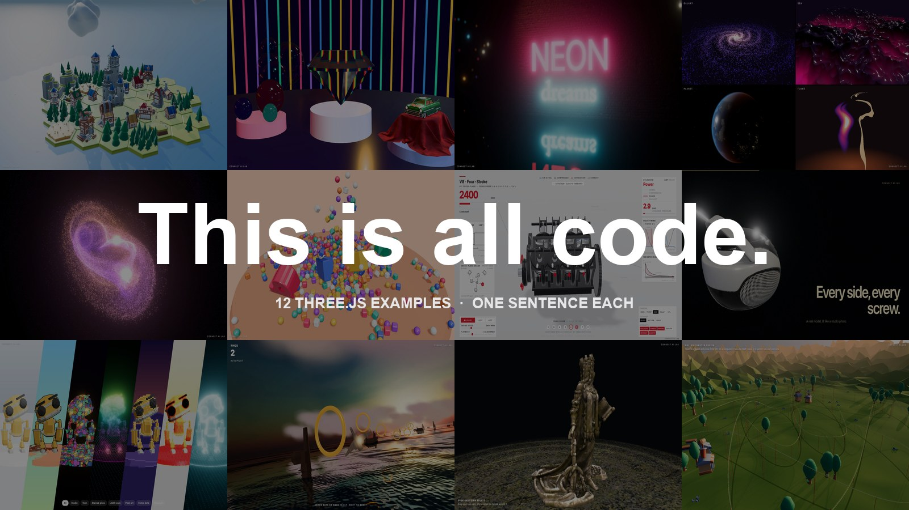</a><br><b>00</b> <a href="examples/00-opening">This is all code</a>: the twelve examples below play live, one after another, in one browser tab</td></tr>
<tr><td width="33%" valign="top"><a href="examples/01-miniature-world">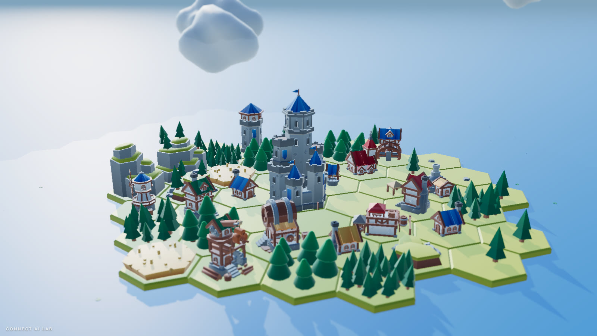</a><br><b>01</b> <a href="examples/01-miniature-world">Miniature world</a></td><td width="33%" valign="top"><a href="examples/02-glass-materials">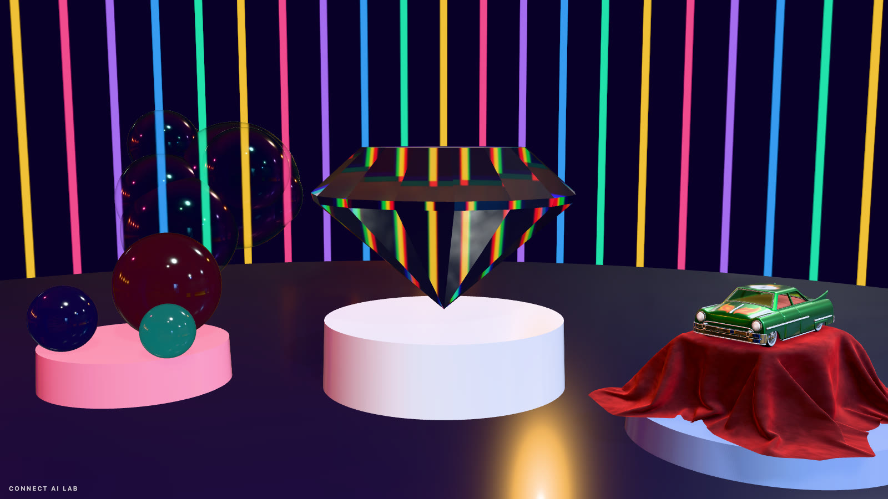</a><br><b>02</b> <a href="examples/02-glass-materials">Glass, rainbow and soap film</a></td><td width="33%" valign="top"><a href="examples/03-neon-text">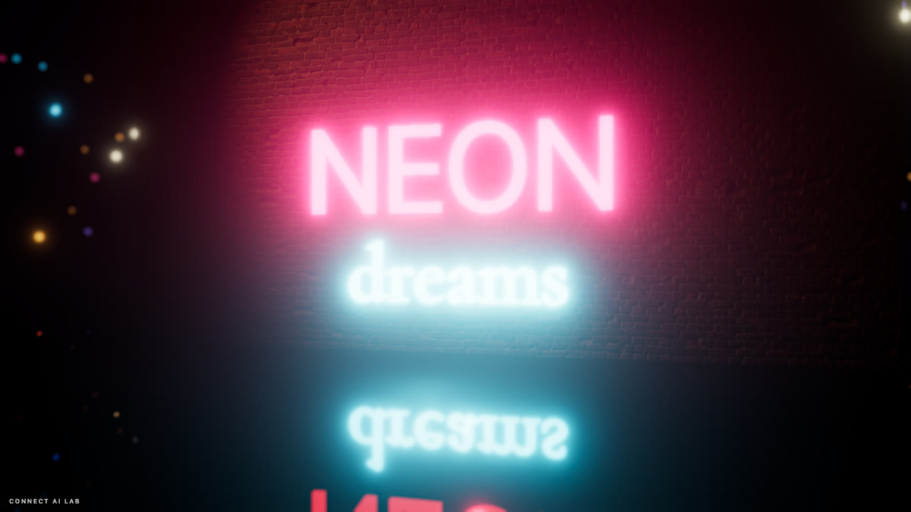</a><br><b>03</b> <a href="examples/03-neon-text">Neon text and post effects</a></td></tr>
<tr><td width="33%" valign="top"><a href="examples/04-shader-worlds">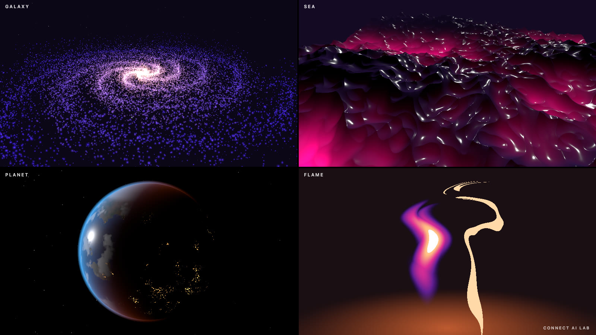</a><br><b>04</b> <a href="examples/04-shader-worlds">Shader worlds: galaxy, sea, planet, flame</a></td><td width="33%" valign="top"><a href="examples/05-particles">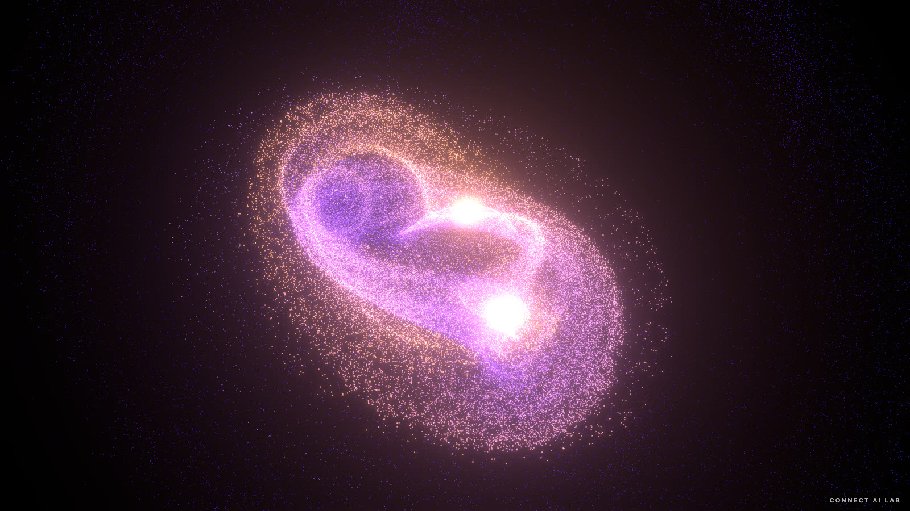</a><br><b>05</b> <a href="examples/05-particles">260,000 particles</a></td><td width="33%" valign="top"><a href="examples/06-physics">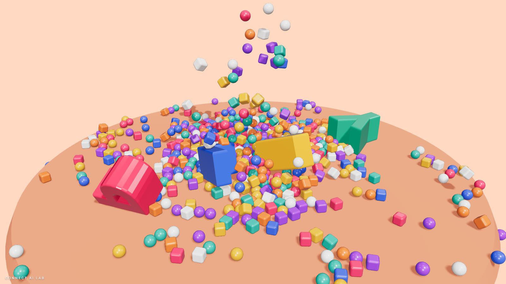</a><br><b>06</b> <a href="examples/06-physics">Real physics</a></td></tr>
<tr><td width="33%" valign="top"><a href="examples/07-teardown">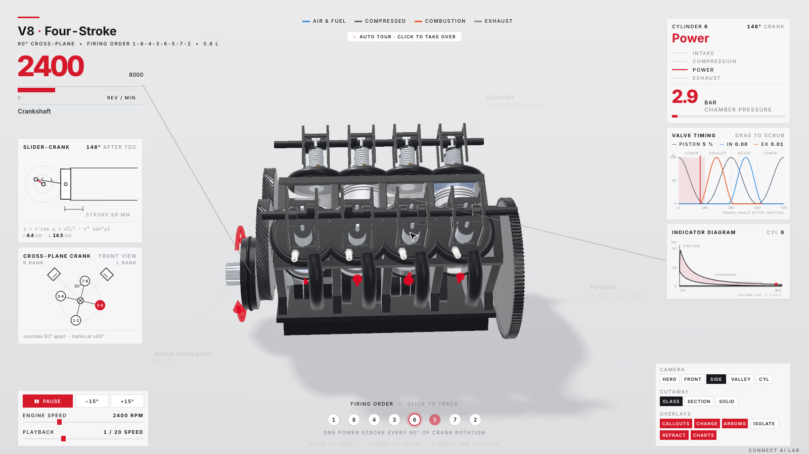</a><br><b>07</b> <a href="examples/07-teardown">Machine teardown</a></td><td width="33%" valign="top"><a href="examples/08-scroll-site">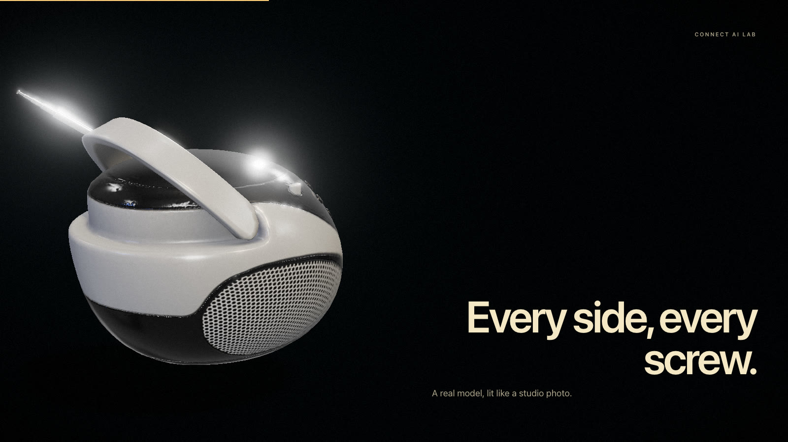</a><br><b>08</b> <a href="examples/08-scroll-site">Scroll website</a></td><td width="33%" valign="top"><a href="examples/09-many-styles">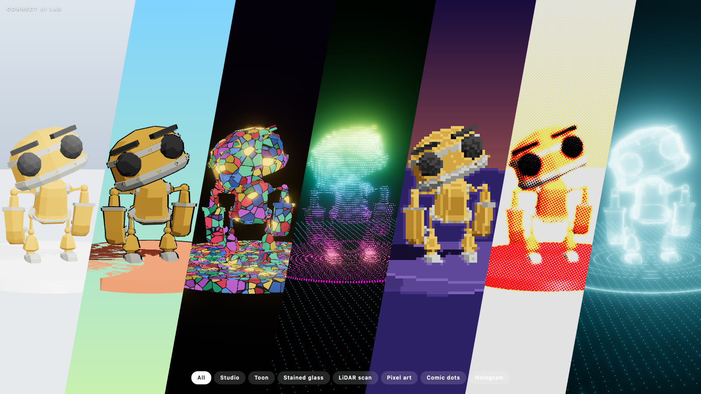</a><br><b>09</b> <a href="examples/09-many-styles">One scene, many styles</a></td></tr>
<tr><td width="33%" valign="top"><a href="examples/10-flight-game">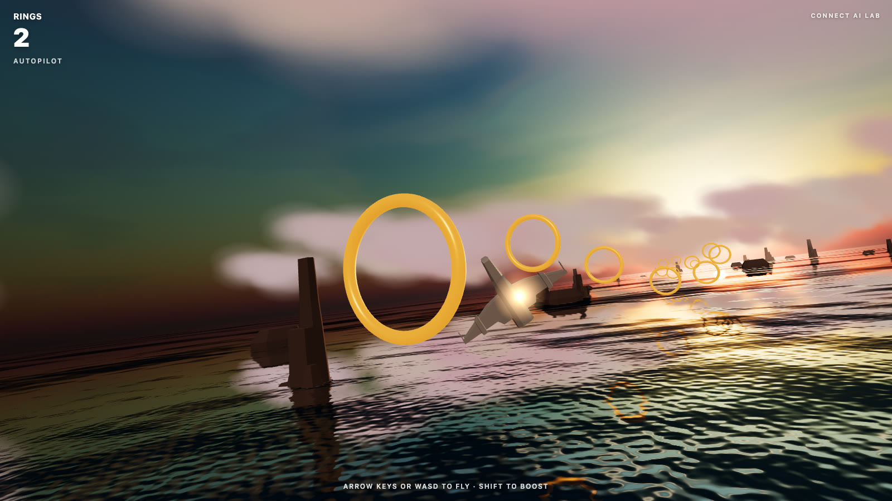</a><br><b>10</b> <a href="examples/10-flight-game">Flight game</a></td><td width="33%" valign="top"><a href="examples/11-gaussian-splat">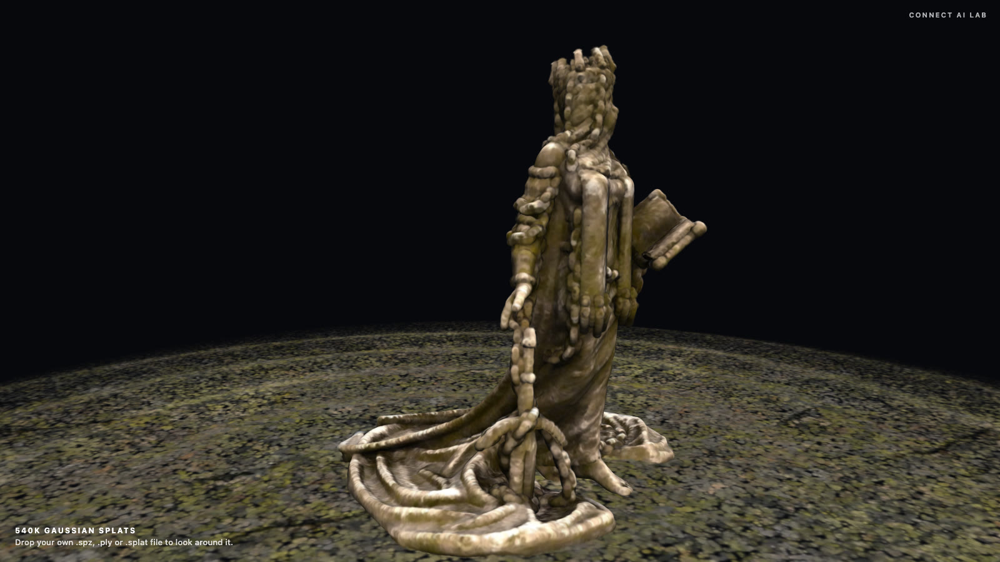</a><br><b>11</b> <a href="examples/11-gaussian-splat">Gaussian splats</a></td><td width="33%" valign="top"><a href="examples/12-xr">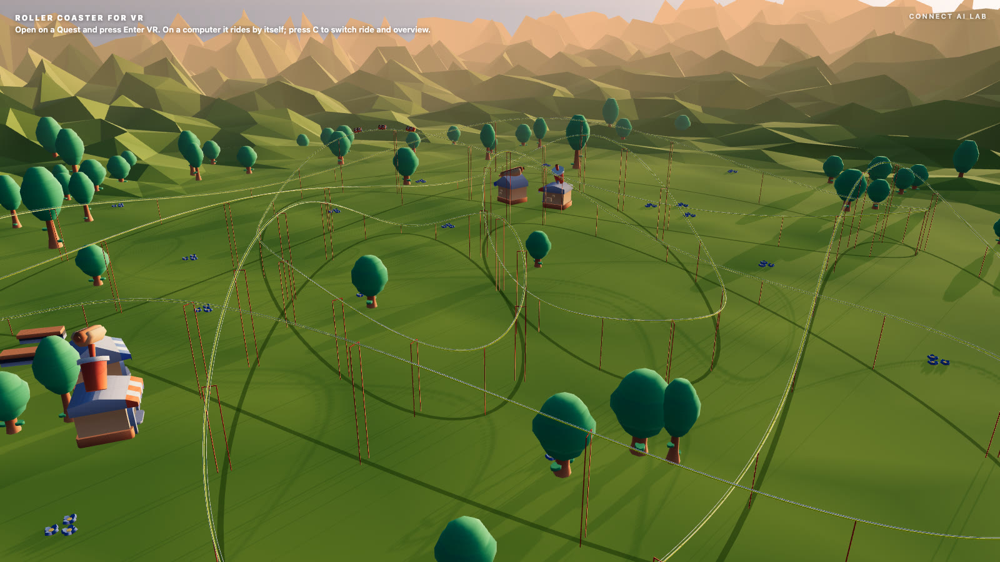</a><br><b>12</b> <a href="examples/12-xr">XR roller coaster</a></td></tr>
</table>

```bash
npx github:wonseokjung/connect-ai-three examples           # the list
npx github:wonseokjung/connect-ai-three example physics    # open one in your browser
npx github:wonseokjung/connect-ai-three example physics --copy my-page   # your own copy to change
```


| | Example | Say this to your AI |
|---|---|---|
| 00 | [`opening`](examples/00-opening) | Make an opening page that plays all my three.js examples one after another with hard cuts, live, with a big title 'This is all code.' at the start. |
| 01 | [`miniature-world`](examples/01-miniature-world) | Make a tiny village on a little island. The windmill and the water wheel turn, clouds drift by, and the whole island slowly spins like a miniature. |
| 02 | [`glass-materials`](examples/02-glass-materials) | Show my product like glass: a crystal that splits light into a rainbow, glass marbles that bend what is behind them, and soap bubbles floating around. Make it slowly turn. |
| 03 | [`neon-text`](examples/03-neon-text) | Make my shop name in 3D neon letters that switch on one by one, glowing on a dark wall, reflected on a wet street, with the city lights behind out of focus. |
| 04 | [`shader-worlds`](examples/04-shader-worlds) | Make a spiral galaxy, a stormy sea, a planet with city lights on the night side and a candle flame, all with shaders and no image files. Put them in four panels. |
| 05 | [`particles`](examples/05-particles) | Make hundreds of thousands of particles that swirl around invisible magnets, computed on the GPU, glowing violet to peach as they speed up. Let me drag the magnets. |
| 06 | [`physics`](examples/06-physics) | Make my logo letters fall from above and bounce on the floor, then pour hundreds of colourful balls and blocks on them with real physics. Double-click shakes everything. |
| 07 | [`teardown`](examples/07-teardown) | Make an interactive V8 engine I can take apart. Cut it open, show the four strokes of one cylinder, let me change the speed and the camera, and play a guided tour when I leave it alone. |
| 08 | [`scroll-site`](examples/08-scroll-site) | Make a product landing page where a 3D speaker sits behind the text. When I scroll, it turns, moves to the other side of the page and its front glows to a beat. |
| 09 | [`many-styles`](examples/09-many-styles) | Show my dancing robot in seven styles: studio, toon, stained glass, LiDAR scan, pixel art, comic dots and hologram. First all side by side in slanted strips, then one at a time, with buttons to pick a style. |
| 10 | [`flight-game`](examples/10-flight-game) | Make a flight game over a sunset sea: fly a jet through golden rings, count the score, and let an autopilot fly when I don't touch the keys. |
| 11 | [`gaussian-splat`](examples/11-gaussian-splat) | Show a 3D scan as Gaussian splats on a web page with a magic reveal effect, let me orbit around it, and let me drop my own phone scan file to view it. |
| 12 | [`xr`](examples/12-xr) | Make a roller coaster ride at sunset that I can ride in VR on my Quest, sitting in the front car, with trees and food stalls around the park. |

Each one started from real open source: the official three.js examples by mrdoob and the three.js authors, plus
[teardown](https://github.com/elvarofficial/teardown), [awwwards-3d](https://github.com/tsogjavklann/awwwards-3d)
and [Spark](https://github.com/sparkjsdev/spark). All MIT. Every model and texture is CC0 (Poly Haven, Kenney,
KayKit, Quaternius, Khronos). Each folder lists its sources, and [NOTICE.md](NOTICE.md) has all of them.

A copy loads three.js 0.187 from a pinned CDN, so it runs on any static host. The opening page plays the others, so it
runs inside the kit only. 05 particles and 04 shader worlds use WebGPU (Chrome, Edge, Safari 26); 12 xr opens in VR
on a Meta Quest.

The skill your agent installs carries a three.js r186 reference
([CloudAI-X/threejs-skills](https://github.com/CloudAI-X/threejs-skills), MIT), so it writes current three.js
(`HDRLoader`, `Timer`, WebGPU and TSL) instead of old patterns.

## No page to start from: one scene.json, a web page and a video

Need a video, not a page? Write one small `scene.json` and the kit makes a web page **and** a video of the same
picture, frame for frame, and checks its own work first. The old examples of this lane are in
[examples/scene-json](examples/scene-json).

### A different world for every sentence

Before, most sentences came out black and gold. Now it reads the sentence and picks colours and a mood that fit. A cafe gets pastel, toys get a bright toy world, a sunset gets a desert at dusk, a club gets neon, a story gets paper craft. Say nothing about the room and it still picks one from your words, so two sentences rarely land in the same room.

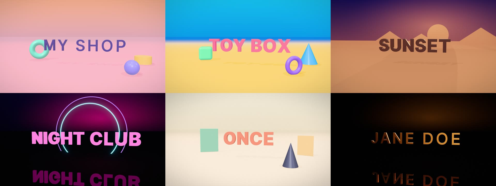

```bash
npx github:wonseokjung/connect-ai-three new "'MY SHOP' logo in a pastel cafe, slow orbit"
npx github:wonseokjung/connect-ai-three new "neon club sign 'NIGHT CLUB'"
npx github:wonseokjung/connect-ai-three make my-shop          # self-check, web page, video, still sheet, report
```

**[Open the catalog page](docs/index.html)**: a live scene you can drag at the top, all 136 items as living clips, the demos, and a prompt to copy for each one.

**One scene spec. Two outputs. A self-check.** You (or your coding agent) write one small `scene.json`: camera, lights, objects, motion, finish. The tool turns it into an interactive web page that runs in any browser **and** a video that is the same picture, frame for frame. Before it hands anything over it checks its own work: blank frames, objects out of view, a covered face, draw calls, texture sizes, phone framing, WebGL leaks.

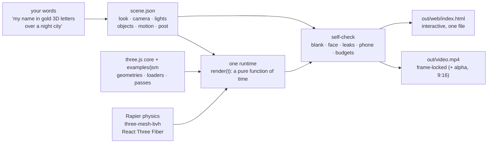

It does not invent one more 3D library. Like mixed martial arts took the best moves of every style and made them work together, it puts the three.js ecosystem (three core, the `examples/jsm` loaders, geometries and post passes, Rapier physics, three-mesh-bvh, React Three Fiber, Remotion's renderer) behind one spec, so any of it is one line:

```json
{"id": "title", "type": "wordmark", "text": "MY NAME", "split": true, "motion": [{"type": "stagger", "at": 0.5}]}
{"id": "camera", "type": "cinema-camera", "tripod": true}
{"id": "model", "type": "gltf", "src": "assets/robot.glb", "motion": ["turntable"]}
{"id": "word", "type": "text3d", "text": "DROP", "bodyEach": true}
```

> **Licences.** This kit is MIT. The web page it makes contains only MIT / Apache-2.0 code (three.js, and Rapier when you use physics). The video side runs on [Remotion](https://www.remotion.dev), which is not MIT: free for individuals and companies of up to 3 people, a company licence above that ([LICENSE.md](https://github.com/remotion-dev/remotion/blob/main/LICENSE.md)). Every part is listed in [NOTICE.md](NOTICE.md).

### Start

Node 18 or newer. macOS, Windows or Linux with a GPU.

```bash
npx github:wonseokjung/connect-ai-three            # makes the demo scene and opens it in your browser: drag to look around
npx github:wonseokjung/connect-ai-three install    # teaches your coding agent (Claude Code, Codex, Cursor, Antigravity) the spec and the catalog
```

Then just say it to your agent:

> Use connect-ai-three: my toy shop name "TOY BOX" in 3D letters, in a bright toy world. I want a web hero I can drag and a 6 second video.

No agent? Words still work:

```bash
npx github:wonseokjung/connect-ai-three new "gold logo 'JANE DOE' over a night city, slow orbit, 6s"
npx github:wonseokjung/connect-ai-three make jane-doe          # self-check, web page, video, still sheet, report
npx github:wonseokjung/connect-ai-three make jane-doe --short --alpha   # also a 9:16 version and a transparent overlay.mov
```

What you get in `out/`:

| File | What it is |
|---|---|
| `web/index.html` | the interactive page: one file, opens by double-click, drop it on any host |
| `video.mp4` | the same scene as video (H.264) |
| `overlay.mov` | `--alpha`: ProRes 4444 with a transparent background, for Premiere / CapCut / DaVinci |
| `short_9x16.mp4` | `--short`: the vertical version (the camera steps back so the picture still fits) |
| `sheet.jpg` | eight stills across the scene |
| `report.md` | the self-check: what must be fixed, what is worth a look, the measured numbers |

### The spec

```json
{
  "name": "jane-doe",
  "duration": 6,
  "look": "connect-night-city",
  "camera": {"position": [0, 1.2, 7], "target": [0, 1, 0], "fov": 32,
    "motion": [{"type": "orbit", "from": -20, "to": 14, "dur": 6}, {"type": "dolly", "from": 1.3, "to": 1, "dur": 6}]},
  "objects": [
    {"id": "floor", "type": "floor", "kind": "mirror"},
    {"id": "title", "type": "text3d", "text": "JANE DOE", "size": 0.56, "split": true, "position": [0, 1, 0],
      "material": "gold", "motion": [{"type": "stagger", "at": 0.5, "each": 0.08}]}
  ],
  "addPost": [{"type": "dof"}],
  "interact": ["parallax", "orbit"]
}
```

`look` is one word for background, lights, reflections and finish. Everything moves from time alone (`at`, `dur`), so you can scrub, loop, and render frames in any order.

Two small fields worth knowing: `"short": {...}` holds what should differ in the 9:16 version (`--short`): a top-level field such as `camera`, or single objects by id (`"objects": {"tag": {"size": 0.12}}`). And `"reflect": false` on an object keeps it out of the mirror floor.

### Catalog: 136 items, every one a scene that runs

```bash
npx github:wonseokjung/connect-ai-three catalog            # the list
npx github:wonseokjung/connect-ai-three catalog motion     # one group, with the sentence to say for each
npx github:wonseokjung/connect-ai-three use dof my-scene   # start from an item
```

| Group | Items | Stands on |
|---|---|---|
| Objects (44) | **the studio prop set** (wordmark, monogram, studio building with your sign, camera, microphone, workstation, display, laptop, softbox, clapperboard, course book: all built in code, no model files), 3D text in six typefaces (whole or letter by letter), labels, glass cards, your image, your `.glb` (Draco and Meshopt compression are read), your `.svg` logo extruded, floors (mirror, shadow catcher, grid), soft contact shadows, rounded boxes and primitives, gem, gyro rings, ribbon, fat lines, instanced grids / spheres / spirals, dot globe, 3D bars, night city, back glow, terrain, rolling surface, sky, liquid-metal blob, teapot, mobius | three core, examples/jsm (TextGeometry, GLTFLoader, SVGLoader, Reflector, Line2, RoundedBoxGeometry, Sky, MarchingCubes ...), our shaders |
| Materials (20) | gold, brushed gold, chrome, steel, piano black, ivory, clay, plastic, car paint, glass, frosted, smoked, velvet, iridescent, glow, wire, flat, toon, rim, gradient | three's physical material, our shaders |
| Motion (21) | turntable, spin, float, sway, pop, fade, rise, drop, slide, move, scale, rotate, pulse, orbit, path, explode, stagger, draw, count, typewriter, billboard | ours |
| Camera (9) | orbit, dolly, crane, truck, zoom, shots (fly between positions), path, handheld, dolly-zoom | ours |
| Light (12) | key, gold rim, fill, point, spot, softbox, sun + sky, sweep, breathe, three reflection environments (our softbox room, lit room, HDRI photo) | three core, RoomEnvironment, RGBELoader, RectAreaLight |
| Post (11) | bloom, depth of field, ambient occlusion, outline, pixel art, halftone, SMAA, vignette, grain, chroma, grade | three's EffectComposer passes, our finishing shader |
| Looks (8) | connect-gold-night, connect-night-city, studio-black, midnight-glass, pale-studio, blueprint, daylight, on-video | ours |
| Interaction (6) | orbit, parallax, hover, zoom, click, scroll | ours (three-mesh-bvh for fast picking on heavy models) |
| Physics (3) | letters drop, dominoes, stack and ball | Rapier, baked so it scrubs and loops |
| Lanes (2) | React Three Fiber adapter, 3D on your own video | @react-three/fiber, @remotion/three, Remotion |

### The self-check

`make` and `check` build the scene in a headless browser and measure it. "FIX" lines stop the render; "look" lines are advice.

| It checks | Why |
|---|---|
| Blank or almost black frames | the most common three.js failure: camera looking the wrong way, no light |
| Objects that are never inside the frame, NaN positions | a typo in a position; one NaN can blacken the whole frame once bloom is on |
| The face keep-out box (`keepOut`), and boxes marked `front` | on your own video nothing may cover your face; with a person matte all 3D is behind you, and a mic arm in front of you stays in front |
| The same picture twice | the frame at 2.0 s must be identical however you got there: this is what makes the page and the video match |
| WebGL leaks | the scene is built and disposed several times: no context, geometry or texture may stay behind (browsers allow about 16 contexts) |
| Draw calls, triangles, largest texture, texture memory | phones: 4096 px textures are the safe ceiling, instancing keeps draw calls down |
| Frame time, at full size and at phone size | measured on your machine, with every post pass counted |
| Phone framing (390 x 844) | is anything cut off in portrait |
| Text height in pixels | labels too small to read on a phone |

### Colour: every scene gets its own world

There is no house colour. Each scene gets a palette and a mood that fit what you said: a pastel cafe (peach to lilac sky, pink clay floor, mint and yellow toys), a bright toy world, a desert sunset, a neon club, paper craft. Black and gold comes only when you ask for luxury or gold. Most of these are a `pale-studio` or `daylight` look with a `background` gradient and a coloured `floor`:

```json
"look": "pale-studio",
"background": {"type": "gradient", "top": "#2EC4F1", "bottom": "#1B6FE0"},
"objects": [{"id": "floor", "type": "floor", "kind": "matte", "material": {"preset": "clay", "color": "#FFD23F"}, "size": 300}],
"addPost": [{"type": "grade", "whites": 0.95}]
```

Bright colours blow out whites easily. `grade` with `whites` about 0.95 rolls the highlights off softly. A model that is too shiny or too dark takes `"surface": {"roughness": 1, "brightness": 1.3}` on its `gltf`, no file editing.

### 3D letters: six typefaces, and any font file

`text3d`, `wordmark` and the sign on `building` take `"font"`: `thin`, `light`, `sans`, `bold` (one clean sans in four
weights) or `serif`, `serif-bold` (a display serif). They are small glyph subsets, tens of KB each, and a web page
carries only the ones its scene names. Kerning pairs are applied.

Flat text (`label`, `card`, the page headline) works in every language with no setup. The sans faces also carry the
Korean letters of a few lines such as "모두를 위한 AI 교육"; for any other Korean, Japanese, Chinese or Arabic text add
your own font file and it is extruded the same way:

```json
{"type": "text3d", "text": "안녕하세요, 반갑습니다", "fontFile": "assets/MyFont.otf", "material": "gold", "split": true}
```

The check tells you when a 3D text has letters the font does not have. See `examples/scene-json/korean-title`. The typeface data
are derived from open fonts and stay under the SIL Open Font License ([licenses/fonts-OFL.txt](licenses/fonts-OFL.txt)).

### 3D on your own video

Lesson 2's tool ([connect-ai-video-motion](https://github.com/wonseokjung/connect-ai-video-motion)) puts 2D graphics around you. This one adds a 3D object to the same video:

```bash
npx github:wonseokjung/connect-ai-three on-video talk.mp4 --faces talk-video-motion/work/face.json --matte talk-video-motion/work/matte
```

It makes a transparent 3D layer over your footage and never touches your pixels. `face.json` and the `matte` folder
are what connect-ai-video-motion wrote when it analysed the clip (the matte is one grayscale picture per frame,
white = person; on macOS it comes from Apple Vision, nothing to download).

- **With the matte, every 3D object is drawn behind you.** A wordmark can rise from behind your shoulders, a camera
  can fly behind your head, and nothing can ever sit in front of your face or your hands. Doubtful pixels at the
  edge of the matte count as you, so the footage always wins.
- **Without a matte** the 3D sits on top, and the face box does the guarding: give `--faces` or
  `--face 0.33,0.13,0.25,0.48`. If an object crosses the box, the check fails and tells you when and by how much.
- A thing in front of you that is not you (a mic arm, a lamp) is not in the matte. Mark its area
  `{"x": 0, "y": 0.5, "w": 0.46, "h": 0.5, "front": true}` in `keepOut` and the check keeps the 3D off it.
- `make --alpha` writes `overlay.mov` with the person already cut out of the 3D, ready to lay over the footage in
  Premiere, CapCut or DaVinci.

`examples/scene-json/on-my-video` has four finished cuts ("3D modeling", "I move the camera", "gravity",
"AI-native company"), each timed to the words spoken in that take. No footage ships with the kit: run them on your own.

### Already using React Three Fiber?

```tsx
import {ConnectScene} from 'connect-ai-three/src/adapters/r3f';

<Canvas>
  <ConnectScene spec={spec} time={t} />   {/* next to your own drei components */}
</Canvas>
```

The same component works inside Remotion's `<ThreeCanvas>` (`npx github:wonseokjung/connect-ai-three video my-scene --r3f`).

### Commands

| Command | What it does |
|---|---|
| `find "<sentence>"` | one ranked table: our examples, the community library and fresh GitHub repositories. `--offline`, `--limit`, `--json` |
| `library [category]` | the community library (code and shared prompts), with licence and post link. `--json` |
| `fetch <owner/repo> --to <folder>` | copies licence-cleared code with its licence text and `SOURCES.md`. `--with-assets` |
| `examples` | the example pages, with the sentence for each. `--check` checks their files |
| `example <name>` | opens one in your browser. `--copy <folder>` writes your own copy, `--port`, `--video out.mp4` films it |
| `film <folder>` | films any page in a folder. `--9x16`, `--4k`, `--seconds`, `--orbit`, `--no-camera`, `--out` |
| `smoke [names]` | opens examples in headless Chrome: console errors, draw calls, colours |
| `npx github:wonseokjung/connect-ai-three` | demo scene, opened in the browser |
| `new "<words>"` | first `scene.json` from words (English or Korean), no AI needed |
| `make [folder]` | check, web page, video, sheet, report. `--short`, `--alpha`, `--force` |
| `web [folder]` | only the page. `--serve` serves it on localhost, `--no-inline` keeps assets as files |
| `video [folder]` | only the video. `--alpha`, `--short`, `--scale 0.5`, `--r3f` |
| `check [folder]` | only the self-check. `--json` |
| `sheet [folder]` / `still [folder] --at 2.5` | stills |
| `on-video <video> [folder]` | 3D over your own video. `--faces face.json` or `--face x,y,w,h`; `--matte <folder>` draws the 3D behind you |
| `catalog [group]` / `use <id> [folder]` | list the catalog / start from an item |
| `install` / `uninstall` | the skill for Claude Code, Codex, Cursor, Antigravity. `--agent`, `--project`, `--dry-run` |
| `doctor` | is this machine ready |

From a clone:

```bash
git clone https://github.com/wonseokjung/connect-ai-three.git
cd connect-ai-three && npm install
npm test                 # 46 tests; --fast skips the ones that open the browser
node bin/cli.mjs demo
```

### Not yet

In the scene.json lane: Gaussian splats and WebGPU / TSL (the examples have both) · sound · a keyframe editor. Depth of field and bloom are left out automatically when the background is transparent, because they do not keep alpha. Frame times are measured on the machine that runs the check, so treat phone numbers as a guide, not a promise.

## Credits

Built on three.js and the projects listed in [NOTICE.md](NOTICE.md), each with version and licence. The examples are adapted from the official three.js examples, elvarofficial/teardown, tsogjavklann/awwwards-3d and Spark (all MIT). Every model, texture and HDRI is CC0 or public domain, and the fonts are under the SIL Open Font License ([licenses/assets.md](licenses/assets.md)). No credit-required assets.

<!-- team:start -->
## CONNECT AI LAB's 14 AI employees · ELDO Browser

I build AI employees in the open, one by one. Grab the one you need, or browse and hire all 14 with [ELDO Browser](https://eldobrowser.com) and [`wonseokjung/eldo`](https://github.com/wonseokjung/eldo) (`npx github:wonseokjung/eldo`).

<table>
<tr><td width="34%" valign="top"><b>ELDO Browser · Open-Source Hub</b><br><a href="https://eldobrowser.com"><code>eldobrowser.com</code></a> · <a href="https://github.com/wonseokjung/eldo"><code>eldo</code></a></td><td valign="top">The free Browser for AI Agents (Apple Notarized macOS &amp; Windows). Sign in once; AI employees work in isolated gold spaces and hand off auth and payments to you.</td></tr>
<tr><td width="34%" valign="top"><b>AI autonomous company HQ</b><br><a href="https://github.com/wonseokjung/connect-ai-autonomous-company"><code>connect-ai-autonomous-company</code></a></td><td valign="top">Local AI company OS connecting your life, AI employees, automations, and ELDO browser.</td></tr>
<tr><td width="34%" valign="top"><b>AI developer</b><br><a href="https://github.com/wonseokjung/connect-ai-developer"><code>connect-ai-developer</code></a></td><td valign="top">One sentence in, a service with sign-up, database, test payments, GitHub and deploy plans out.</td></tr>
<tr><td width="34%" valign="top"><b>AI accountant</b><br><a href="https://github.com/wonseokjung/connect-ai-accountant"><code>connect-ai-accountant</code></a></td><td valign="top">Receipts, 홈택스, card and bank in. A monthly sheet and a package for your tax accountant out.</td></tr>
<tr><td width="34%" valign="top"><b>AI marketing team</b><br><a href="https://github.com/wonseokjung/connect-ai-marketer"><code>connect-ai-marketer</code></a></td><td valign="top">8 AI teammates handling replies, social listening and YouTube uploads 24/7 in your browser.</td></tr>
<tr><td width="34%" valign="top"><b>AI writer</b><br><a href="https://github.com/wonseokjung/connect-ai-writer"><code>connect-ai-writer</code></a></td><td valign="top">Give it one video or topic; it researches and writes platform posts in your voice, with pictures.</td></tr>
<tr><td width="34%" valign="top"><b>AI business analyst</b><br><a href="https://github.com/wonseokjung/reversebusiness"><code>reversebusiness</code></a></td><td valign="top">Give it a website URL, and it breaks down how that business makes money and designs your version.</td></tr>
<tr><td width="34%" valign="top"><b>AI image director</b><br><a href="https://github.com/wonseokjung/connect-ai-image"><code>connect-ai-image</code></a></td><td valign="top">Free-first local ComfyUI + FLUX or logged-in browser image series for every platform.</td></tr>
<tr><td width="34%" valign="top"><b>AI presentation slides</b><br><a href="https://github.com/wonseokjung/connect-ai-slides-web"><code>connect-ai-slides-web</code></a></td><td valign="top">Turn a few lines or an old PPT into a motion-first 3D web deck and a real PowerPoint (.pptx) file.</td></tr>
<tr><td width="34%" valign="top"><b>AI Web 3D Agent</b> · <b>this one</b><br><a href="https://github.com/wonseokjung/connect-ai-three"><code>connect-ai-three</code></a></td><td valign="top">Say it: it finds the best community three.js work, films it in 16:9 and 9:16 and credits the authors.</td></tr>
<tr><td width="34%" valign="top"><b>AI motion designer</b><br><a href="https://github.com/wonseokjung/connect-ai-motion"><code>connect-ai-motion</code></a></td><td valign="top">Give it a few lines of text, and it makes a 16:9 and 9:16 motion graphics video. No footage needed.</td></tr>
<tr><td width="34%" valign="top"><b>AI video editor</b><br><a href="https://github.com/wonseokjung/connect-ai-video-motion"><code>connect-ai-video-motion</code></a></td><td valign="top">Give it your video, and it puts 80 body-aware motion graphics in the empty space around you.</td></tr>
<tr><td width="34%" valign="top"><b>AI XR developer</b><br><a href="https://github.com/wonseokjung/connect-ai-xr"><code>connect-ai-xr</code></a></td><td valign="top">Give it one sentence, and it makes a WebXR app for Meta Quest passthrough AR, VR, and desktop.</td></tr>
<tr><td width="34%" valign="top"><b>AI product photographer</b><br><a href="https://github.com/wonseokjung/connect-ai-product-photo"><code>connect-ai-product-photo</code></a></td><td valign="top">Drop phone product photos in a folder and get platform-ready studio shots keeping real sharp labels.</td></tr>
<tr><td width="34%" valign="top"><b>AI global localizer</b><br><a href="https://github.com/wonseokjung/connect-ai-localizer"><code>connect-ai-localizer</code></a></td><td valign="top">Rewrite your Korean post or subtitles natively for English, Japanese and Spanish in your own voice.</td></tr>
</table>
<!-- team:end -->

---

I teach how to build tools like this with your own AI agent in [Visual Vibe Coding](https://www.aicitybuilders.com/vibecoding).

<table><tr>
<td width="140" valign="top"></td>
<td valign="top"><b>Made by AI Mentor Jay</b> · CONNECT AI LAB<br>
I'll keep releasing AI employees as open source, one by one, and show how I build them on YouTube and in my course.<br>
<a href="https://www.youtube.com/@CONNECT-AI-LAB">YouTube</a> · <a href="https://www.aicitybuilders.com/vibecoding">Visual Vibe Coding</a> · <a href="https://github.com/wonseokjung">More open source</a></td>
</tr></table>

MIT · CONNECT AI LAB
