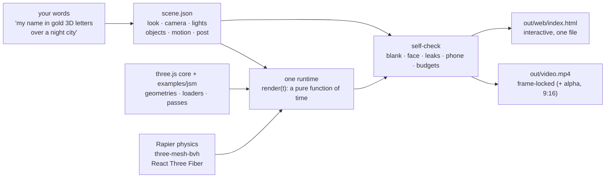

<p align="center"></p>

<p align="center">
  <b>CONNECT AI LAB</b> · AI education for everyone · 모두를 위한 AI 교육<br>
  <a href="https://www.youtube.com/@CONNECT-AI-LAB">YouTube: CONNECT AI LAB</a> · <a href="https://www.aicitybuilders.com/vibecoding">Course: Visual Vibe Coding</a> · <a href="README.ko.md">한국어</a>
</p>

# connect-ai-three

**An AI 3D web developer. Say what you want to see in one sentence, and you get a 3D web page you can drag and a video of the same picture.**

[](docs/showcase/v04/hero.mp4)

```bash
npx github:wonseokjung/connect-ai-three
```

That one line makes the demo scene and opens it in your browser. Drag it around. To teach your agent (Claude Code, Codex, Antigravity, Cursor), paste `npx github:wonseokjung/connect-ai-three install` into its chat and ask it to install it. Then open a new chat and say: "Use connect-ai-three: my cafe logo 'MY SHOP' in 3D, a web page I can drag and a 6 second video."

You need [Node.js](https://nodejs.org) 18 or newer and a computer with a GPU. No paid API key.

## 0.4: a different world for every sentence

Before, most sentences came out black and gold. Now it reads the sentence and picks colours and a mood that fit. A cafe gets pastel, toys get a bright toy world, a sunset gets a desert at dusk, a club gets neon, a story gets paper craft. Say nothing about the room and it still picks one from your words, so two sentences rarely land in the same room.


```bash
npx github:wonseokjung/connect-ai-three new "'MY SHOP' logo in a pastel cafe, slow orbit"
npx github:wonseokjung/connect-ai-three new "neon club sign 'NIGHT CLUB'"
npx github:wonseokjung/connect-ai-three make my-shop          # self-check, web page, video, still sheet, report
```

It goes on your own video too. It never covers your face, and with a person matte the 3D passes behind you.

[](docs/showcase/v04/on-video.mp4)

**[Open the catalog page](docs/index.html)**: a live scene you can drag at the top, all 136 items as living clips, the demos, and a prompt to copy for each one.

**One scene spec. Two outputs. A self-check.** You (or your coding agent) write one small `scene.json`: camera, lights, objects, motion, finish. The tool turns it into an interactive web page that runs in any browser **and** a video that is the same picture, frame for frame. Before it hands anything over it checks its own work: blank frames, objects out of view, a covered face, draw calls, texture sizes, phone framing, WebGL leaks.



It does not invent one more 3D library. Like mixed martial arts took the best moves of every style and made them work together, it puts the three.js ecosystem (three core, the `examples/jsm` loaders, geometries and post passes, Rapier physics, three-mesh-bvh, React Three Fiber, Remotion's renderer) behind one spec, so any of it is one line:

```json
{"id": "title", "type": "wordmark", "text": "MY NAME", "split": true, "motion": [{"type": "stagger", "at": 0.5}]}
{"id": "camera", "type": "cinema-camera", "tripod": true}
{"id": "model", "type": "gltf", "src": "assets/robot.glb", "motion": ["turntable"]}
{"id": "word", "type": "text3d", "text": "DROP", "bodyEach": true}
```

> **Licences.** This kit is MIT. The web page it makes contains only MIT / Apache-2.0 code (three.js, and Rapier when you use physics). The video side runs on [Remotion](https://www.remotion.dev), which is not MIT: free for individuals and companies of up to 3 people, a company licence above that ([LICENSE.md](https://github.com/remotion-dev/remotion/blob/main/LICENSE.md)). Every part is listed in [NOTICE.md](NOTICE.md).

## Start

Node 18 or newer. macOS, Windows or Linux with a GPU.

```bash
npx github:wonseokjung/connect-ai-three            # makes the demo scene and opens it in your browser: drag to look around
npx github:wonseokjung/connect-ai-three install    # teaches your coding agent (Claude Code, Codex, Cursor, Antigravity) the spec and the catalog
```

Then just say it to your agent:

> Use connect-ai-three: my toy shop name "TOY BOX" in 3D letters, in a bright toy world. I want a web hero I can drag and a 6 second video.

No agent? Words still work:

```bash
npx github:wonseokjung/connect-ai-three new "gold logo 'JANE DOE' over a night city, slow orbit, 6s"
npx github:wonseokjung/connect-ai-three make jane-doe          # self-check, web page, video, still sheet, report
npx github:wonseokjung/connect-ai-three make jane-doe --short --alpha   # also a 9:16 version and a transparent overlay.mov
```

What you get in `out/`:

| File | What it is |
|---|---|
| `web/index.html` | the interactive page: one file, opens by double-click, drop it on any host |
| `video.mp4` | the same scene as video (H.264) |
| `overlay.mov` | `--alpha`: ProRes 4444 with a transparent background, for Premiere / CapCut / DaVinci |
| `short_9x16.mp4` | `--short`: the vertical version (the camera steps back so the picture still fits) |
| `sheet.jpg` | eight stills across the scene |
| `report.md` | the self-check: what must be fixed, what is worth a look, the measured numbers |

## The spec

```json
{
  "name": "jane-doe",
  "duration": 6,
  "look": "connect-night-city",
  "camera": {"position": [0, 1.2, 7], "target": [0, 1, 0], "fov": 32,
    "motion": [{"type": "orbit", "from": -20, "to": 14, "dur": 6}, {"type": "dolly", "from": 1.3, "to": 1, "dur": 6}]},
  "objects": [
    {"id": "floor", "type": "floor", "kind": "mirror"},
    {"id": "title", "type": "text3d", "text": "JANE DOE", "size": 0.56, "split": true, "position": [0, 1, 0],
      "material": "gold", "motion": [{"type": "stagger", "at": 0.5, "each": 0.08}]}
  ],
  "addPost": [{"type": "dof"}],
  "interact": ["parallax", "orbit"]
}
```

`look` is one word for background, lights, reflections and finish. Everything moves from time alone (`at`, `dur`), so you can scrub, loop, and render frames in any order.

Two small fields worth knowing: `"short": {...}` holds what should differ in the 9:16 version (`--short`): a top-level field such as `camera`, or single objects by id (`"objects": {"tag": {"size": 0.12}}`). And `"reflect": false` on an object keeps it out of the mirror floor.

## Catalog: 136 items, every one a scene that runs

```bash
npx github:wonseokjung/connect-ai-three catalog            # the list
npx github:wonseokjung/connect-ai-three catalog motion     # one group, with the sentence to say for each
npx github:wonseokjung/connect-ai-three use dof my-scene   # start from an item
```

| Group | Items | Stands on |
|---|---|---|
| Objects (44) | **the studio prop set** (wordmark, monogram, studio building with your sign, camera, microphone, workstation, display, laptop, softbox, clapperboard, course book: all built in code, no model files), 3D text in six typefaces (whole or letter by letter), labels, glass cards, your image, your `.glb` (Draco and Meshopt compression are read), your `.svg` logo extruded, floors (mirror, shadow catcher, grid), soft contact shadows, rounded boxes and primitives, gem, gyro rings, ribbon, fat lines, instanced grids / spheres / spirals, dot globe, 3D bars, night city, back glow, terrain, rolling surface, sky, liquid-metal blob, teapot, mobius | three core, examples/jsm (TextGeometry, GLTFLoader, SVGLoader, Reflector, Line2, RoundedBoxGeometry, Sky, MarchingCubes ...), our shaders |
| Materials (20) | gold, brushed gold, chrome, steel, piano black, ivory, clay, plastic, car paint, glass, frosted, smoked, velvet, iridescent, glow, wire, flat, toon, rim, gradient | three's physical material, our shaders |
| Motion (21) | turntable, spin, float, sway, pop, fade, rise, drop, slide, move, scale, rotate, pulse, orbit, path, explode, stagger, draw, count, typewriter, billboard | ours |
| Camera (9) | orbit, dolly, crane, truck, zoom, shots (fly between positions), path, handheld, dolly-zoom | ours |
| Light (12) | key, gold rim, fill, point, spot, softbox, sun + sky, sweep, breathe, three reflection environments (our softbox room, lit room, HDRI photo) | three core, RoomEnvironment, RGBELoader, RectAreaLight |
| Post (11) | bloom, depth of field, ambient occlusion, outline, pixel art, halftone, SMAA, vignette, grain, chroma, grade | three's EffectComposer passes, our finishing shader |
| Looks (8) | connect-gold-night, connect-night-city, studio-black, midnight-glass, pale-studio, blueprint, daylight, on-video | ours |
| Interaction (6) | orbit, parallax, hover, zoom, click, scroll | ours (three-mesh-bvh for fast picking on heavy models) |
| Physics (3) | letters drop, dominoes, stack and ball | Rapier, baked so it scrubs and loops |
| Lanes (2) | React Three Fiber adapter, 3D on your own video | @react-three/fiber, @remotion/three, Remotion |

## The self-check

`make` and `check` build the scene in a headless browser and measure it. "FIX" lines stop the render; "look" lines are advice.

| It checks | Why |
|---|---|
| Blank or almost black frames | the most common three.js failure: camera looking the wrong way, no light |
| Objects that are never inside the frame, NaN positions | a typo in a position; one NaN can blacken the whole frame once bloom is on |
| The face keep-out box (`keepOut`), and boxes marked `front` | on your own video nothing may cover your face; with a person matte all 3D is behind you, and a mic arm in front of you stays in front |
| The same picture twice | the frame at 2.0 s must be identical however you got there: this is what makes the page and the video match |
| WebGL leaks | the scene is built and disposed several times: no context, geometry or texture may stay behind (browsers allow about 16 contexts) |
| Draw calls, triangles, largest texture, texture memory | phones: 4096 px textures are the safe ceiling, instancing keeps draw calls down |
| Frame time, at full size and at phone size | measured on your machine, with every post pass counted |
| Phone framing (390 x 844) | is anything cut off in portrait |
| Text height in pixels | labels too small to read on a phone |

## Colour: every scene gets its own world

There is no house colour. Each scene gets a palette and a mood that fit what you said: a pastel cafe (peach to lilac sky, pink clay floor, mint and yellow toys), a bright toy world, a desert sunset, a neon club, paper craft. Black and gold comes only when you ask for luxury or gold. Most of these are a `pale-studio` or `daylight` look with a `background` gradient and a coloured `floor`:

```json
"look": "pale-studio",
"background": {"type": "gradient", "top": "#2EC4F1", "bottom": "#1B6FE0"},
"objects": [{"id": "floor", "type": "floor", "kind": "matte", "material": {"preset": "clay", "color": "#FFD23F"}, "size": 300}],
"addPost": [{"type": "grade", "whites": 0.95}]
```

Bright colours blow out whites easily. `grade` with `whites` about 0.95 rolls the highlights off softly. A model that is too shiny or too dark takes `"surface": {"roughness": 1, "brightness": 1.3}` on its `gltf`, no file editing.

## 3D letters: six typefaces, and any font file

`text3d`, `wordmark` and the sign on `building` take `"font"`: `thin`, `light`, `sans`, `bold` (one clean sans in four
weights) or `serif`, `serif-bold` (a display serif). They are small glyph subsets, tens of KB each, and a web page
carries only the ones its scene names. Kerning pairs are applied.

Flat text (`label`, `card`, the page headline) works in every language with no setup. The sans faces also carry the
Korean letters of a few lines such as "모두를 위한 AI 교육"; for any other Korean, Japanese, Chinese or Arabic text add
your own font file and it is extruded the same way:

```json
{"type": "text3d", "text": "안녕하세요, 반갑습니다", "fontFile": "assets/MyFont.otf", "material": "gold", "split": true}
```

The check tells you when a 3D text has letters the font does not have. See `examples/korean-title`. The typeface data
are derived from open fonts and stay under the SIL Open Font License ([licenses/fonts-OFL.txt](licenses/fonts-OFL.txt)).

## 3D on your own video

Lesson 2's tool ([connect-ai-video-motion](https://github.com/wonseokjung/connect-ai-video-motion)) puts 2D graphics around you. This one adds a 3D object to the same video:

```bash
npx github:wonseokjung/connect-ai-three on-video talk.mp4 --faces talk-video-motion/work/face.json --matte talk-video-motion/work/matte
```

It makes a transparent 3D layer over your footage and never touches your pixels. `face.json` and the `matte` folder
are what connect-ai-video-motion wrote when it analysed the clip (the matte is one grayscale picture per frame,
white = person; on macOS it comes from Apple Vision, nothing to download).

- **With the matte, every 3D object is drawn behind you.** A wordmark can rise from behind your shoulders, a camera
  can fly behind your head, and nothing can ever sit in front of your face or your hands. Doubtful pixels at the
  edge of the matte count as you, so the footage always wins.
- **Without a matte** the 3D sits on top, and the face box does the guarding: give `--faces` or
  `--face 0.33,0.13,0.25,0.48`. If an object crosses the box, the check fails and tells you when and by how much.
- A thing in front of you that is not you (a mic arm, a lamp) is not in the matte. Mark its area
  `{"x": 0, "y": 0.5, "w": 0.46, "h": 0.5, "front": true}` in `keepOut` and the check keeps the 3D off it.
- `make --alpha` writes `overlay.mov` with the person already cut out of the 3D, ready to lay over the footage in
  Premiere, CapCut or DaVinci.

`examples/on-my-video` has five finished cuts (a greeting, "3D modeling", "I move the camera", "gravity",
"AI-native company"), each timed to the words spoken in that take.

## Already using React Three Fiber?

```tsx
import {ConnectScene} from 'connect-ai-three/src/adapters/r3f';

<Canvas>
  <ConnectScene spec={spec} time={t} />   {/* next to your own drei components */}
</Canvas>
```

The same component works inside Remotion's `<ThreeCanvas>` (`npx github:wonseokjung/connect-ai-three video my-scene --r3f`).

## Commands

| Command | What it does |
|---|---|
| `npx github:wonseokjung/connect-ai-three` | demo scene, opened in the browser |
| `new "<words>"` | first `scene.json` from words (English or Korean), no AI needed |
| `make [folder]` | check, web page, video, sheet, report. `--short`, `--alpha`, `--force` |
| `web [folder]` | only the page. `--serve` serves it on localhost, `--no-inline` keeps assets as files |
| `video [folder]` | only the video. `--alpha`, `--short`, `--scale 0.5`, `--r3f` |
| `check [folder]` | only the self-check. `--json` |
| `sheet [folder]` / `still [folder] --at 2.5` | stills |
| `on-video <video> [folder]` | 3D over your own video. `--faces face.json` or `--face x,y,w,h`; `--matte <folder>` draws the 3D behind you |
| `catalog [group]` / `use <id> [folder]` | list the catalog / start from an item |
| `install` / `uninstall` | the skill for Claude Code, Codex, Cursor, Antigravity. `--agent`, `--project`, `--dry-run` |
| `doctor` | is this machine ready |

From a clone:

```bash
git clone https://github.com/wonseokjung/connect-ai-three.git
cd connect-ai-three && npm install
npm test                 # 33 tests; --fast skips the ones that open the browser
node bin/cli.mjs demo
```

## Not yet

Gaussian splats · WebGPU / TSL materials · sound · a keyframe editor. Depth of field and bloom are left out automatically when the background is transparent, because they do not keep alpha. Frame times are measured on the machine that runs the check, so treat phone numbers as a guide, not a promise.

## Credits

Built on three.js and the projects listed in [NOTICE.md](NOTICE.md), each with version and licence. Assets: one CC0 HDRI from Poly Haven, one public-domain NASA model, and typeface data derived from two open fonts under the SIL Open Font License ([licenses/assets.md](licenses/assets.md)); no credit-required assets. The props are built in code. The clips on the catalog page that show a person are the author, on his own footage.

<!-- team:start -->
## CONNECT AI LAB's AI employees

I'm building AI employees one by one, in the open. Grab the one you need first.

<table>
<tr><td width="34%" valign="top"><b>AI business analyst</b><br><a href="https://github.com/wonseokjung/reversebusiness"><code>reversebusiness</code></a></td><td valign="top">Give it a website, and it breaks down how that business makes money.</td></tr>
<tr><td width="34%" valign="top"><b>AI video editor</b><br><a href="https://github.com/wonseokjung/connect-ai-video-motion"><code>connect-ai-video-motion</code></a></td><td valign="top">Give it your video, and it puts motion graphics in the empty space around you.</td></tr>
<tr><td width="34%" valign="top"><b>AI motion designer</b><br><a href="https://github.com/wonseokjung/connect-ai-motion"><code>connect-ai-motion</code></a></td><td valign="top">Give it a few lines of text, and it makes a motion graphics video. No footage needed.</td></tr>
<tr><td width="34%" valign="top"><b>AI presentation designer</b><br><a href="https://github.com/wonseokjung/connect-ai-slides-web"><code>connect-ai-slides-web</code></a></td><td valign="top">Give it a few lines or an old PPT, and it makes a deck that moves and a PowerPoint file you can edit.</td></tr>
<tr><td width="34%" valign="top"><b>AI 3D web developer</b> · <b>this one</b><br><a href="https://github.com/wonseokjung/connect-ai-three"><code>connect-ai-three</code></a></td><td valign="top">Give it one sentence, and it makes a 3D web page you can drag and a video of the same picture.</td></tr>
<tr><td width="34%" valign="top"><b>AI marketing team</b><br><a href="https://github.com/wonseokjung/connect-ai-marketer"><code>connect-ai-marketer</code></a></td><td valign="top">Replies, social listening and uploads, 24/7 in your own browser.</td></tr>
<tr><td width="34%" valign="top"><b>AI writer</b><br><a href="https://github.com/wonseokjung/connect-ai-writer"><code>connect-ai-writer</code></a></td><td valign="top">Give it one video, and it writes a post for every platform in your voice, with pictures.</td></tr>
<tr><td width="34%" valign="top"><b>AI XR developer</b><br><a href="https://github.com/wonseokjung/connect-ai-xr"><code>connect-ai-xr</code></a></td><td valign="top">Give it one sentence, and it makes an XR app that opens on Meta Quest, computers and phones.</td></tr>
</table>
<!-- team:end -->

---

I teach how to build tools like this with your own AI agent in [Visual Vibe Coding](https://www.aicitybuilders.com/vibecoding).

<table><tr>
<td width="140" valign="top"></td>
<td valign="top"><b>Made by AI Mentor Jay</b> · CONNECT AI LAB<br>
I'll keep releasing AI employees as open source, one by one, and show how I build them on YouTube and in my course.<br>
<a href="https://www.youtube.com/@CONNECT-AI-LAB">YouTube</a> · <a href="https://www.aicitybuilders.com/vibecoding">Visual Vibe Coding</a> · <a href="https://github.com/wonseokjung">More open source</a></td>
</tr></table>

MIT · CONNECT AI LAB
