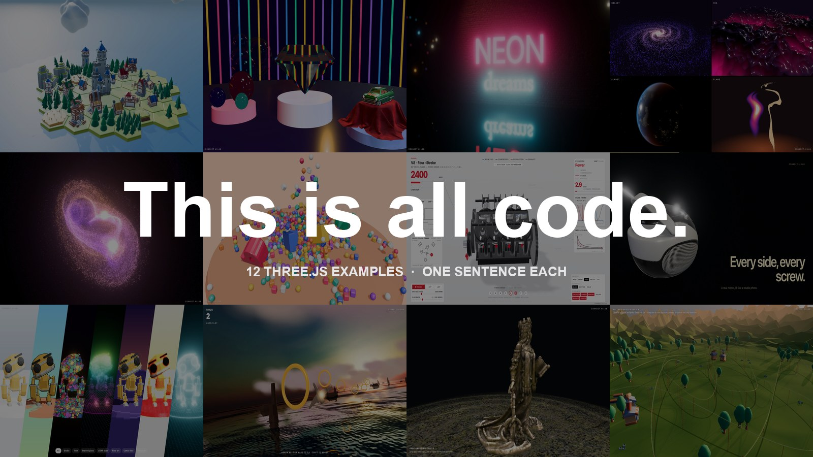

# 00 This is all code



The opening: the twelve other examples play one after another with hard cuts, live in the browser. Nothing is a video.

[preview.mp4](preview.mp4)

## Say this to your AI

> Make an opening page that plays all my three.js examples one after another with hard cuts, live, with a big title 'This is all code.' at the start.

## 한국어로는 이렇게 말해요

> 내 three.js 예제들을 하나씩 바로바로 바꿔 가며 실시간으로 보여 주는 오프닝 페이지 만들어 줘. 처음엔 크게 '이게 다 코드예요'라고 써 줘.

오프닝이에요. 나머지 예제 12개가 브라우저에서 실시간으로 하나씩 바로바로 바뀌면서 지나가요. 영상은 하나도 없어요.

## Run it

```bash
npx github:wonseokjung/connect-ai-three example opening
```

Your own copy to change (three.js then comes from a pinned CDN, so any static server works):

```bash
npx github:wonseokjung/connect-ai-three example opening --copy my-opening
```

The opening plays the other examples, so it runs inside the kit only.

## Where it comes from

- the other examples in this folder (made for this kit): everything on screen

The full credits are in [NOTICE.md](../../NOTICE.md).
