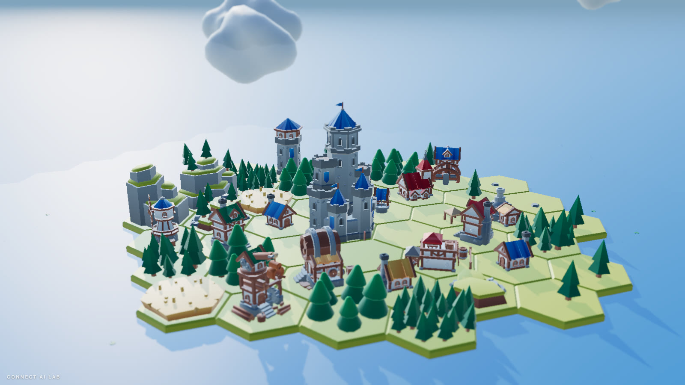

# 01 Miniature world



A hex island village that slowly turns. The windmill, the water wheel and the saw run on keyframe clips, clouds drift, a tilt-shift blur makes it look tiny.

[preview.mp4](preview.mp4)

## Say this to your AI

> Make a tiny village on a little island. The windmill and the water wheel turn, clouds drift by, and the whole island slowly spins like a miniature.

## 한국어로는 이렇게 말해요

> 작은 섬 위에 미니어처 마을을 만들어 줘. 풍차랑 물레방아는 돌아가고 구름은 흘러가고, 섬 전체가 천천히 돌게 해 줘.

천천히 도는 육각 섬 마을이에요. 풍차, 물레방아, 톱이 키프레임 애니메이션으로 돌아가고 구름이 흘러가요. 위아래를 살짝 흐리게 해서 진짜 미니어처처럼 보여요.

## Run it

```bash
npx github:wonseokjung/connect-ai-three example miniature-world
```

Make it a video (MP4 H.264, BT.709, frame-exact, 1920x1080; add `--9x16` for a vertical one, `--4k` for 3840x2160):

```bash
npx github:wonseokjung/connect-ai-three example miniature-world --video miniature-world.mp4
```

Your own copy to change (three.js then comes from a pinned CDN, so any static server works):

```bash
npx github:wonseokjung/connect-ai-three example miniature-world --copy my-miniature-world
```

## Where it comes from

- [three.js example webgl_animation_keyframes](https://threejs.org/examples/#webgl_animation_keyframes) (MIT): the page: Sky + PMREM light, GLTFLoader, AnimationMixer, OrbitControls
- [three.js addons HorizontalTiltShiftShader / VerticalTiltShiftShader](https://github.com/mrdoob/three.js/tree/dev/examples/jsm/shaders) (MIT): the miniature blur
- [KayKit Medieval Hexagon Pack 1.0 by Kay Lousberg](https://kaylousberg.com/game-assets/medieval-hexagon-pack-free) (CC0-1.0): every tile, building, tree and cloud (assets/)

The official example uses the Littlest Tokyo model (CC BY 4.0). It is not used here.

The full credits are in [NOTICE.md](../../NOTICE.md).
