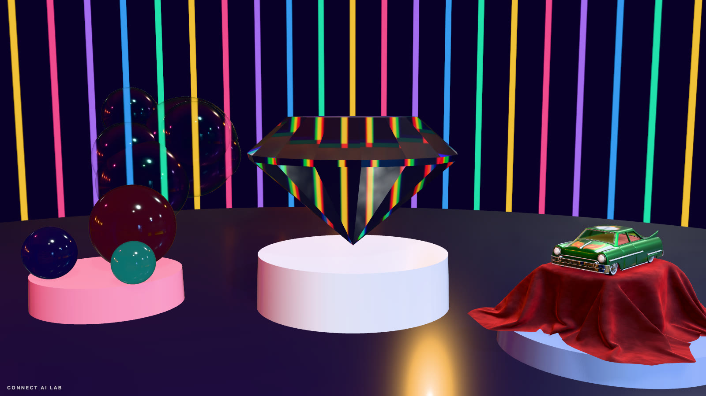

# 02 Glass, rainbow and soap film



A cut crystal splits light into a rainbow, thick glass orbs bend the stripes behind them, soap bubbles shimmer, and a real glTF toy car shows clearcoat, sheen and a glass dome.

[preview.mp4](preview.mp4)

## Say this to your AI

> Show my product like glass: a crystal that splits light into a rainbow, glass marbles that bend what is behind them, and soap bubbles floating around. Make it slowly turn.

## 한국어로는 이렇게 말해요

> 내 제품을 유리처럼 보여 줘. 빛이 무지개로 갈라지는 보석, 뒤가 휘어 보이는 유리구슬, 주변에 둥둥 떠다니는 비눗방울까지. 천천히 돌아가게.

보석이 빛을 무지갯빛으로 가르고, 두꺼운 유리구슬 너머로 뒤쪽 줄무늬가 휘어 보이고, 비눗방울이 반짝여요. glTF 장난감 자동차 모델에는 코팅 페인트, 천 질감, 유리 돔이 다 들어 있어요.

## Run it

```bash
npx github:wonseokjung/connect-ai-three example glass-materials
```

Make it a video (MP4 H.264, BT.709, frame-exact, 1920x1080; add `--9x16` for a vertical one, `--4k` for 3840x2160):

```bash
npx github:wonseokjung/connect-ai-three example glass-materials --video glass-materials.mp4
```

Your own copy to change (three.js then comes from a pinned CDN, so any static server works):

```bash
npx github:wonseokjung/connect-ai-three example glass-materials --copy my-glass-materials
```

## Where it comes from

- [three.js example webgl_loader_gltf_dispersion](https://threejs.org/examples/#webgl_loader_gltf_dispersion) (MIT): dispersion on MeshPhysicalMaterial, NeutralToneMapping
- [three.js example webgl_materials_physical_transmission](https://threejs.org/examples/#webgl_materials_physical_transmission) (MIT): transmission, thickness, ior
- [three.js example webgl_loader_gltf_iridescence](https://threejs.org/examples/#webgl_loader_gltf_iridescence) (MIT): iridescence on a clear shell
- [Khronos glTF Sample Assets: ToyCar (Guido Odendahl, Eric Chadwick)](https://github.com/KhronosGroup/glTF-Sample-Assets/tree/main/Models/ToyCar) (CC0-1.0): assets/toy-car.glb
- [Poly Haven: Colorful Studio HDRI (Sergej Majboroda)](https://polyhaven.com/a/colorful_studio) (CC0-1.0): assets/colorful_studio_1k.hdr

The official examples use DispersionTest and IridescenceLamp (CC BY 4.0). They are not used here.

The full credits are in [NOTICE.md](../../NOTICE.md).
