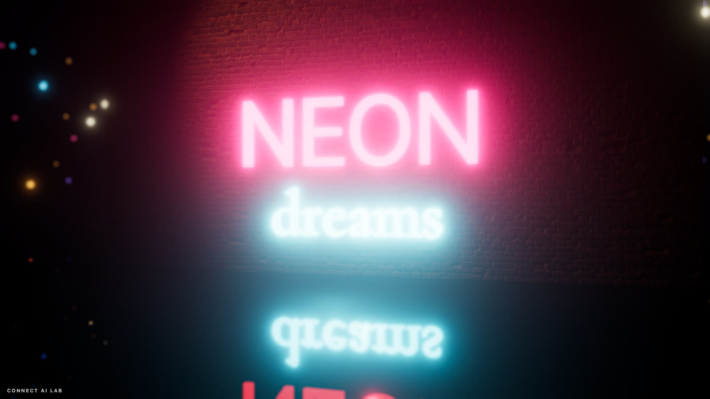

# 03 Neon text and post effects



3D letters switch on one by one like real neon tubes, the wet street reflects them, and the city behind melts into bokeh. Bloom and depth of field are post effects on top of the render.

[preview.mp4](preview.mp4)

## Say this to your AI

> Make my shop name in 3D neon letters that switch on one by one, glowing on a dark wall, reflected on a wet street, with the city lights behind out of focus.

## 한국어로는 이렇게 말해요

> 우리 가게 이름을 3D 네온 글자로 만들어 줘. 글자가 하나씩 켜지면서 빛나고, 젖은 바닥에 비치고, 뒤쪽 도시 불빛은 초점이 흐려지게 해 줘.

3D 글자가 진짜 네온관처럼 하나씩 켜지고, 젖은 바닥에 비치고, 뒤쪽 도시 불빛은 동그랗게 흐려져요. 빛 번짐이랑 초점 흐림은 렌더링한 화면 위에 얹는 후처리 효과예요.

## Run it

```bash
npx github:wonseokjung/connect-ai-three example neon-text
```

Make it a video (MP4 H.264, BT.709, frame-exact, 1920x1080; add `--9x16` for a vertical one, `--4k` for 3840x2160):

```bash
npx github:wonseokjung/connect-ai-three example neon-text --video neon-text.mp4
```

Your own copy to change (three.js then comes from a pinned CDN, so any static server works):

```bash
npx github:wonseokjung/connect-ai-three example neon-text --copy my-neon-text
```

## Where it comes from

- [three.js example webgl_postprocessing_unreal_bloom](https://threejs.org/examples/#webgl_postprocessing_unreal_bloom) (MIT): EffectComposer, UnrealBloomPass, OutputPass
- [three.js example webgl_geometry_text](https://threejs.org/examples/#webgl_geometry_text) (MIT): FontLoader, TextGeometry with bevel
- [three.js example webgl_postprocessing_dof](https://threejs.org/examples/#webgl_postprocessing_dof) (MIT): BokehPass depth of field
- [three.js addons Reflector](https://threejs.org/examples/#webgl_mirror) (MIT): the wet street
- [typeface subsets of Pretendard and Cormorant Garamond (in this kit)](https://github.com/wonseokjung/connect-ai-three/blob/main/licenses/fonts-OFL.txt) (OFL-1.1): assets/*.typeface.json, licence text in assets/LICENSE-fonts-OFL.txt
- [Poly Haven: Brick Wall 006 (Jan Burghardt)](https://polyhaven.com/a/brick_wall_006) (CC0-1.0): assets/brick_*_1k.jpg, made smaller

The bloom example's ion drive model is not used.

The full credits are in [NOTICE.md](../../NOTICE.md).
