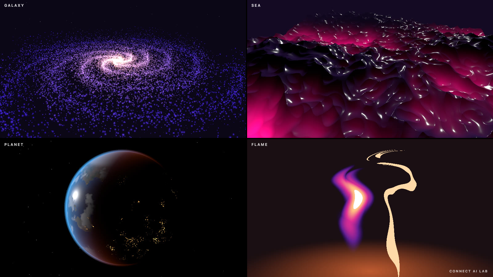

# 04 Shader worlds: galaxy, sea, planet, flame



Four things drawn only by shaders, side by side: a spiral galaxy of 40,000 sprites, a stormy sea, a planet with day, night, clouds and city lights, and two candle flames. No image files. Click a panel to open it full screen.

[preview.mp4](preview.mp4)

## Say this to your AI

> Make a spiral galaxy, a stormy sea, a planet with city lights on the night side and a candle flame, all with shaders and no image files. Put them in four panels.

## 한국어로는 이렇게 말해요

> 소용돌이 은하, 거친 바다, 밤이 된 쪽에 도시 불빛이 켜지는 행성, 흔들리는 촛불을 셰이더로만 만들어 줘. 이미지 파일 없이, 네 칸으로 나눠서.

셰이더로만 그린 네 장면을 한 화면에 모았어요. 스프라이트 4만 개짜리 은하, 거친 바다, 낮과 밤에 구름이랑 도시 불빛까지 있는 행성, 그리고 촛불 두 개예요. 이미지 파일은 하나도 없어요. 칸을 누르면 크게 보여요.

## Run it

```bash
npx github:wonseokjung/connect-ai-three example shader-worlds
```

Your own copy to change (three.js then comes from a pinned CDN, so any static server works):

```bash
npx github:wonseokjung/connect-ai-three example shader-worlds --copy my-shader-worlds
```

## Where it comes from

- [three.js example webgpu_tsl_galaxy](https://threejs.org/examples/#webgpu_tsl_galaxy) (MIT): the galaxy, as it is, with more arms and stars
- [three.js example webgpu_tsl_raging_sea](https://threejs.org/examples/#webgpu_tsl_raging_sea) (MIT): the sea, as it is
- [three.js example webgpu_tsl_earth](https://threejs.org/examples/#webgpu_tsl_earth) (MIT): day and night mix, fresnel atmosphere; the photo maps are replaced by noise
- [three.js example webgpu_tsl_vfx_flames](https://threejs.org/examples/#webgpu_tsl_vfx_flames) (MIT): both flame shaders; the noise images are replaced by MaterialX noise nodes

The Earth example's day, night and cloud photos are CC BY 4.0 and are not used. The flame example's noise images are not used.

The full credits are in [NOTICE.md](../../NOTICE.md).
