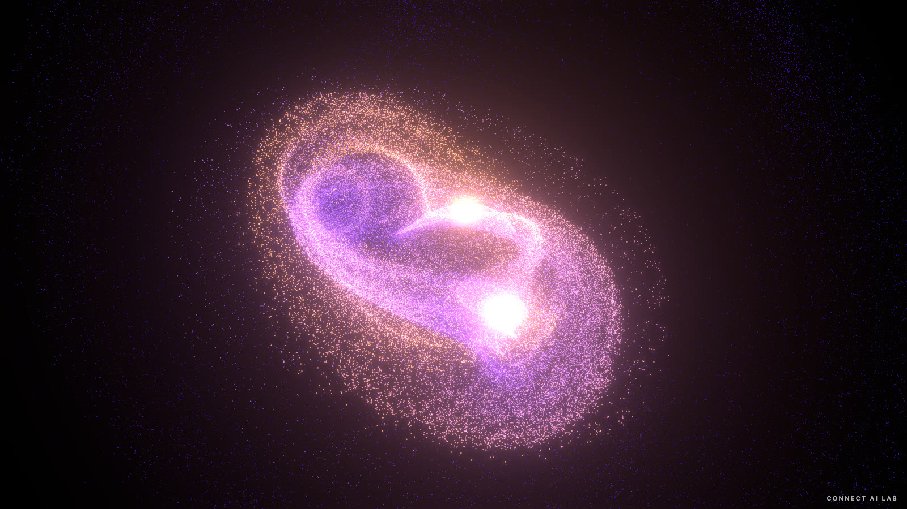

# 05 260,000 particles



262,144 particles pulled around three invisible attractors, computed on the graphics card every frame. Faster ones turn from violet to peach. Press G and drag the rings to move the attractors.

[preview.mp4](preview.mp4)

## Say this to your AI

> Make hundreds of thousands of particles that swirl around invisible magnets, computed on the GPU, glowing violet to peach as they speed up. Let me drag the magnets.

## 한국어로는 이렇게 말해요

> 입자 수십만 개가 보이지 않는 자석을 따라 소용돌이치게 만들어 줘. GPU로 계산하고, 빨라질수록 보라색에서 복숭아색으로 빛나게. 자석은 내가 끌어서 옮길 수 있게.

입자 262,144개가 보이지 않는 자석 세 개를 따라 돌아요. 이걸 매 프레임 그래픽 카드가 계산해요. 빨라질수록 보라색에서 복숭아색으로 바뀌어요. G 키를 누르고 고리를 끌면 자석이 움직여요.

## Run it

```bash
npx github:wonseokjung/connect-ai-three example particles
```

Your own copy to change (three.js then comes from a pinned CDN, so any static server works):

```bash
npx github:wonseokjung/connect-ai-three example particles --copy my-particles
```

## Where it comes from

- [three.js example webgpu_tsl_compute_attractors_particles](https://threejs.org/examples/#webgpu_tsl_compute_attractors_particles) (MIT): the whole simulation and its look, almost unchanged
- [three.js example webgpu_postprocessing_bloom](https://threejs.org/examples/#webgpu_postprocessing_bloom) (MIT): RenderPipeline + bloom

The full credits are in [NOTICE.md](../../NOTICE.md).
