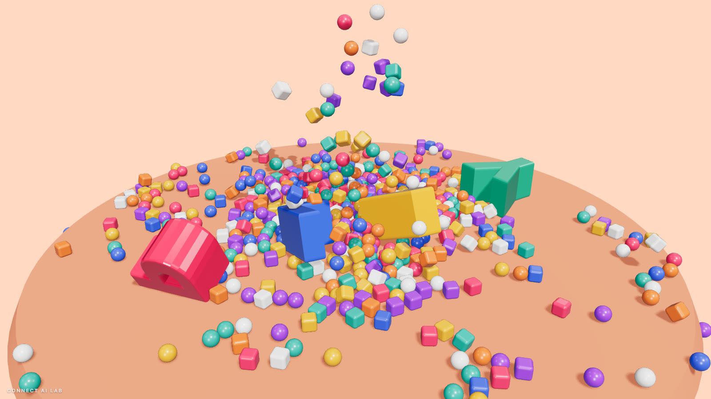

# 06 Real physics



Big 3D letters drop and bounce, then 600 candy balls and blocks pour down on them and keep pouring. Every piece is a Rapier rigid body. Double-click to shake it all up.

[preview.mp4](preview.mp4)

## Say this to your AI

> Make my logo letters fall from above and bounce on the floor, then pour hundreds of colourful balls and blocks on them with real physics. Double-click shakes everything.

## 한국어로는 이렇게 말해요

> 내 로고 글자들이 위에서 떨어져서 바닥에 부딪혀 튕기게 해 줘. 그 위로 알록달록한 공이랑 블록 수백 개가 진짜 물리 법칙대로 쏟아지고, 더블클릭하면 다 튀어 오르게.

큰 3D 글자가 떨어져서 튕기고, 그 위로 사탕 같은 공과 블록 600개가 계속 쏟아져요. 하나하나가 다 Rapier 물리 엔진으로 움직여요. 더블클릭하면 전부 튀어 올라요.

## Run it

```bash
npx github:wonseokjung/connect-ai-three example physics
```

Your own copy to change (three.js then comes from a pinned CDN, so any static server works):

```bash
npx github:wonseokjung/connect-ai-three example physics --copy my-physics
```

## Where it comes from

- [three.js example physics_rapier_instancing](https://threejs.org/examples/#physics_rapier_instancing) (MIT): instanced bodies, recycling from the top, the shake impulse; the collider shapes follow three's RapierPhysics addon
- [Rapier (@dimforge/rapier3d-compat 0.21.0)](https://github.com/dimforge/rapier) (Apache-2.0): the physics engine, loaded from the kit's node_modules
- [three.js addons TextGeometry, RoundedBoxGeometry, RoomEnvironment](https://github.com/mrdoob/three.js/tree/dev/examples/jsm) (MIT): letters, blocks, reflections
- [typeface subset of Pretendard Bold (in this kit)](https://github.com/wonseokjung/connect-ai-three/blob/main/licenses/fonts-OFL.txt) (OFL-1.1): assets/bold.typeface.json, licence text in assets/LICENSE-fonts-OFL.txt

The full credits are in [NOTICE.md](../../NOTICE.md).
