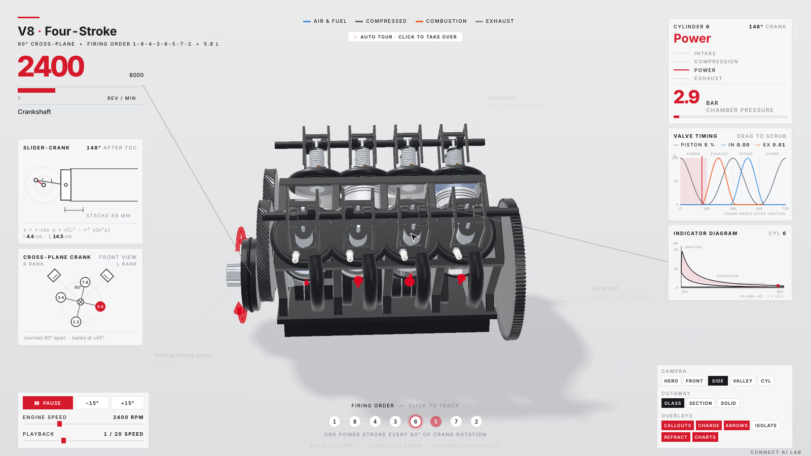

# 07 Machine teardown



A V8 engine built from code that you can take apart: cut it open, follow one cylinder through its four strokes, slow it down, switch camera views. Left alone, it gives itself a guided tour.

[preview.mp4](preview.mp4)

## Say this to your AI

> Make an interactive V8 engine I can take apart. Cut it open, show the four strokes of one cylinder, let me change the speed and the camera, and play a guided tour when I leave it alone.

## 한국어로는 이렇게 말해요

> 분해해 볼 수 있는 V8 엔진 시뮬레이터 만들어 줘. 단면으로 잘라서 실린더 하나가 네 박자로 움직이는 걸 보여 주고, 속도랑 카메라도 바꿀 수 있게 해 줘. 가만히 두면 자동 투어가 돌아가게 해 줘.

코드로 만든 V8 엔진을 분해해 보는 시뮬레이터예요. 단면으로 잘라 보고, 실린더 하나가 네 박자로 움직이는 걸 따라가고, 속도를 늦추거나 카메라도 바꿀 수 있어요. 가만히 두면 자동으로 투어가 돌아가요.

## Run it

```bash
npx github:wonseokjung/connect-ai-three example teardown
```

Make it a video (MP4 H.264, BT.709, frame-exact, 1920x1080; add `--9x16` for a vertical one, `--4k` for 3840x2160):

```bash
npx github:wonseokjung/connect-ai-three example teardown --video teardown.mp4
```

Your own copy to change (three.js then comes from a pinned CDN, so any static server works):

```bash
npx github:wonseokjung/connect-ai-three example teardown --copy my-teardown
```

## Where it comes from

- [elvarofficial/teardown, V8 four-stroke live page (sims/kit, sims/v8-shared, sims/v8-live)](https://github.com/elvarofficial/teardown) (MIT): the whole simulator: engine geometry, kinematics, cutaway, HUD, auto tour (kit/, v8/)
- [Inter by The Inter Project Authors](https://github.com/rsms/inter) (OFL-1.1): HUD typeface (assets/fonts)
- [JetBrains Mono by The JetBrains Mono Project Authors](https://github.com/JetBrains/JetBrainsMono) (OFL-1.1): HUD numbers typeface (assets/fonts)

The full credits are in [NOTICE.md](../../NOTICE.md).
