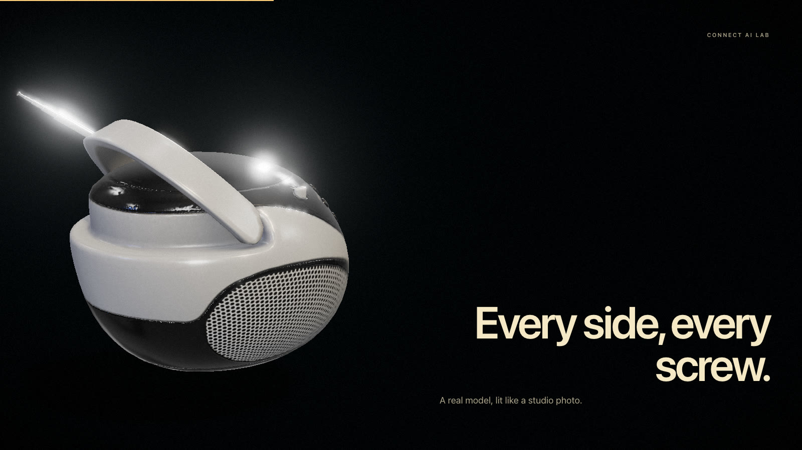

# 08 Scroll website



A product page with a real 3D speaker behind the text. As you scroll, it turns, moves to the other side and lights up on the beat; the background colour changes with each section.

[preview.mp4](preview.mp4)

## Say this to your AI

> Make a product landing page where a 3D speaker sits behind the text. When I scroll, it turns, moves to the other side of the page and its front glows to a beat.

## 한국어로는 이렇게 말해요

> 글 뒤에 3D 스피커가 떠 있는 제품 소개 페이지 만들어 줘. 스크롤하면 스피커가 돌면서 반대편으로 옮겨 가고, 앞면이 박자에 맞춰 빛나게 해 줘.

글 뒤에 진짜 3D 스피커가 있는 제품 페이지예요. 스크롤하면 스피커가 돌고, 반대편으로 옮겨 가고, 박자에 맞춰 불이 들어와요. 섹션마다 배경색도 바뀌어요.

## Run it

```bash
npx github:wonseokjung/connect-ai-three example scroll-site
```

Your own copy to change (three.js then comes from a pinned CDN, so any static server works):

```bash
npx github:wonseokjung/connect-ai-three example scroll-site --copy my-scroll-site
```

## Where it comes from

- [tsogjavklann/awwwards-3d, coin-scroll template](https://github.com/tsogjavklann/awwwards-3d) (MIT): the page: fixed canvas behind HTML sections, warm three-point light, shadow floor, bloom + vignette + grain, damped scroll values
- [Khronos glTF Sample Assets, BoomBox by Microsoft](https://github.com/KhronosGroup/glTF-Sample-Assets/tree/main/Models/BoomBox) (CC0-1.0): the speaker (assets/boombox.glb, textures resized to 1024 px)

The template uses GSAP (its own non-MIT licence) and Lenis; here the scroll is read with plain JavaScript, so there is nothing extra to install.

The full credits are in [NOTICE.md](../../NOTICE.md).
