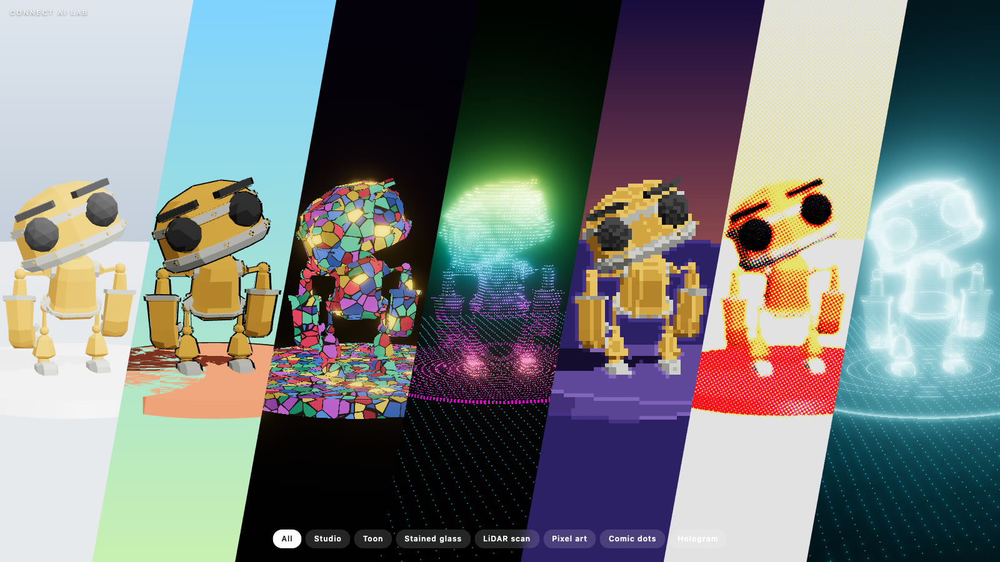

# 09 One scene, many styles



The same dancing robot on the same stage, drawn seven ways: studio, toon, stained glass, LiDAR scan, pixel art, comic dots and hologram. First all side by side, then one at a time.

[preview.mp4](preview.mp4)

## Say this to your AI

> Show my dancing robot in seven styles: studio, toon, stained glass, LiDAR scan, pixel art, comic dots and hologram. First all side by side in slanted strips, then one at a time, with buttons to pick a style.

## 한국어로는 이렇게 말해요

> 춤추는 로봇을 일곱 가지 스타일로 보여 줘. 스튜디오, 툰, 스테인드글라스, 라이다 스캔, 픽셀 아트, 만화 망점, 홀로그램. 처음엔 화면을 비스듬하게 나눠서 나란히 보여 주고, 그다음엔 하나씩 버튼으로 고를 수 있게 해 줘.

같은 무대에서 춤추는 로봇 하나를 일곱 가지 스타일로 그려요. 스튜디오, 툰, 스테인드글라스, 라이다 스캔, 픽셀 아트, 만화 망점, 홀로그램이에요. 처음엔 나란히, 그다음엔 하나씩 보여 줘요.

## Run it

```bash
npx github:wonseokjung/connect-ai-three example many-styles
```

Your own copy to change (three.js then comes from a pinned CDN, so any static server works):

```bash
npx github:wonseokjung/connect-ai-three example many-styles --copy my-many-styles
```

## Where it comes from

- [three.js example webgl_animation_skinning_morph](https://threejs.org/examples/#webgl_animation_skinning_morph) (MIT): the robot, its Dance clip, AnimationMixer
- [three.js example webgl_materials_toon + OutlineEffect](https://threejs.org/examples/#webgl_materials_toon) (MIT): toon shading with a 3-step gradient map and outlines
- [three.js example webgl_postprocessing_pixel (RenderPixelatedPass)](https://threejs.org/examples/#webgl_postprocessing_pixel) (MIT): pixel art look
- [three.js addons HalftonePass, UnrealBloomPass](https://github.com/mrdoob/three.js/tree/dev/examples/jsm/postprocessing) (MIT): comic dots, glow
- [RobotExpressive by Tomas Laulhe (Quaternius), morphs by Don McCurdy](https://github.com/mrdoob/three.js/tree/dev/examples/models/gltf/RobotExpressive) (CC0-1.0): the robot (assets/robot.glb)
- stained glass, LiDAR and hologram shader patches (made for this kit): written for this kit

The full credits are in [NOTICE.md](../../NOTICE.md).
