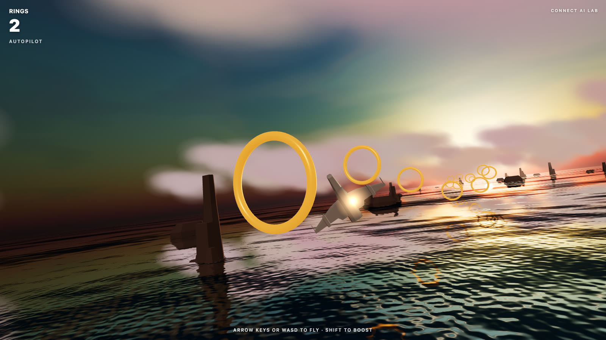

# 10 Flight game



Fly a jet over a sunset sea and through golden rings. Arrow keys or WASD steer, Shift boosts; leave the keys alone and the autopilot flies for you.

[preview.mp4](preview.mp4)

## Say this to your AI

> Make a flight game over a sunset sea: fly a jet through golden rings, count the score, and let an autopilot fly when I don't touch the keys.

## 한국어로는 이렇게 말해요

> 노을 지는 바다 위 링을 통과하는 비행 게임 만들어 줘. 링을 지나가면 점수가 오르고, 키를 안 누르면 자동 조종으로 날게 해 줘.

노을 지는 바다 위를 날면서 금색 링을 통과하는 게임이에요. 방향키나 WASD로 조종하고 Shift로 가속해요. 키에서 손을 떼면 자동 조종으로 알아서 날아가요.

## Run it

```bash
npx github:wonseokjung/connect-ai-three example flight-game
```

Make it a video (MP4 H.264, BT.709, frame-exact, 1920x1080; add `--9x16` for a vertical one, `--4k` for 3840x2160):

```bash
npx github:wonseokjung/connect-ai-three example flight-game --video flight-game.mp4
```

Your own copy to change (three.js then comes from a pinned CDN, so any static server works):

```bash
npx github:wonseokjung/connect-ai-three example flight-game --copy my-flight-game
```

## Where it comes from

- [three.js example webgl_shaders_ocean](https://threejs.org/examples/#webgl_shaders_ocean) (MIT): Water and Sky objects, the shared sun, sky lighting with PMREMGenerator
- [Spaceship by Quaternius (via Poly Pizza)](https://poly.pizza/m/DbGajMHrvp) (CC0-1.0): the jet (assets/jet.glb)
- [Kenney Nature Kit](https://kenney.nl/assets/nature-kit) (CC0-1.0): rocks used as sea stacks (assets/rock_*.glb)

The official example's waternormals.jpg is not used; the normal map is drawn in code.

The full credits are in [NOTICE.md](../../NOTICE.md).
