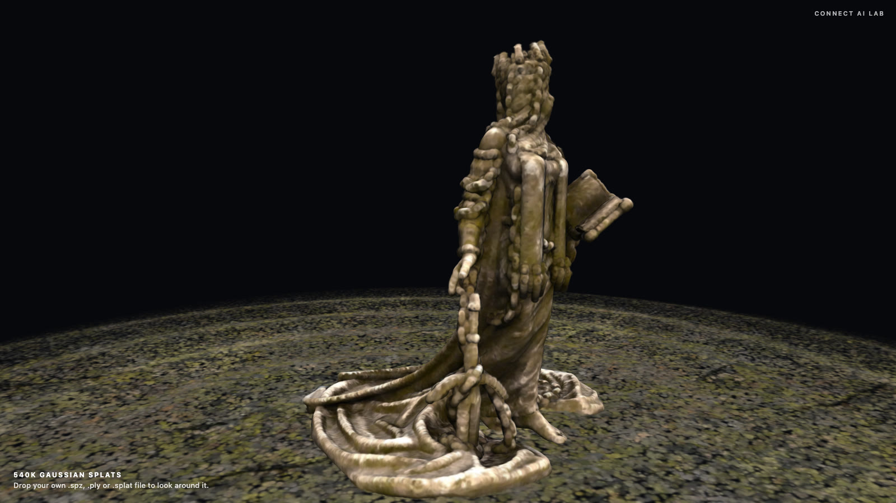

# 11 Gaussian splats



A photoscanned statue shown the way phone and drone scans are shown on the web: as 540k soft coloured splats, with a sweeping reveal. Drop your own .spz, .ply or .splat capture to look around it.

[preview.mp4](preview.mp4)

## Say this to your AI

> Show a 3D scan as Gaussian splats on a web page with a magic reveal effect, let me orbit around it, and let me drop my own phone scan file to view it.

## 한국어로는 이렇게 말해요

> 내가 폰으로 찍은 3D 스캔을 웹에서 둘러보게 해 줘. 가우시안 스플랫으로 보여 주고, 처음엔 마법처럼 나타나게 해 줘. 내 파일을 끌어다 놓으면 바로 보여 주고.

폰이나 드론으로 찍은 3D 스캔을 웹에 올리는 방식 그대로예요. 사진으로 스캔한 석상을 54만 개의 부드러운 점(스플랫)으로 보여 줘요. 처음에 스르륵 드러나는 효과가 있고, 내 스캔 파일(.spz, .ply, .splat)을 끌어다 놓으면 바로 둘러볼 수 있어요.

## Run it

```bash
npx github:wonseokjung/connect-ai-three example gaussian-splat
```

Make it a video (MP4 H.264, BT.709, frame-exact, 1920x1080; add `--9x16` for a vertical one, `--4k` for 3840x2160):

```bash
npx github:wonseokjung/connect-ai-three example gaussian-splat --video gaussian-splat.mp4
```

Your own copy to change (three.js then comes from a pinned CDN, so any static server works):

```bash
npx github:wonseokjung/connect-ai-three example gaussian-splat --copy my-gaussian-splat
```

## Where it comes from

- [Spark by World Labs (@sparkjsdev/spark 2.4.0)](https://github.com/sparkjsdev/spark) (MIT): the splat renderer (lib/spark/spark.module.min.js), constructSplats from the procedural-splats example, the Magic reveal from the splat-reveal-effects example
- [Poly Haven, Gothic Statue](https://polyhaven.com/a/gothic_statue) (CC0-1.0): the photoscan the statue splats are sampled from (assets/gothic_statue.*, texture resized to 1k)
- [Poly Haven, Mossy Rock](https://polyhaven.com/a/mossy_rock) (CC0-1.0): ground colour (assets/mossy_rock_diff_512.jpg)

Spark's own demo captures are not used here; the splats are made in the browser from a CC0 photoscan.

The full credits are in [NOTICE.md](../../NOTICE.md).
