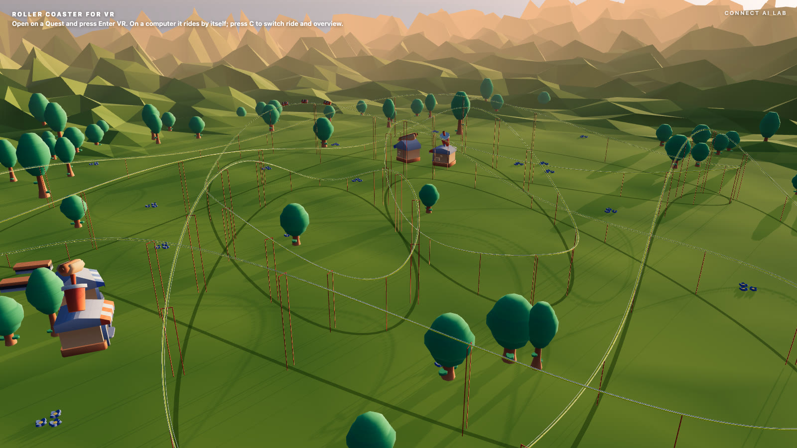

# 12 XR roller coaster



A roller coaster at sunset that you ride in VR. On a Meta Quest press Enter VR and you sit in the front car; on a computer it rides along on screen, and C shows the whole park.

[preview.mp4](preview.mp4)

## Say this to your AI

> Make a roller coaster ride at sunset that I can ride in VR on my Quest, sitting in the front car, with trees and food stalls around the park.

## 한국어로는 이렇게 말해요

> 퀘스트에서 타 볼 수 있게 VR 롤러코스터로 만들어 줘. 노을 지는 공원에 나무랑 매점이 있고, 맨 앞 칸에 앉아서 타게 해 줘.

노을 속 롤러코스터를 VR로 타요. 메타 퀘스트에서 Enter VR을 누르면 맨 앞 칸에 앉아요. 컴퓨터에서는 화면으로 바로 타 볼 수 있고, C 키를 누르면 공원 전체가 보여요.

## Run it

```bash
npx github:wonseokjung/connect-ai-three example xr
```

Make it a video (MP4 H.264, BT.709, frame-exact, 1920x1080; add `--9x16` for a vertical one, `--4k` for 3840x2160):

```bash
npx github:wonseokjung/connect-ai-three example xr --video xr.mp4
```

Your own copy to change (three.js then comes from a pinned CDN, so any static server works):

```bash
npx github:wonseokjung/connect-ai-three example xr --copy my-xr
```

## Where it comes from

- [three.js example webxr_vr_rollercoaster](https://threejs.org/examples/#webxr_vr_rollercoaster) (MIT): track curve, RollerCoaster geometries, speed and banking, VRButton and 'local' reference space
- [three.js example webgl_shaders_sky (Sky)](https://threejs.org/examples/#webgl_shaders_sky) (MIT): sunset sky and its light
- [Kenney Coaster Kit](https://kenney.nl/assets/coaster-kit) (CC0-1.0): cars, station, trees, flowers, food and drink stalls (assets/)

The full credits are in [NOTICE.md](../../NOTICE.md).
