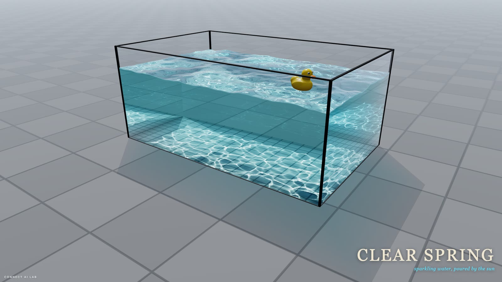

# 13 Caustic water for a drink page



A glass tank of water on a tiled floor. Sunlight goes through the moving surface, bends and gathers into the bright net of lines you see on the bottom of a pool. A rubber duck bobs and makes a wake, a click makes a ripple, and a lamp lights it at night. One HTML file, no model or texture files, adapted from Scottie's CAUSTIC//LITE.

[preview.mp4](preview.mp4) · [preview-9x16.mp4](preview-9x16.mp4)

## Say this to your AI

> Make the hero of my sparkling water page: a glass tank of water where sunlight draws moving caustics on the floor, a rubber duck bobbing on the surface, ripples where I click, and my brand name on the right.

## 한국어로는 이렇게 말해요

> 우리 탄산수 페이지 첫 화면을 만들어 줘. 유리 수조 속 물에 햇빛이 비쳐서 바닥에 물빛 무늬가 일렁이고, 고무 오리가 둥둥 떠 있고, 클릭하면 물결이 퍼지고, 오른쪽에 우리 브랜드 이름이 있게 해 줘.

타일 바닥 위 유리 수조예요. 햇빛이 움직이는 물결을 지나며 꺾이고 모여서, 수영장 바닥에서 보는 밝은 빛 그물을 그려요. 고무 오리가 떠다니며 물결을 만들고, 클릭하면 파문이 생기고, 밤에는 램프로 비춰요. 모델이나 텍스처 파일 없이 HTML 한 파일이에요. Scottie 의 CAUSTIC//LITE 를 옮겼어요.

## Run it

```bash
npx github:wonseokjung/connect-ai-three example caustic-water
```

Make it a video (MP4 H.264, BT.709, frame-exact, 1920x1080; add `--9x16` for a vertical one, `--4k` for 3840x2160):

```bash
npx github:wonseokjung/connect-ai-three example caustic-water --video caustic-water.mp4
```

Your own copy to change (three.js then comes from a pinned CDN, so any static server works):

```bash
npx github:wonseokjung/connect-ai-three example caustic-water --copy my-caustic-water
```

## Where it comes from

- [CAUSTIC//LITE by Scottie (ScottieFox/caustic-volume)](https://github.com/ScottieFox/caustic-volume) (MIT): lite/index.html: the random sea, the GPU ripple simulation, the rubber duck, caustics, the CPU fallback and the panel, kept as written
- [three.js (GPUComputationRenderer, OrbitControls)](https://threejs.org) (MIT): the renderer and addons, from the kit

Only the CDN import map changed (the kit serves three.js 0.187), plus a product line on the right. Nothing was taken out.

The full credits are in [NOTICE.md](../../NOTICE.md).
