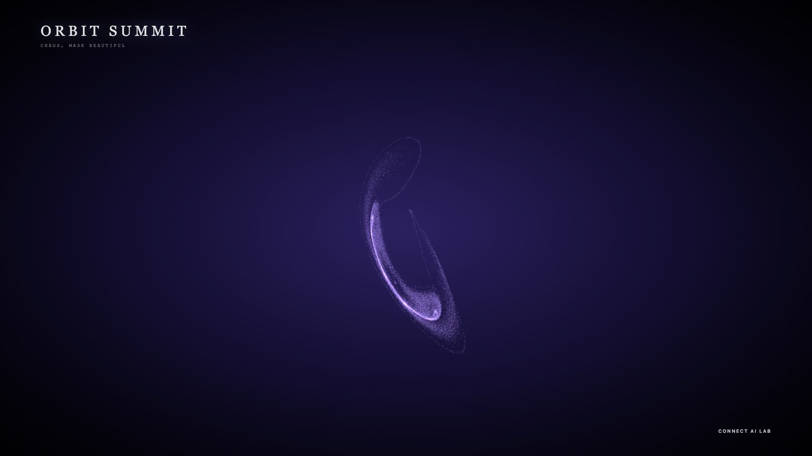

# 15 65,536 particles morphing between attractors



65,536 glowing particles, computed on the GPU, flow along a strange attractor and slowly morph into the next one: Lorenz, Aizawa, Thomas and Halvorsen. They push away from the mouse, the view turns by itself, and sliders change speed, glow, size and hue. Adapted from Alexandru DAN's Particles gallery, as a stage background with an event name.

[preview.mp4](preview.mp4) · [preview-9x16.mp4](preview-9x16.mp4)

## Say this to your AI

> Make the stage background for my event: tens of thousands of glowing particles that flow along strange attractor shapes and slowly morph from one shape to the next, push away from my mouse, with the event name in the corner.

## 한국어로는 이렇게 말해요

> 우리 행사 무대 배경을 만들어 줘. 빛나는 입자 수만 개가 신비한 끌개 모양을 따라 흐르다가 천천히 다른 모양으로 바뀌고, 마우스를 대면 밀려나고, 구석에 행사 이름이 있게 해 줘.

GPU 에서 계산하는 빛나는 입자 65,536개가 이상한 끌개 모양을 따라 흐르다가 천천히 다음 모양으로 바뀌어요. 로렌츠, 아이자와, 토머스, 할보르센 순서예요. 마우스를 대면 입자가 밀려나고, 화면은 저절로 돌고, 슬라이더로 속도, 빛 번짐, 크기, 색을 바꿔요. Alexandru DAN 의 Particles 갤러리 작품을 행사 무대 배경으로 옮겼어요.

## Run it

```bash
npx github:wonseokjung/connect-ai-three example attractor-particles
```

Make it a video (MP4 H.264, BT.709, frame-exact, 1920x1080; add `--9x16` for a vertical one, `--4k` for 3840x2160):

```bash
npx github:wonseokjung/connect-ai-three example attractor-particles --video attractor-particles.mp4
```

Your own copy to change (three.js then comes from a pinned CDN, so any static server works):

```bash
npx github:wonseokjung/connect-ai-three example attractor-particles --copy my-attractor-particles
```

## Where it comes from

- [Attractor Morph from Particles by Alexandru DAN (danlex/particles)](https://github.com/danlex/particles) (MIT): attractor-morph.html: RK4 seeding, the GPU morph between Lorenz, Aizawa, Thomas and Halvorsen, bloom, mouse push, sliders; the vignette from shared-ui.js
- [three.js (GPUComputationRenderer, UnrealBloomPass, OrbitControls)](https://threejs.org) (MIT): the renderer and addons, from the kit

shared-ui.js (the gallery's share, embed, video export and audio panel) and the link back to the gallery are left out; an event name replaces the page title.

The full credits are in [NOTICE.md](../../NOTICE.md).
