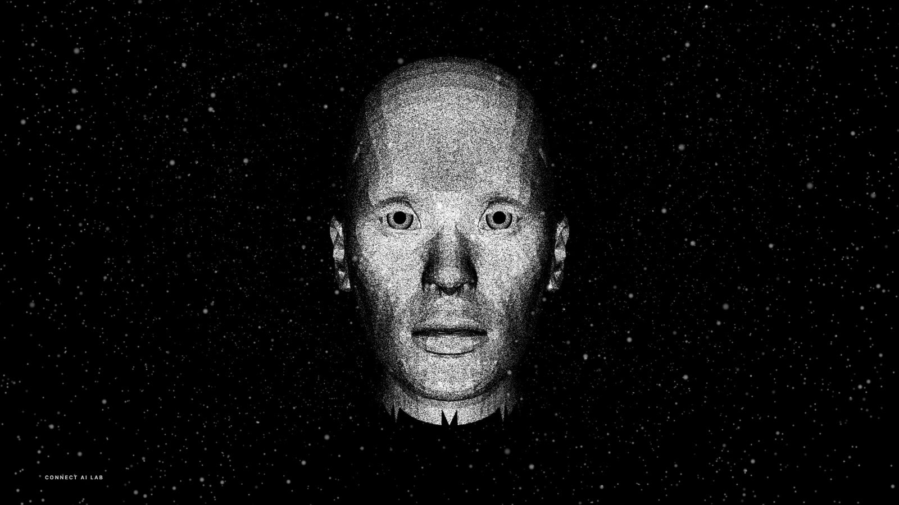

# 16 A talking AI assistant face made of light



A human head drawn as a cloud of glowing points that blinks, looks around and moves its lips to what it says. The mouth follows visemes (the shapes lips make for each sound) on a CC0 head model. Here it talks by itself without a voice server: each line turns into visemes from its letters and shows as a caption. Adapted from ptakaya's Claude Face (CC0), as the face of a shop assistant.

[preview.mp4](preview.mp4) · [preview-9x16.mp4](preview-9x16.mp4)

## Say this to your AI

> Give my shop's AI assistant a face: a human head made of glowing particles that blinks, looks around and moves its lips while it talks, with what it says as a caption underneath, and let me drag to turn it.

## 한국어로는 이렇게 말해요

> 우리 가게 AI 비서에게 얼굴을 만들어 줘. 빛나는 입자로 된 사람 얼굴이 눈을 깜빡이고 두리번거리고, 말할 때 입술이 움직이고, 아래에 하는 말이 자막으로 나오고, 마우스로 끌어서 돌려 볼 수 있게 해 줘.

빛나는 점 구름으로 그린 사람 얼굴이 눈을 깜빡이고, 두리번거리고, 말하는 대로 입술을 움직여요. 입 모양은 CC0 머리 모델의 비즘(소리마다 입술이 만드는 모양)을 따라가요. 여기서는 음성 서버 없이 혼자 말해요. 문장 글자로 비즘을 만들고 자막으로 보여 줘요. ptakaya 의 Claude Face(CC0)를 가게 상담 비서 얼굴로 옮겼어요.

## Run it

```bash
npx github:wonseokjung/connect-ai-three example ai-face
```

Make it a video (MP4 H.264, BT.709, frame-exact, 1920x1080; add `--9x16` for a vertical one, `--4k` for 3840x2160):

```bash
npx github:wonseokjung/connect-ai-three example ai-face --video ai-face.mp4
```

Your own copy to change (three.js then comes from a pinned CDN, so any static server works):

```bash
npx github:wonseokjung/connect-ai-three example ai-face --copy my-ai-face
```

## Where it comes from

- [Claude Face by ptakaya (ptakaya/claude-face), an unofficial community project](https://github.com/ptakaya/claude-face) (CC0-1.0): phase1/index.html and phase1/main.js: the particle sampling, viseme mouth, eyes, blinks, look panel and app chrome, kept as written
- [head-default.glb from Claude Face (MakeHuman base body + MPFB eyes, teeth and tongue)](https://github.com/ptakaya/claude-face/blob/main/ATTRIBUTION.md) (CC0-1.0): assets/head.glb, with its three textures taken out because the particles never read them
- [three.js (GLTFLoader, OrbitControls)](https://threejs.org) (MIT): the renderer and addons, from the kit

No voice engine (HeadTTS), no bridge and no Claude session: the page talks silently from its own letter-to-viseme reading and shows each line as a caption. The voice and bridge code is still there and starts only with its URL parameters (?ttsPort=, ?bridge=1). The head's unused textures were removed (5 MB to 1.9 MB).

The full credits are in [NOTICE.md](../../NOTICE.md).
