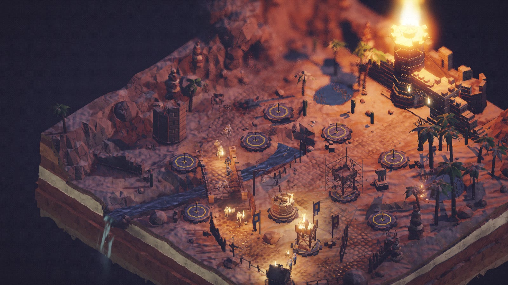

# 17 Tower defense with an AI commander



A 3D isometric tower defense that plays itself: an AI commander builds and upgrades towers against waves of monsters across five lands, and your first click puts you in charge. Every model, texture and sound is made by code.

[preview.mp4](preview.mp4) · [preview-9x16.mp4](preview-9x16.mp4)

## Say this to your AI

> Make a 3D tower defense game in the browser that an AI commander plays by itself from the moment the page opens, with towers, waves of monsters and a boss every fifth wave, and let me take over with one click.

## 한국어로는 이렇게 말해요

> 페이지를 열자마자 AI 사령관이 혼자 플레이하는 3D 타워 디펜스 게임을 만들어 줘. 탑이랑 몰려오는 몬스터, 다섯 번째 판마다 보스가 나오고, 내가 클릭 한 번 하면 내가 지휘하게 해 줘.

혼자서 돌아가는 3D 타워 디펜스예요. AI 사령관이 다섯 지역을 돌며 몰려오는 몬스터에 맞서 탑을 짓고 올려요. 내가 한 번 클릭하면 그때부터 내가 지휘해요. 모델, 텍스처, 소리가 전부 코드로 만들어져요.

## Run it

```bash
npx github:wonseokjung/connect-ai-three example tower-defense
```

Make it a video (MP4 H.264, BT.709, frame-exact, 1920x1080; add `--9x16` for a vertical one, `--4k` for 3840x2160):

```bash
npx github:wonseokjung/connect-ai-three example tower-defense --video tower-defense.mp4
```

Your own copy to change (three.js then comes from a pinned CDN, so any static server works):

```bash
npx github:wonseokjung/connect-ai-three example tower-defense --copy my-tower-defense
```

## Where it comes from

- [Cinderwatch by kevintngo](https://github.com/kevintngo/cinderwatch) (MIT): the whole game: src/*.js joined into main.js and src/shell.html as index.html, licence text in LICENSE-cinderwatch.txt
- [three.js](https://threejs.org) (MIT): loaded from the kit (0.187) through the import map instead of the vendored r170 copy

The repository's media/ folder (gameplay video and screenshots) is not copied.

The full credits are in [NOTICE.md](../../NOTICE.md).
