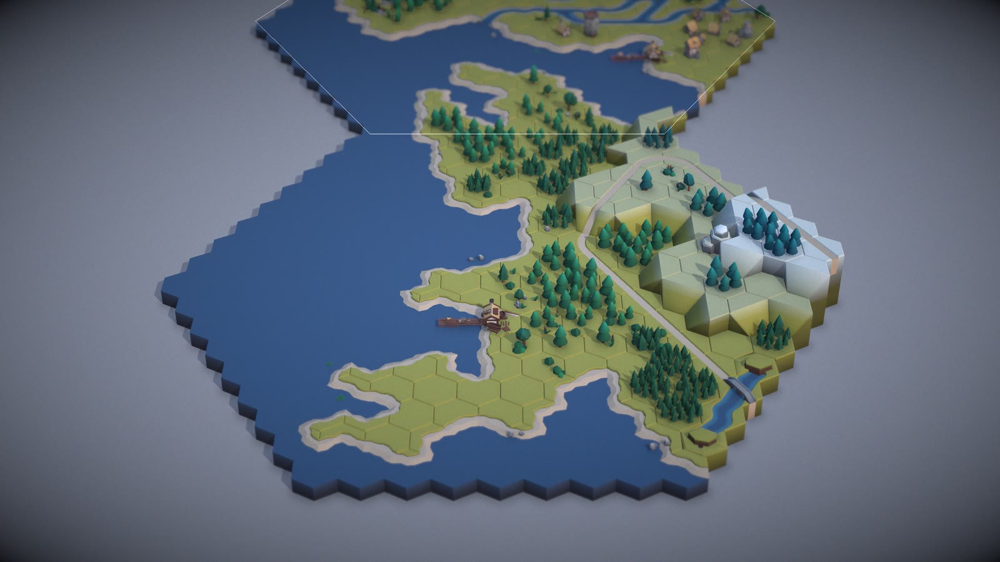

# 18 An island map that builds itself



Hexagon tiles drop in and lock together into an island with roads, rivers, villages, windmills and coast, solved by Wave Function Collapse. Click the cog on an empty plot and a new piece of island grows there; every load is a new island.

[preview.mp4](preview.mp4) · [preview-9x16.mp4](preview-9x16.mp4)

## Say this to your AI

> Make a little island map for our chain stores out of hexagon tiles that drop in and lock together by themselves, with roads, rivers, villages and windmills, and grow a new piece of island wherever I click.

## 한국어로는 이렇게 말해요

> 우리 체인점들이 있는 작은 섬 지도를 육각 타일로 만들어 줘. 타일이 떨어지면서 저절로 맞물리고, 길이랑 강, 마을, 풍차가 있고, 내가 누르는 곳마다 새 섬 조각이 자라나게 해 줘.

육각 타일이 떨어지며 맞물려서 길, 강, 마을, 풍차, 해안이 있는 섬이 돼요. 파동 함수 붕괴(WFC)라는 방법으로 타일 자리를 풀어요. 빈 자리의 톱니를 누르면 거기에 새 섬 조각이 자라고, 열 때마다 다른 섬이 나와요.

## Run it

```bash
npx github:wonseokjung/connect-ai-three example hex-island
```

Make it a video (MP4 H.264, BT.709, frame-exact, 1920x1080; add `--9x16` for a vertical one, `--4k` for 3840x2160):

```bash
npx github:wonseokjung/connect-ai-three example hex-island --video hex-island.mp4
```

Your own copy to change (three.js then comes from a pinned CDN, so any static server works):

```bash
npx github:wonseokjung/connect-ai-three example hex-island --copy my-hex-island
```

## Where it comes from

- [Hex Map WFC by Felix Turner](https://github.com/felixturner/hex-map-wfc) (MIT): the whole app in src/ (WFC solver, tiles, decorations, water, post effects), licence text in LICENSE-hex-map-wfc.txt
- [KayKit Medieval Hexagon Pack (Kay Lousberg)](https://kaylousberg.itch.io/kaykit-medieval-hexagon) (CC0-1.0): the tiles in assets/models/hex-terrain.glb and their colour atlases assets/textures/*.png, as packed in the Hex Map WFC repository
- [Poly Haven: Venice Sunset (Greg Zaal)](https://polyhaven.com/a/venice_sunset) (CC0-1.0): assets/hdr/venice_sunset_1k.hdr, the environment light
- [tween, sound stub and drawn textures (this kit)](https://github.com/wonseokjung/connect-ai-three) (made for this kit): src/lib/tween.js in place of GSAP, a silent src/lib/Sounds.js in place of howler.js and its mp3 files, src/lib/proceduralTextures.js in place of caustic.jpg and cog.png
- [three.js](https://threejs.org) (MIT): WebGPURenderer, TSL, GLTFLoader, HDRLoader, OrbitControls, CSS2DRenderer, lil-gui, from the kit (0.187)

Left out: GSAP and howler.js, the five sound files, caustic.jpg, cog.png, loader.gif, the summer and fall colour atlases, the WebGPU-only gate (WebGPURenderer falls back to WebGL 2) and the Google Fonts link.

The full credits are in [NOTICE.md](../../NOTICE.md).
