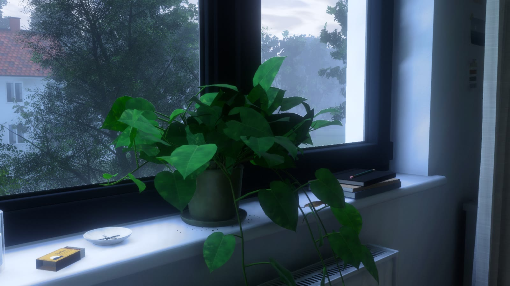

# 20 A room at dawn, made of code



A bedroom at 6:51 in the morning: low sun through the window, soft bounced light, a bed, a desk, plants and a hundred small things. No model or texture files: every object and surface is built by code, and the light was path traced once and stored per vertex. Walk around with WASD and the mouse, or press C for the cinematic camera.

[preview.mp4](preview.mp4) · [preview-9x16.mp4](preview-9x16.mp4)

## Say this to your AI

> Make a photoreal hotel room at dawn for our booking page, with low morning sun through the window, soft light on the bed and the desk, plants and small things around, built entirely in code with no model files, and let guests walk around it.

## 한국어로는 이렇게 말해요

> 우리 숙소 예약 페이지에 쓸 새벽 호텔 방을 사진처럼 만들어 줘. 창으로 낮은 아침 해가 들어오고, 침대랑 책상에 빛이 부드럽게 닿고, 화분이랑 자잘한 물건이 있게. 모델 파일 없이 전부 코드로 만들고, 손님이 방 안을 걸어 다닐 수 있게 해 줘.

아침 6시 51분의 침실이에요. 창으로 낮은 해가 들어오고, 빛이 부드럽게 번지고, 침대, 책상, 화분, 자잘한 물건이 가득해요. 모델 파일도 텍스처 파일도 없어요. 물건과 표면을 전부 코드로 만들고, 빛은 한 번 경로 추적으로 계산해서 꼭짓점마다 저장해 뒀어요. WASD 와 마우스로 걸어 다니고, C 를 누르면 영화 같은 카메라로 바뀌어요.

## Run it

```bash
npx github:wonseokjung/connect-ai-three example room-at-dawn
```

Make it a video (MP4 H.264, BT.709, frame-exact, 1920x1080; add `--9x16` for a vertical one, `--4k` for 3840x2160):

```bash
npx github:wonseokjung/connect-ai-three example room-at-dawn --video room-at-dawn.mp4
```

Your own copy to change (three.js then comes from a pinned CDN, so any static server works):

```bash
npx github:wonseokjung/connect-ai-three example room-at-dawn --copy my-room-at-dawn
```

## Where it comes from

- [Room at Dawn (6:51) by Leon Lin (Leonxlnx)](https://github.com/Leonxlnx/room-at-dawn) (MIT): the whole room in src/ (geometry, materials, sky, render pipeline, walk mode) and its baked lighting, licence text in LICENSE-room-at-dawn.txt
- [8-bit bake loader (this kit)](https://github.com/wonseokjung/connect-ai-three) (made for this kit): bake/gi8.bin.gz: the author's 13 MB gi.bin re-packed to 3.8 MB (8 bits, delta-coded, gzip) and applyBake8() in src/core/gi.js that reads it
- [three.js](https://threejs.org) (MIT): WebGLRenderer, BufferGeometryUtils, from the kit (0.187)

Left out: the music and leaves recordings (CC BY 4.0) and the birdsong mixed into the same file, so the room is silent; the bake tool (src/bake/) and the ?film recorder hook in main.js, which need the author's Vite dev server.

The full credits are in [NOTICE.md](../../NOTICE.md).
