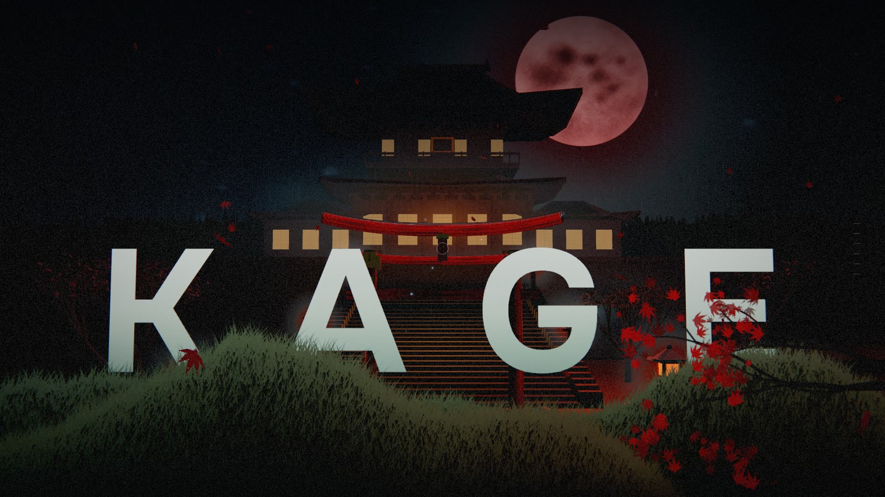

# 21 Cinematic landing page with a live 3D world



A full landing page for a place or a product: a night temple garden in three.js sits behind the text, the camera walks deeper with every section you scroll, lanterns flicker, maple leaves fall, and a giant wordmark stands in the sky. Put your own word in with ?word=YOURNAME.

[preview.mp4](preview.mp4) · [preview-9x16.mp4](preview-9x16.mp4)

## Say this to your AI

> Make a cinematic landing page for my product: a 3D night garden behind the text that the camera walks into as I scroll, lanterns, falling leaves, and my brand name as a giant word in the sky.

## 한국어로는 이렇게 말해요

> 내 제품 랜딩 페이지를 영화처럼 만들어 줘. 글 뒤에 3D 밤 정원이 있고, 스크롤하면 카메라가 안으로 걸어 들어가고, 등불이랑 떨어지는 잎, 하늘에는 내 브랜드 이름이 크게 떠 있게 해 줘.

장소나 제품을 소개하는 랜딩 페이지 한 장이에요. 글 뒤에 three.js 로 만든 밤의 사찰 정원이 깔려 있고, 스크롤할 때마다 카메라가 한 걸음씩 안으로 들어가요. 등불이 깜박이고 단풍잎이 떨어지고, 하늘에는 큰 글자가 서 있어요. 주소 뒤에 ?word=내이름 을 붙이면 그 글자가 내 이름으로 바뀌어요.

## Run it

```bash
npx github:wonseokjung/connect-ai-three example landing-hero
```

Make it a video (MP4 H.264, BT.709, frame-exact, 1920x1080; add `--9x16` for a vertical one, `--4k` for 3840x2160):

```bash
npx github:wonseokjung/connect-ai-three example landing-hero --video landing-hero.mp4
```

Your own copy to change (three.js then comes from a pinned CDN, so any static server works):

```bash
npx github:wonseokjung/connect-ai-three example landing-hero --copy my-landing-hero
```

## Where it comes from

- [ThreeUI Community: Kage landing page (Meng To)](https://github.com/MengTo/threeui/blob/main/public/landing-pages/kage.html) (MIT): the whole page: layout, scroll scenes, the procedural temple world, post effects (kage.js, index.html)
- [ThreeUI Community: Kage scene layers (WebP)](https://github.com/MengTo/threeui/blob/main/ASSET-LICENSES.md) (MIT): assets/foreground and assets/generated, the repository's own images
- [Onest typeface (shipped by ThreeUI)](https://github.com/googlefonts/onest) (OFL-1.1): assets/fonts.css, licence text in assets/LICENSE-fonts-OFL.md
- [three.js](https://threejs.org) (MIT): the kit's three.js r187 in place of the page's vendored r149

Left out: the vendored three.min.js (r149, the kit's r187 is used), the Wordmark and NotoJP fonts (no licence in the repository: Onest draws the word, Japanese words fall back to the system font), and the ThreeUI catalog thumbnails and videos on threeui.com (not part of the MIT release).

The full credits are in [NOTICE.md](../../NOTICE.md).
