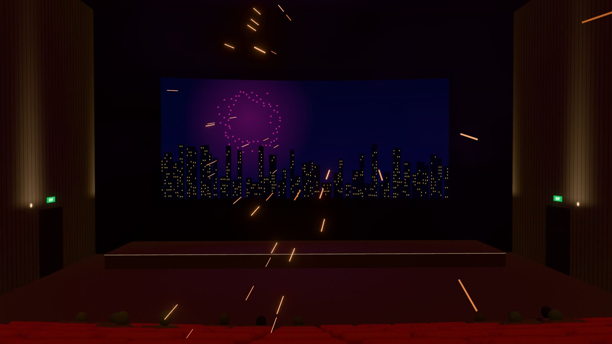

# 22 Pick a seat in a 3D cinema



A seat booking page as a real 3D cinema: click a seat on the map or in the room, fly to it and watch the screen from there. The film lights the room, a 4D track adds fog, rain, sparks and seat jolts, and the chosen seats go into tickets with a total. The film and its sound are made in code.

[preview.mp4](preview.mp4) · [preview-9x16.mp4](preview-9x16.mp4)

## Say this to your AI

> Make a seat booking page for my lecture hall as a 3D room: I click a seat, fly to it and see the stage from there, the screen lights the room, and my chosen seats add up as tickets with a total.

## 한국어로는 이렇게 말해요

> 우리 강의장 좌석 예약 페이지를 3D 공간으로 만들어 줘. 자리를 누르면 그 자리로 날아가서 거기서 무대가 어떻게 보이는지 보여 주고, 화면 빛이 객석을 비추고, 고른 자리는 티켓으로 쌓여서 합계가 나오게 해 줘.

좌석 예약 페이지를 진짜 3D 극장으로 만든 거예요. 좌석표나 극장 안에서 자리를 누르면 그 자리로 날아가서 거기서 본 화면을 보여 줘요. 영화 빛이 객석을 비추고, 4D 효과로 안개, 비, 불꽃, 좌석 흔들림이 나와요. 고른 자리는 티켓과 합계로 쌓여요. 영화와 소리는 전부 코드로 만들었어요.

## Run it

```bash
npx github:wonseokjung/connect-ai-three example cinema-seat
```

Make it a video (MP4 H.264, BT.709, frame-exact, 1920x1080; add `--9x16` for a vertical one, `--4k` for 3840x2160):

```bash
npx github:wonseokjung/connect-ai-three example cinema-seat --video cinema-seat.mp4
```

Your own copy to change (three.js then comes from a pinned CDN, so any static server works):

```bash
npx github:wonseokjung/connect-ai-three example cinema-seat --copy my-cinema-seat
```

## Where it comes from

- [Codrops: Cinema Seat Preview](https://github.com/codrops/CinemaSeatPreview) (MIT): the whole demo: room, seats, audience, flights, seat map, preview window, 4D effects, film light (js/, css/)
- [a film, its soundtrack and a GSAP stand-in](https://github.com/wonseokjung/connect-ai-three) (made for this kit): js/codefilm.js (a 36 s film on a canvas + Web Audio music), js/tween.js, the 4D track re-timed in js/cues.js
- [three.js (WebGPURenderer, TSL)](https://threejs.org) (MIT): the kit's three.js r187 in place of the demo's vendored r186

Left out: the film (a cut of Blender Studio's Charge, CC BY 4.0) and its poster, GSAP (its licence is not MIT), the vendored three.js r186, and the Google Fonts link. A film drawn in code with its own music plays instead, the 4D track is re-timed to it, and a small tween engine stands in for GSAP.

The full credits are in [NOTICE.md](../../NOTICE.md).
