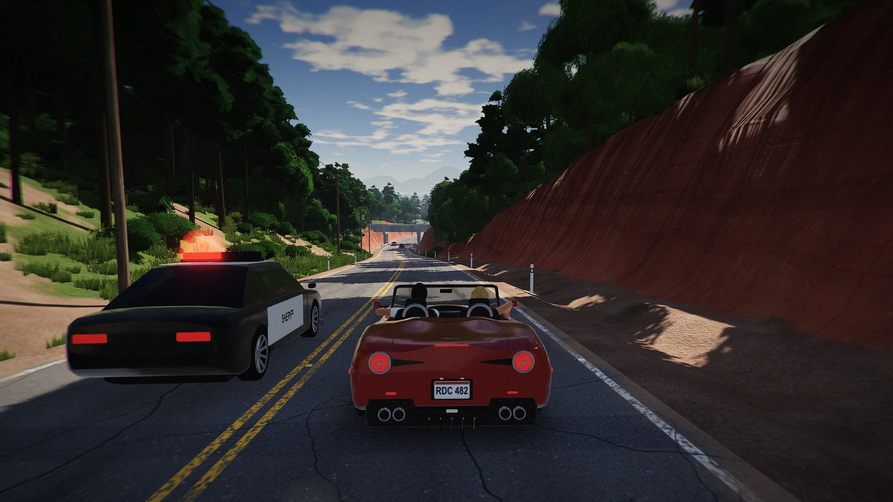

# 23 A police chase on a red clay road



A driving game in the browser with zero asset files: a convertible on a red clay road through the hills, police cars that ram, box you in and brake-check, five wanted levels, damage that rips doors and the hood off, and sound made with Web Audio. Every texture, car, person and tree is built by code.

[preview.mp4](preview.mp4) · [preview-9x16.mp4](preview-9x16.mp4)

## Say this to your AI

> Make a car chase game in the browser: I drive a convertible on a winding red clay road, police cars chase me and try to box me in, there are wanted stars, and the car gets damaged when I crash. No model files, everything made in code.

## 한국어로는 이렇게 말해요

> 브라우저에서 하는 자동차 추격 게임 만들어 줘. 구불구불한 붉은 흙길을 오픈카로 달리고, 경찰차들이 쫓아와서 앞뒤로 막고, 수배 별이 올라가고, 부딪히면 차가 부서지게 해 줘. 모델 파일 없이 전부 코드로.

에셋 파일이 하나도 없는 브라우저 운전 게임이에요. 언덕 사이 붉은 흙길을 오픈카로 달리고, 경찰차가 들이받고, 양옆을 막고, 앞에서 급정거해요. 수배 단계가 5개 있고, 부딪히면 문짝이랑 보닛이 떨어져 나가요. 소리는 Web Audio 로 만들고, 텍스처, 차, 사람, 나무는 전부 코드로 만들어요.

## Run it

```bash
npx github:wonseokjung/connect-ai-three example police-chase
```

Make it a video (MP4 H.264, BT.709, frame-exact, 1920x1080; add `--9x16` for a vertical one, `--4k` for 3840x2160):

```bash
npx github:wonseokjung/connect-ai-three example police-chase --video police-chase.mp4
```

Your own copy to change (three.js then comes from a pinned CDN, so any static server works):

```bash
npx github:wonseokjung/connect-ai-three example police-chase --copy my-police-chase
```

## Where it comes from

- [noclipepe: Red Clay Chase](https://github.com/noclipepe/red-clay-chase) (MIT): the whole game (js/, index.html): driving, police, damage, world, sound, menu
- [three.js](https://threejs.org) (MIT): the kit's three.js r187 in place of the game's vendored r160 (boot.js gives the scripts a global THREE)

Left out: the vendored three.min.js (r160). The links back to the author's game site now point to the original repository.

The full credits are in [NOTICE.md](../../NOTICE.md).
