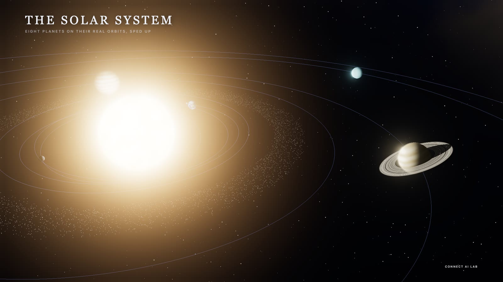

# 25 The solar system, sped up



The Sun and the eight planets on their real orbits, solved with Kepler's equation from today's date and sped up as far as you like. The Sun boils and glows, Earth has oceans, clouds and city lights on its night side, Jupiter has its red spot and Saturn its rings with the planet's shadow on them. A glass HUD sets the speed, hides orbits and labels and flies the camera to any planet. Every surface, the stars and the Milky Way are drawn by shaders, with no texture or model files.

[preview.mp4](preview.mp4) · [preview-9x16.mp4](preview-9x16.mp4)

## Say this to your AI

> Make a beautiful, sped-up solar system for my science channel intro: a glowing sun, planets with real surfaces on their real orbits, a star field, a clean HUD with a time slider, and a slow glide past Saturn's rings.

## 한국어로는 이렇게 말해요

> 과학 채널 인트로로 아름다운 태양계를 만들어 줘. 빛나는 태양, 진짜 같은 표면의 행성들이 실제 궤도를 빠르게 돌고, 별이 가득하고, 시간 조절 막대가 있는 깔끔한 정보창, 마지막엔 토성 고리 옆을 천천히 지나가게 해 줘.

태양과 여덟 행성이 실제 궤도를 따라 돌아요. 오늘 날짜에서 케플러 방정식으로 위치를 풀고, 원하는 만큼 빨리 감을 수 있어요. 태양은 끓어오르며 빛나고, 지구에는 바다와 구름과 밤 쪽 도시 불빛이 있고, 목성에는 대적점, 토성에는 행성 그림자가 드리운 고리가 있어요. 유리 같은 정보창으로 속도를 바꾸고, 궤도선과 이름을 끄고, 원하는 행성으로 카메라가 날아가요. 표면과 별과 은하수는 전부 셰이더로 그려서 텍스처나 모델 파일이 없어요.

## Run it

```bash
npx github:wonseokjung/connect-ai-three example solar-system
```

Make it a video (MP4 H.264, BT.709, frame-exact, 1920x1080; add `--9x16` for a vertical one, `--4k` for 3840x2160):

```bash
npx github:wonseokjung/connect-ai-three example solar-system --video solar-system.mp4
```

Your own copy to change (three.js then comes from a pinned CDN, so any static server works):

```bash
npx github:wonseokjung/connect-ai-three example solar-system --copy my-solar-system
```

## Where it comes from

- [three.js (OrbitControls, EffectComposer, UnrealBloomPass)](https://threejs.org) (MIT): the renderer and addons, from the kit
- [cb_doge on X: shared prompt](https://x.com/cb_doge/status/2074920311896879359) (made for this kit): the idea and the prompt only; all code written for this kit

Nothing to replace: no code was published with the post, so this page is written from scratch for the kit from the shared prompt.

The full credits are in [NOTICE.md](../../NOTICE.md).
