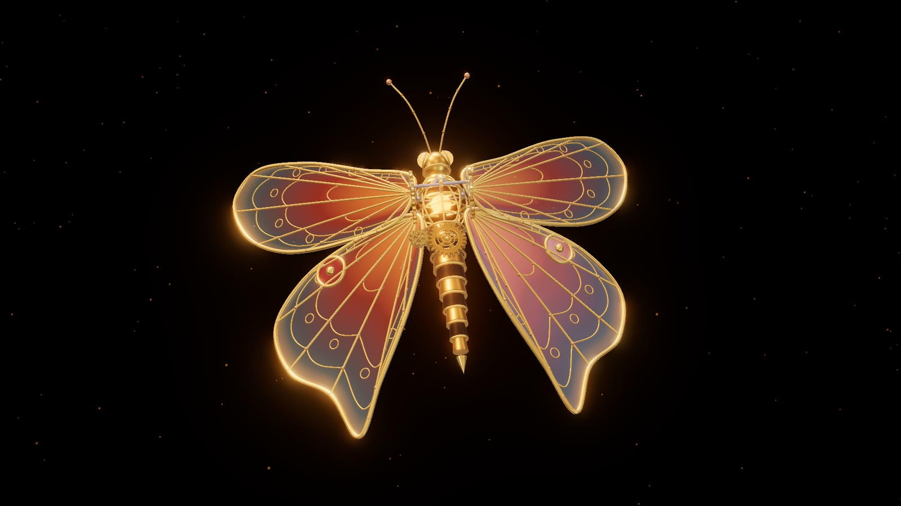

# 26 A mechanical butterfly that winds itself up



A clockwork butterfly of gold and brass assembles itself out of the dark, lights its heart and eyes, and starts to fly. The gears really mesh, and a crank on its back drives two push rods into the wing levers, so every wing beat comes from the mechanism. Filigree wing frames with enamel panels, rivets, dust in the warm light. Every part is built in code, with no model, texture or sound file. Drag to turn it, scroll to come closer, click to wind it again.

[preview.mp4](preview.mp4) · [preview-9x16.mp4](preview-9x16.mp4)

## Say this to your AI

> Make a beautiful mechanical butterfly for my watch brand film: gold gears and filigree wings with enamel panels, a clockwork heart, the parts assembling out of the dark, then the wings starting to beat as the camera circles close.

## 한국어로는 이렇게 말해요

> 우리 시계 브랜드 영상으로 아름다운 기계 나비를 만들어 줘. 금빛 톱니와 섬세한 금속 날개 틀, 에나멜 판, 태엽 심장이 있고, 어둠 속에서 부품이 모여 조립된 다음 날개가 움직이기 시작하고, 카메라가 가까이서 천천히 돌게 해 줘.

금과 황동으로 된 태엽 나비가 어둠 속에서 스스로 조립되고, 심장과 눈에 불이 들어오면서 날기 시작해요. 톱니바퀴가 진짜로 맞물려 돌고, 등에 있는 크랭크가 막대 두 개로 날개 레버를 밀어서 날갯짓이 전부 기계 장치에서 나와요. 금실 같은 날개 틀에 에나멜 유리판, 리벳, 따뜻한 빛 속 먼지까지 있어요. 모델 파일도 텍스처 파일도 소리 파일도 없이 전부 코드로 만들었어요. 끌어서 돌리고, 스크롤로 가까이 가고, 클릭하면 태엽을 다시 감아요.

## Run it

```bash
npx github:wonseokjung/connect-ai-three example mechanical-butterfly
```

Make it a video (MP4 H.264, BT.709, frame-exact, 1920x1080; add `--9x16` for a vertical one, `--4k` for 3840x2160):

```bash
npx github:wonseokjung/connect-ai-three example mechanical-butterfly --video mechanical-butterfly.mp4
```

Your own copy to change (three.js then comes from a pinned CDN, so any static server works):

```bash
npx github:wonseokjung/connect-ai-three example mechanical-butterfly --copy my-mechanical-butterfly
```

## Where it comes from

- [three.js](https://threejs.org) (MIT): WebGLRenderer, OrbitControls, RoomEnvironment, BufferGeometryUtils, EffectComposer with UnrealBloomPass, from the kit (0.187)
- [thtbee_ on X: shared prompt](https://x.com/thtbee_/status/2101304547876700627) (made for this kit): the idea and the prompt only; all code written for this kit

The full credits are in [NOTICE.md](../../NOTICE.md).
