# Examples

13 real three.js pages, one per lesson section. Each one started from MIT open source (the official three.js
examples and other projects named in its folder) and uses only CC0 models and textures.

<table>
<tr><td width="33%" valign="top"><a href="00-opening/">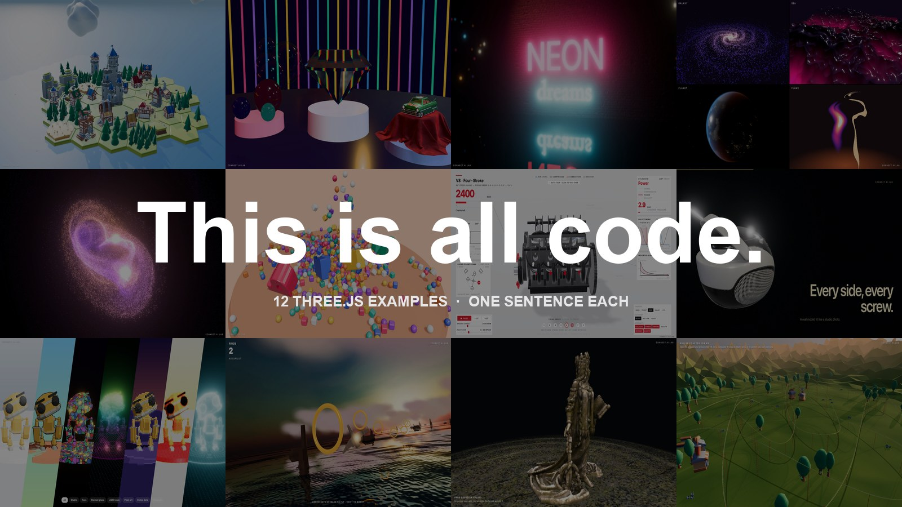</a><br><b>00 This is all code</b></td><td width="33%" valign="top"><a href="01-miniature-world/"></a><br><b>01 Miniature world</b></td><td width="33%" valign="top"><a href="02-glass-materials/">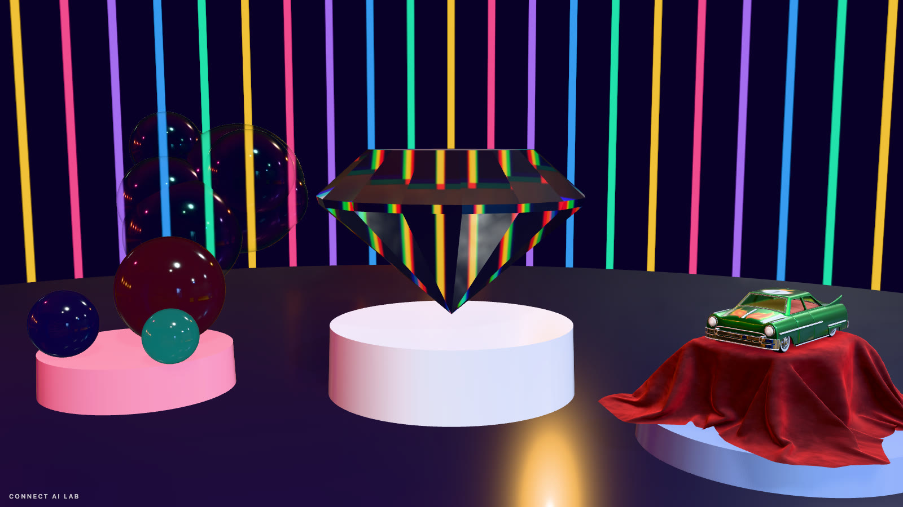</a><br><b>02 Glass, rainbow and soap film</b></td></tr>
<tr><td width="33%" valign="top"><a href="03-neon-text/">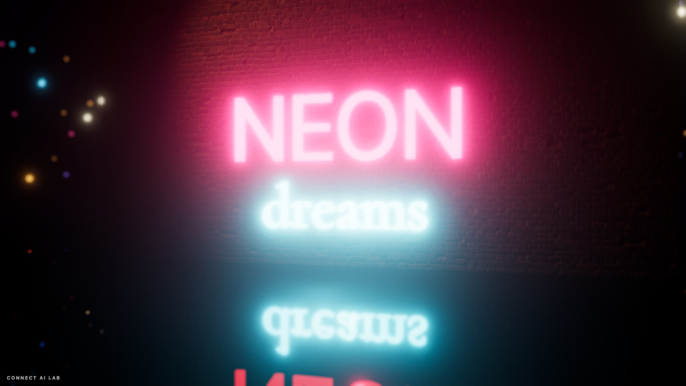</a><br><b>03 Neon text and post effects</b></td><td width="33%" valign="top"><a href="04-shader-worlds/">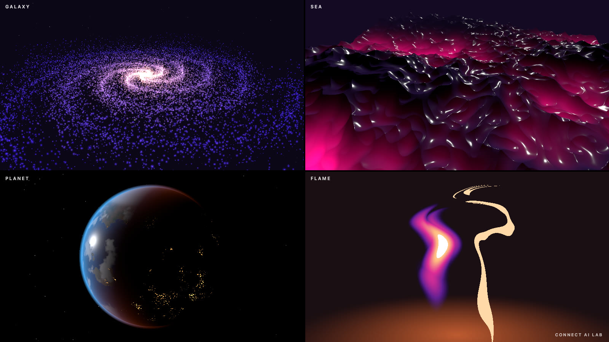</a><br><b>04 Shader worlds: galaxy, sea, planet, flame</b></td><td width="33%" valign="top"><a href="05-particles/">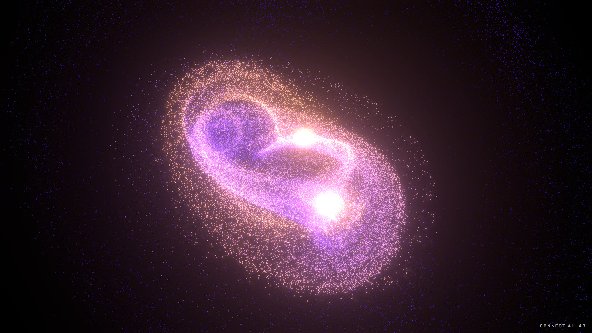</a><br><b>05 260,000 particles</b></td></tr>
<tr><td width="33%" valign="top"><a href="06-physics/">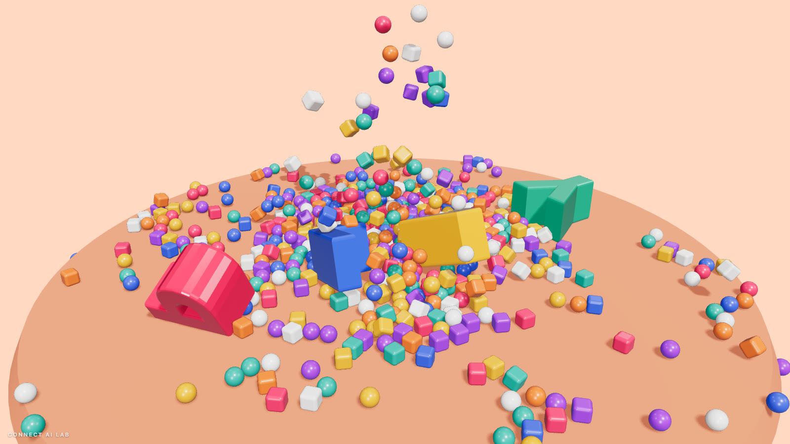</a><br><b>06 Real physics</b></td><td width="33%" valign="top"><a href="07-teardown/">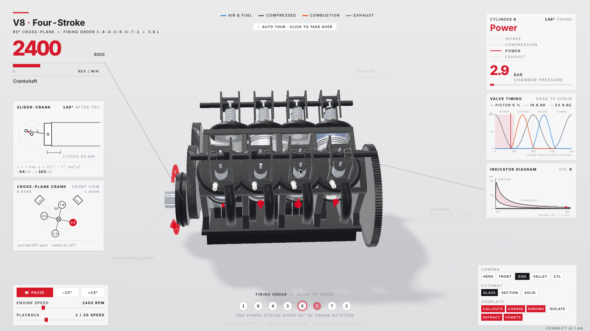</a><br><b>07 Machine teardown</b></td><td width="33%" valign="top"><a href="08-scroll-site/">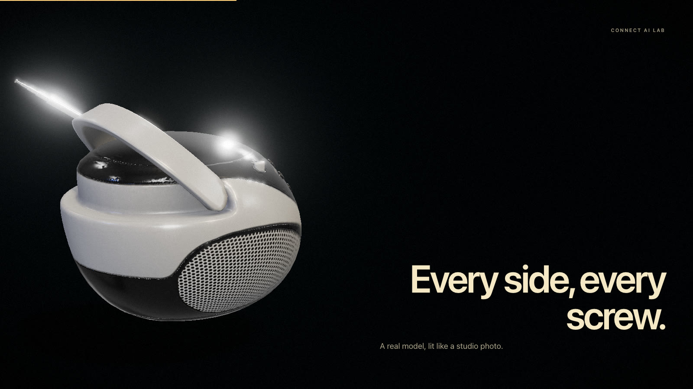</a><br><b>08 Scroll website</b></td></tr>
<tr><td width="33%" valign="top"><a href="09-many-styles/">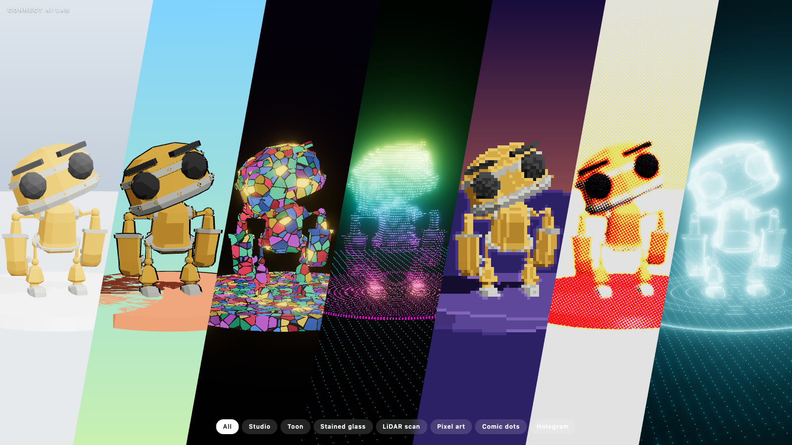</a><br><b>09 One scene, many styles</b></td><td width="33%" valign="top"><a href="10-flight-game/">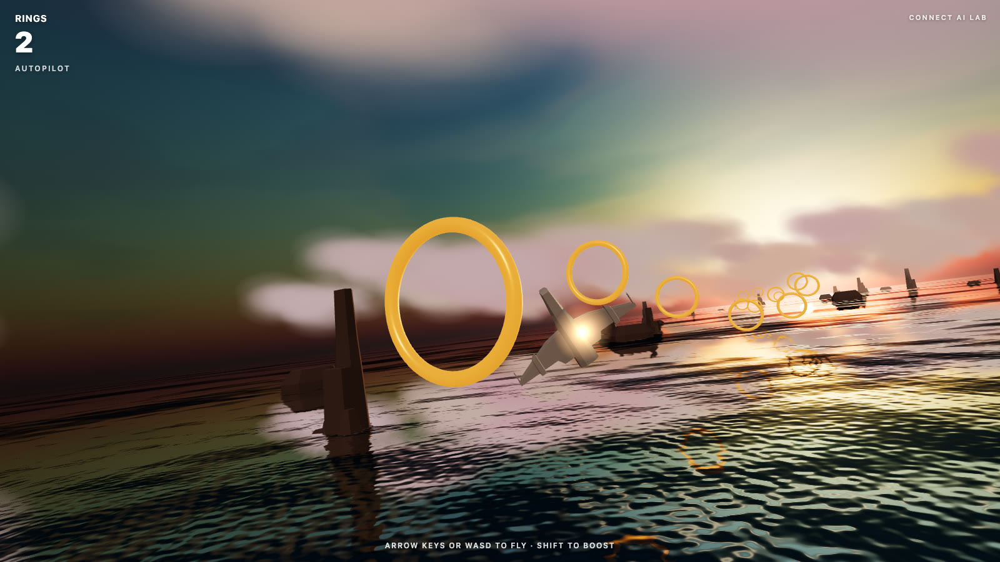</a><br><b>10 Flight game</b></td><td width="33%" valign="top"><a href="11-gaussian-splat/">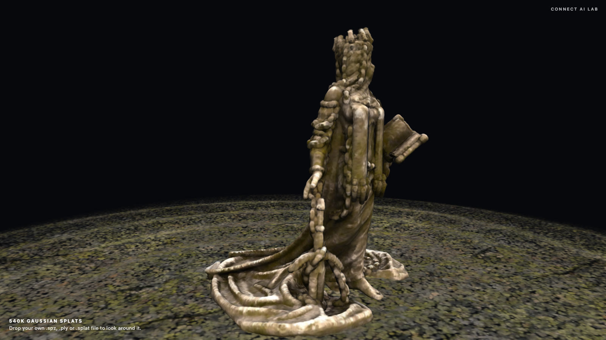</a><br><b>11 Gaussian splats</b></td></tr>
<tr><td width="33%" valign="top"><a href="12-xr/">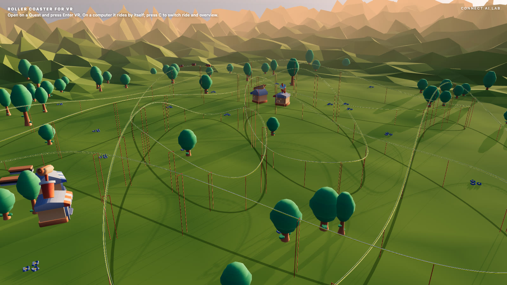</a><br><b>12 XR roller coaster</b></td></tr>
</table>

| | example | say this to your AI |
|---|---|---|
| 00 | [opening](00-opening/) | Make an opening page that plays all my three.js examples one after another with hard cuts, live, with a big title 'This is all code.' at the start. |
| 01 | [miniature-world](01-miniature-world/) | Make a tiny village on a little island. The windmill and the water wheel turn, clouds drift by, and the whole island slowly spins like a miniature. |
| 02 | [glass-materials](02-glass-materials/) | Show my product like glass: a crystal that splits light into a rainbow, glass marbles that bend what is behind them, and soap bubbles floating around. Make it slowly turn. |
| 03 | [neon-text](03-neon-text/) | Make my shop name in 3D neon letters that switch on one by one, glowing on a dark wall, reflected on a wet street, with the city lights behind out of focus. |
| 04 | [shader-worlds](04-shader-worlds/) | Make a spiral galaxy, a stormy sea, a planet with city lights on the night side and a candle flame, all with shaders and no image files. Put them in four panels. |
| 05 | [particles](05-particles/) | Make hundreds of thousands of particles that swirl around invisible magnets, computed on the GPU, glowing violet to peach as they speed up. Let me drag the magnets. |
| 06 | [physics](06-physics/) | Make my logo letters fall from above and bounce on the floor, then pour hundreds of colourful balls and blocks on them with real physics. Double-click shakes everything. |
| 07 | [teardown](07-teardown/) | Make an interactive V8 engine I can take apart. Cut it open, show the four strokes of one cylinder, let me change the speed and the camera, and play a guided tour when I leave it alone. |
| 08 | [scroll-site](08-scroll-site/) | Make a product landing page where a 3D speaker sits behind the text. When I scroll, it turns, moves to the other side of the page and its front glows to a beat. |
| 09 | [many-styles](09-many-styles/) | Show my dancing robot in seven styles: studio, toon, stained glass, LiDAR scan, pixel art, comic dots and hologram. First all side by side in slanted strips, then one at a time, with buttons to pick a style. |
| 10 | [flight-game](10-flight-game/) | Make a flight game over a sunset sea: fly a jet through golden rings, count the score, and let an autopilot fly when I don't touch the keys. |
| 11 | [gaussian-splat](11-gaussian-splat/) | Show a 3D scan as Gaussian splats on a web page with a magic reveal effect, let me orbit around it, and let me drop my own phone scan file to view it. |
| 12 | [xr](12-xr/) | Make a roller coaster ride at sunset that I can ride in VR on my Quest, sitting in the front car, with trees and food stalls around the park. |

```bash
npx github:wonseokjung/connect-ai-three examples          # the list
npx github:wonseokjung/connect-ai-three example physics   # open one
```

The old scene.json examples (one file of JSON per scene, made into video) are in [scene-json/](scene-json/).
