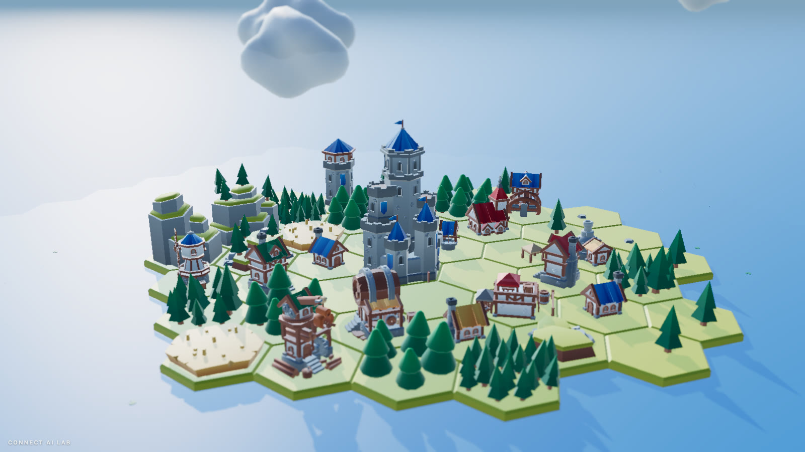
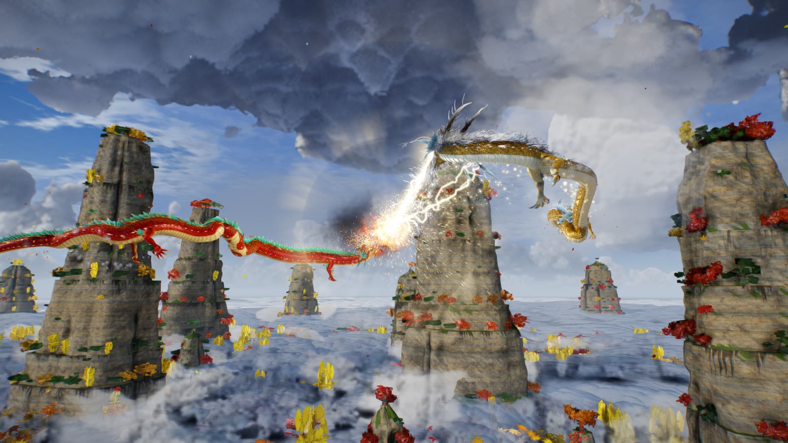
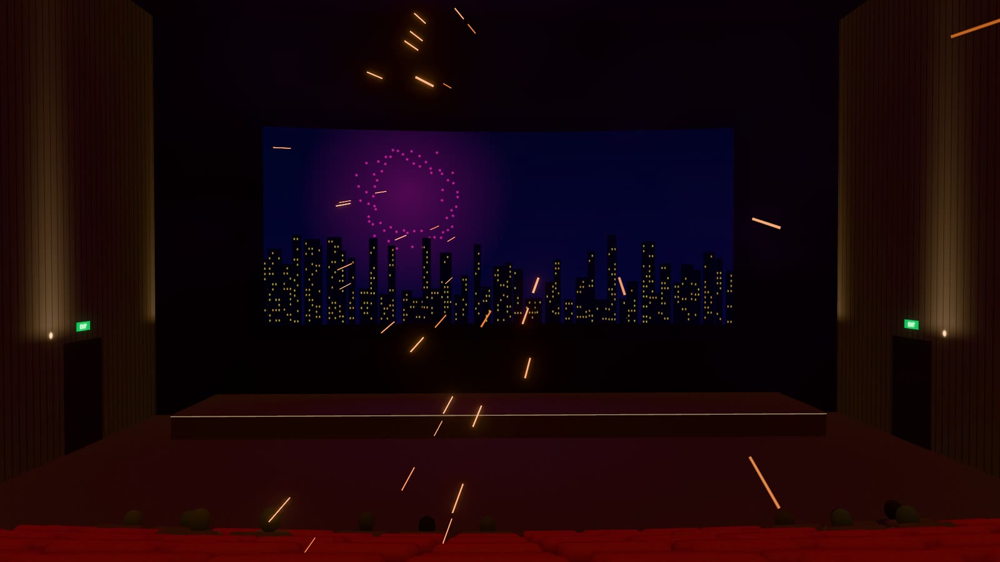
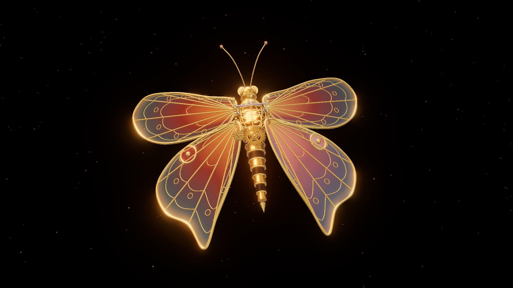
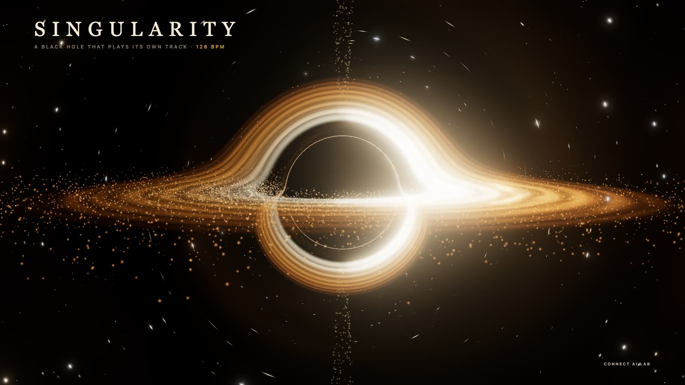

# Examples

28 real three.js pages, one per lesson section, and each one films itself into a video. 00 to 12 started from the
official three.js examples, 13 and up from community projects people made and shared on X, GitHub and Threads. Every one
started from MIT, Apache-2.0 or CC0 code named in its folder, and ships only CC0 or the project's own licensed files.

<table>
<tr><td width="33%" valign="top"><a href="00-opening/"></a><br><b>00 This is all code</b></td><td width="33%" valign="top"><a href="01-miniature-world/"></a><br><b>01 Miniature world</b></td><td width="33%" valign="top"><a href="02-glass-materials/"></a><br><b>02 Glass, rainbow and soap film</b></td></tr>
<tr><td width="33%" valign="top"><a href="03-neon-text/"></a><br><b>03 Neon text and post effects</b></td><td width="33%" valign="top"><a href="04-shader-worlds/"></a><br><b>04 Shader worlds: galaxy, sea, planet, flame</b></td><td width="33%" valign="top"><a href="05-particles/"></a><br><b>05 260,000 particles</b></td></tr>
<tr><td width="33%" valign="top"><a href="06-physics/"></a><br><b>06 Real physics</b></td><td width="33%" valign="top"><a href="07-teardown/"></a><br><b>07 Machine teardown</b></td><td width="33%" valign="top"><a href="08-scroll-site/"></a><br><b>08 Scroll website</b></td></tr>
<tr><td width="33%" valign="top"><a href="09-many-styles/"></a><br><b>09 One scene, many styles</b></td><td width="33%" valign="top"><a href="10-flight-game/"></a><br><b>10 Flight game</b></td><td width="33%" valign="top"><a href="11-gaussian-splat/"></a><br><b>11 Gaussian splats</b></td></tr>
<tr><td width="33%" valign="top"><a href="12-xr/"></a><br><b>12 XR roller coaster</b></td><td width="33%" valign="top"><a href="13-caustic-water/"></a><br><b>13 Caustic water for a drink page</b></td><td width="33%" valign="top"><a href="14-deep-ocean/"></a><br><b>14 Open ocean at golden hour</b></td></tr>
<tr><td width="33%" valign="top"><a href="15-attractor-particles/"></a><br><b>15 65,536 particles morphing between attractors</b></td><td width="33%" valign="top"><a href="16-ai-face/"></a><br><b>16 A talking AI assistant face made of light</b></td><td width="33%" valign="top"><a href="17-tower-defense/"></a><br><b>17 Tower defense with an AI commander</b></td></tr>
<tr><td width="33%" valign="top"><a href="18-hex-island/"></a><br><b>18 An island map that builds itself</b></td><td width="33%" valign="top"><a href="19-dragon-film/"></a><br><b>19 A 90 second dragon film, all code</b></td><td width="33%" valign="top"><a href="20-room-at-dawn/"></a><br><b>20 A room at dawn, made of code</b></td></tr>
<tr><td width="33%" valign="top"><a href="21-landing-hero/"></a><br><b>21 Cinematic landing page with a live 3D world</b></td><td width="33%" valign="top"><a href="22-cinema-seat/"></a><br><b>22 Pick a seat in a 3D cinema</b></td><td width="33%" valign="top"><a href="23-police-chase/"></a><br><b>23 A police chase on a red clay road</b></td></tr>
<tr><td width="33%" valign="top"><a href="24-self-building/"></a><br><b>24 A building that builds itself</b></td><td width="33%" valign="top"><a href="25-solar-system/"></a><br><b>25 The solar system, sped up</b></td><td width="33%" valign="top"><a href="26-mechanical-butterfly/"></a><br><b>26 A mechanical butterfly that winds itself up</b></td></tr>
<tr><td width="33%" valign="top"><a href="27-black-hole-music/"></a><br><b>27 A black hole that plays its own track</b></td></tr>
</table>

| | example | say this to your AI |
|---|---|---|
| 00 | [opening](00-opening/) | Make an opening page that plays all my three.js examples one after another with hard cuts, live, with a big title 'This is all code.' at the start. |
| 01 | [miniature-world](01-miniature-world/) | Make a tiny village on a little island. The windmill and the water wheel turn, clouds drift by, and the whole island slowly spins like a miniature. |
| 02 | [glass-materials](02-glass-materials/) | Show my product like glass: a crystal that splits light into a rainbow, glass marbles that bend what is behind them, and soap bubbles floating around. Make it slowly turn. |
| 03 | [neon-text](03-neon-text/) | Make my shop name in 3D neon letters that switch on one by one, glowing on a dark wall, reflected on a wet street, with the city lights behind out of focus. |
| 04 | [shader-worlds](04-shader-worlds/) | Make a spiral galaxy, a stormy sea, a planet with city lights on the night side and a candle flame, all with shaders and no image files. Put them in four panels. |
| 05 | [particles](05-particles/) | Make hundreds of thousands of particles that swirl around invisible magnets, computed on the GPU, glowing violet to peach as they speed up. Let me drag the magnets. |
| 06 | [physics](06-physics/) | Make my logo letters fall from above and bounce on the floor, then pour hundreds of colourful balls and blocks on them with real physics. Double-click shakes everything. |
| 07 | [teardown](07-teardown/) | Make an interactive V8 engine I can take apart. Cut it open, show the four strokes of one cylinder, let me change the speed and the camera, and play a guided tour when I leave it alone. |
| 08 | [scroll-site](08-scroll-site/) | Make a product landing page where a 3D speaker sits behind the text. When I scroll, it turns, moves to the other side of the page and its front glows to a beat. |
| 09 | [many-styles](09-many-styles/) | Show my dancing robot in seven styles: studio, toon, stained glass, LiDAR scan, pixel art, comic dots and hologram. First all side by side in slanted strips, then one at a time, with buttons to pick a style. |
| 10 | [flight-game](10-flight-game/) | Make a flight game over a sunset sea: fly a jet through golden rings, count the score, and let an autopilot fly when I don't touch the keys. |
| 11 | [gaussian-splat](11-gaussian-splat/) | Show a 3D scan as Gaussian splats on a web page with a magic reveal effect, let me orbit around it, and let me drop my own phone scan file to view it. |
| 12 | [xr](12-xr/) | Make a roller coaster ride at sunset that I can ride in VR on my Quest, sitting in the front car, with trees and food stalls around the park. |
| 13 | [caustic-water](13-caustic-water/) | Make the hero of my sparkling water page: a glass tank of water where sunlight draws moving caustics on the floor, a rubber duck bobbing on the surface, ripples where I click, and my brand name on the right. |
| 14 | [deep-ocean](14-deep-ocean/) | Make the first screen of my seaside resort site: an endless open ocean at golden hour with real waves and foam, the sun low over the water, my resort name on top, and let visitors fly over the sea and dive under it. |
| 15 | [attractor-particles](15-attractor-particles/) | Make the stage background for my event: tens of thousands of glowing particles that flow along strange attractor shapes and slowly morph from one shape to the next, push away from my mouse, with the event name in the corner. |
| 16 | [ai-face](16-ai-face/) | Give my shop's AI assistant a face: a human head made of glowing particles that blinks, looks around and moves its lips while it talks, with what it says as a caption underneath, and let me drag to turn it. |
| 17 | [tower-defense](17-tower-defense/) | Make a 3D tower defense game in the browser that an AI commander plays by itself from the moment the page opens, with towers, waves of monsters and a boss every fifth wave, and let me take over with one click. |
| 18 | [hex-island](18-hex-island/) | Make a little island map for our chain stores out of hexagon tiles that drop in and lock together by themselves, with roads, rivers, villages and windmills, and grow a new piece of island wherever I click. |
| 19 | [dragon-film](19-dragon-film/) | Make a 90 second film that plays live in the browser with no asset files at all: two dragons fighting with fire and lightning around a cliff monastery among stone pillars, with its own music made by code, then rain, a rainbow and sky lanterns at dusk. |
| 20 | [room-at-dawn](20-room-at-dawn/) | Make a photoreal hotel room at dawn for our booking page, with low morning sun through the window, soft light on the bed and the desk, plants and small things around, built entirely in code with no model files, and let guests walk around it. |
| 21 | [landing-hero](21-landing-hero/) | Make a cinematic landing page for my product: a 3D night garden behind the text that the camera walks into as I scroll, lanterns, falling leaves, and my brand name as a giant word in the sky. |
| 22 | [cinema-seat](22-cinema-seat/) | Make a seat booking page for my lecture hall as a 3D room: I click a seat, fly to it and see the stage from there, the screen lights the room, and my chosen seats add up as tickets with a total. |
| 23 | [police-chase](23-police-chase/) | Make a car chase game in the browser: I drive a convertible on a winding red clay road, police cars chase me and try to box me in, there are wanted stars, and the car gets damaged when I crash. No model files, everything made in code. |
| 24 | [self-building](24-self-building/) | Make the opening of my architecture studio's page: a 3D building that assembles itself, foundations first, then walls brick by brick, then the roof, with a timeline I can scrub and buttons that fly the camera to the details. |
| 25 | [solar-system](25-solar-system/) | Make a beautiful, sped-up solar system for my science channel intro: a glowing sun, planets with real surfaces on their real orbits, a star field, a clean HUD with a time slider, and a slow glide past Saturn's rings. |
| 26 | [mechanical-butterfly](26-mechanical-butterfly/) | Make a beautiful mechanical butterfly for my watch brand film: gold gears and filigree wings with enamel panels, a clockwork heart, the parts assembling out of the dark, then the wings starting to beat as the camera circles close. |
| 27 | [black-hole-music](27-black-hole-music/) | Make a 3D audio visualizer in one page: a black hole with a glowing accretion disk and gravitational lensing, stars around it, and particles that pulse to the beat of an EDM track called SINGULARITY. Make the music in code, start it with a play button, and let the disk flare when the drop hits. |

```bash
npx github:wonseokjung/connect-ai-three examples          # the list
npx github:wonseokjung/connect-ai-three example physics   # open one
npx github:wonseokjung/connect-ai-three example caustic-water --video water.mp4 --9x16   # film one
```

The old scene.json examples (one file of JSON per scene, made into video) are in [scene-json/](scene-json/).
