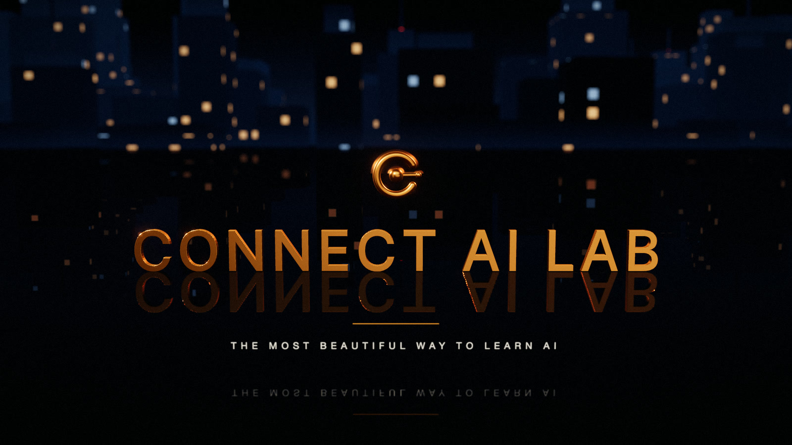
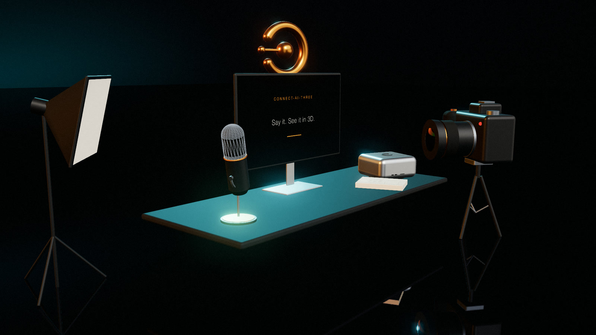
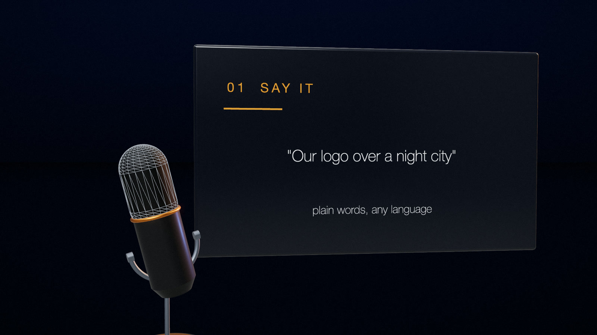
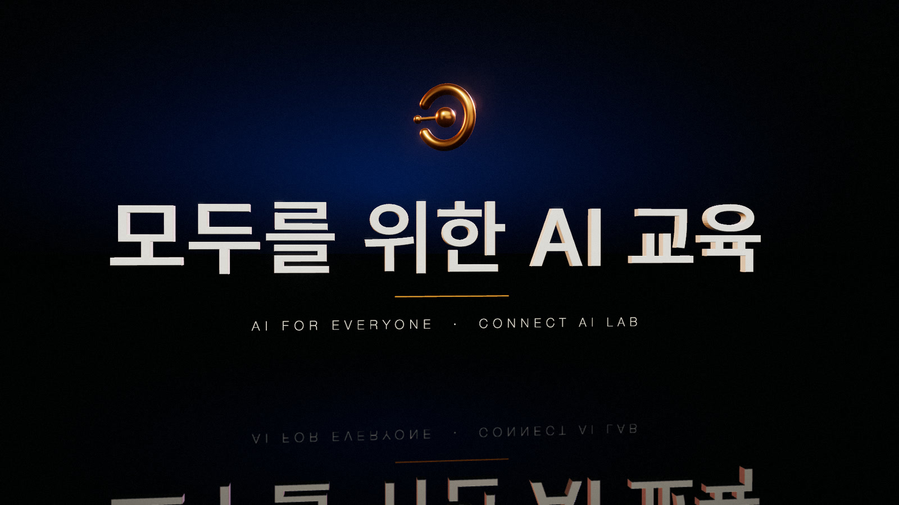

# Examples

Each folder is one finished scene: its `scene.json`, a `preview.jpg` and a short `preview.mp4` made with the kit, and a README with the sentence behind it. Copy a folder, change the words, run `make`. Run the commands in a copy of this repo.

| | Folder | What it is | Run |
|---|---|---|---|
|  | [`bust`](bust) | A marble bust on a mint plinth in a peach and lilac gallery, the title fades in beside it. A CC0 model and HDRI. | `npx github:wonseokjung/connect-ai-three make examples/bust --short` |
|  | [`showroom`](showroom) | A vintage cine camera turning on a pink stage in a blue and yellow toy world. A CC0 model and HDRI. | `npx github:wonseokjung/connect-ai-three make examples/showroom --short` |
|  | [`flythrough`](flythrough) | The camera flies past a boombox, a pocket watch and a chess set on a desert at dusk, a glass plaque at each stop. Three CC0 models and an HDRI. | `npx github:wonseokjung/connect-ai-three make examples/flythrough --short` |
|  | [`toy-studio`](toy-studio) | The demo: a cinema camera turning on a pink stage in a blue and yellow toy world, all built in code. | `npx github:wonseokjung/connect-ai-three make examples/toy-studio --short` |
|  | [`logo-night-city`](logo-night-city) | The logo film: gold letters standing on a dark mirror, the mark above, a night city far behind and out of focus, one slow push-in. | `npx github:wonseokjung/connect-ai-three make examples/logo-night-city --short` |
|  | [`interactive-hero`](interactive-hero) | A web hero: a small studio on a desk you can turn around. The camera leans to the pointer, things lift on hover and spin on click. The `pointerScript` in the file lets the video show the same interaction. | `npx github:wonseokjung/connect-ai-three web examples/interactive-hero` |
|  | [`explainer-fly`](explainer-fly) | Three stations in one 3D space (a microphone, a display, a laptop with a clapperboard) and a camera that flies between them. | `npx github:wonseokjung/connect-ai-three make examples/explainer-fly` |
|  | [`korean-title`](korean-title) | 3D text in Korean with the built-in sans face; any other text takes your own font file (`fontFile`). | `npx github:wonseokjung/connect-ai-three make examples/korean-title` |
|  | [`on-my-video`](on-my-video) | Five cuts of 3D behind the speaker in a talking video (person matte), timed to the words. Bring your own clip: see the README inside. | `npx github:wonseokjung/connect-ai-three on-video my-talk.mp4 --faces face.json --matte matte/` |

Click a picture for its folder; in the folder, click the picture to play the clip.

More starting points: every catalog item is a complete scene too (`npx github:wonseokjung/connect-ai-three catalog`, `npx github:wonseokjung/connect-ai-three use <id>`).
