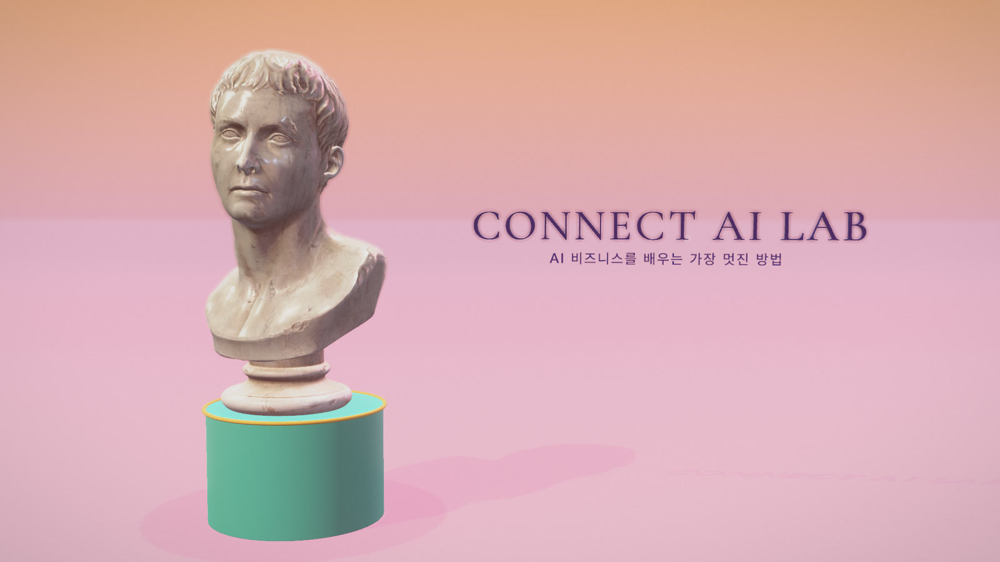

# Bust in a pastel gallery

Say it to your agent:

> Use connect-ai-three: my marble bust (assets/bust.glb) on a mint plinth in a peach and lilac gallery. The camera eases back from the face, and our name fades in beside it. 9 seconds, and a page I can drag.

Make it, in a copy of this repo:

    npx github:wonseokjung/connect-ai-three make examples/bust --short

You get `out/web/index.html` (one file, the model inside), `out/video.mp4`, `out/short_9x16.mp4`, a still sheet and the check report.
The marble is calmed with `"surface": {"roughness": 1, "brightness": 1.45}` on the `gltf`, and `grade` with `whites` 0.95 keeps the light parts soft.

Model and HDRI: Poly Haven, CC0 ([licenses/assets.md](../../licenses/assets.md)).
