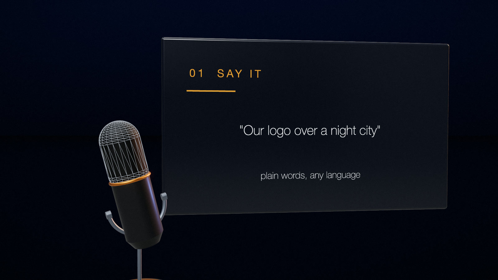

# Explainer fly-through

Say it to your agent:

> Use connect-ai-three: explain my three steps as three stations in one space (a microphone with a glass card, a display, a laptop with a clapperboard), the camera flying from one to the next, then pulling back to show all of them.

Make it, in a copy of this repo:

    npx github:wonseokjung/connect-ai-three make examples/explainer-fly

How this tool works, told by the tool: what you say, the one file, the two outputs. One 3D space instead of slides.
