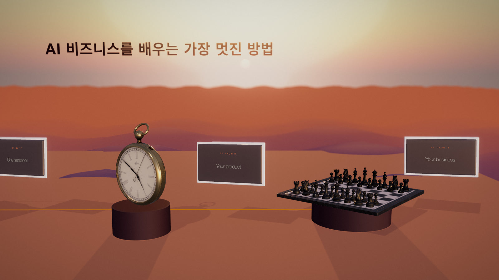

# Three stops on a desert at sunset

Say it to your agent:

> Use connect-ai-three: a desert at sunset with three stops, a boombox, a pocket watch and a chess set, each on a pedestal with a glass plaque. The camera flies from one to the next and then pulls back to show all three. 13 seconds.

Make it, in a copy of this repo:

    npx github:wonseokjung/connect-ai-three make examples/flythrough --short
    npx github:wonseokjung/connect-ai-three web examples/flythrough --serve     # the page keeps the three models next to it, so open it from a small server

The camera stops at each pedestal with `shots`. With three detailed models the check counts 434 draw calls and lists that under "worth a look".

Models and HDRI: Poly Haven, CC0 ([licenses/assets.md](../../licenses/assets.md)).
