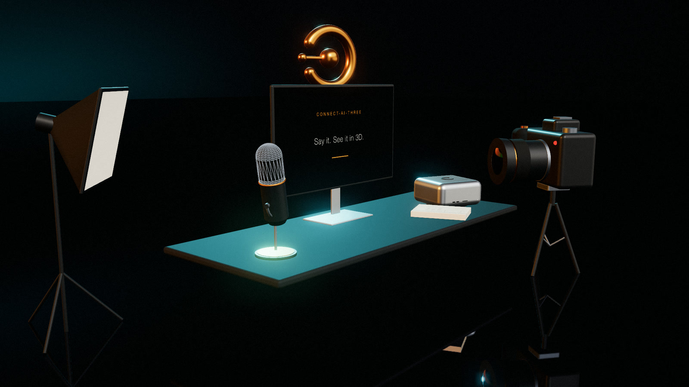

# Interactive hero

Say it to your agent:

> Use connect-ai-three: an interactive hero for my landing page. A small studio set on a desk: display, computer, microphone, a camera on a tripod, a softbox. Hover lifts, click spins, drag turns the scene.

Make the page, in a copy of this repo:

    npx github:wonseokjung/connect-ai-three web examples/interactive-hero

The camera leans to the pointer, things lift on hover and spin on click. The small ring in the video is the `pointerScript` in the file: it plays the same moves so the video can show them.
