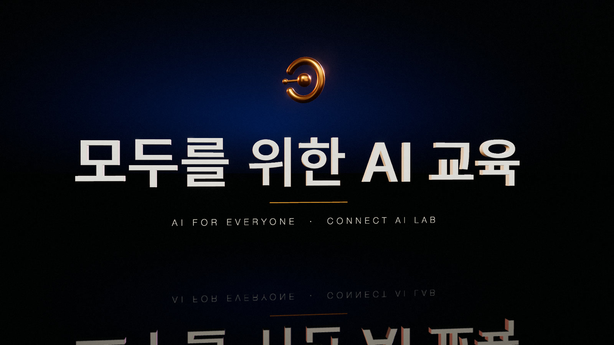

# 3D text in Korean

Say it to your agent:

> Use connect-ai-three: the words "모두를 위한 AI 교육" as ivory 3D letters arriving one by one, a small gold mark above, blue light behind.

The four sans typefaces (`thin`, `light`, `sans`, `bold`) carry the Korean letters of a few lines, so this scene needs
no font file: "모두를 위한 AI 교육" (AI education for everyone).

For any other Korean text, or Japanese, Chinese, Arabic and so on, give the 3D text your own font file. Put a `.ttf`
or `.otf` you are allowed to use in `assets/` and name it:

    {"type": "text3d", "text": "안녕하세요, 반갑습니다", "fontFile": "assets/MyFont.otf"}

Then `npx github:wonseokjung/connect-ai-three make examples/korean-title`. The check tells you which letters a font does not have.
Letters inside-out? Add `"fontReversed": true` (or `false`): `.otf` and `.ttf` files wind their outlines opposite ways.
