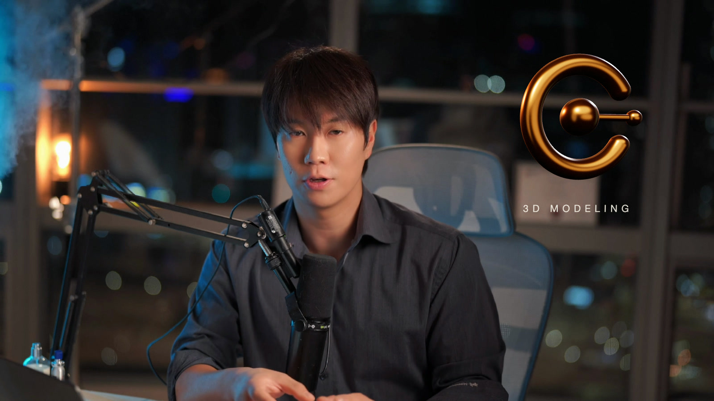

# 3D on your own video, behind you

Say it to your agent:

> Use connect-ai-three on my talking video with the person matte: when I say "3D modeling" show our mark as a wireframe on my right and turn it into solid gold; when I say "a good computer" slide a computer out from behind my head. Nothing in front of my face or my mic.

The preview is `scene.json` (cut 2) made with the kit on the author's own footage.

Five finished cuts. Each one is timed to the words spoken in that take, and with a person matte every object is drawn
behind the speaker.

| File | He says | What happens |
|---|---|---|
| `cuts/1-hello.json` | "Hello, CONNECT AI LAB, I'm your AI mentor Jay." | the name rises from behind his shoulders and settles above his head; his own name appears beside him |
| `scene.json` (= `cuts/2-modeling.json`) | "...3D modeling like Blender ... you need a good computer..." | our mark as a wireframe turns into solid gold; a computer slides out from behind his head |
| `cuts/3-camera.json` | "...because I move the camera around ... like a movie." | a camera flies behind his head to his other side; a clapperboard claps |
| `cuts/4-gravity.json` | "...this world has gravity." | three things that were hanging in the air fall (Rapier physics, baked) |
| `cuts/5-company.json` (a bright room) | "...an AI-native company ... engineering and business." | the studio building rises behind his shoulder; a computer and a book appear |

The kit does not ship anyone's footage. Run a cut on your own clip:

    npx github:wonseokjung/connect-ai-video-motion analyze my-talk.mp4          # lesson 2's tool: writes work/face.json and work/matte
    npx github:wonseokjung/connect-ai-three on-video my-talk.mp4 my-talk-three --faces my-talk-video-motion/work/face.json --matte my-talk-video-motion/work/matte

Then copy a cut over `my-talk-three/scene.json`, move the objects to the empty parts of your own frame, set the times
to your own words, and run `npx github:wonseokjung/connect-ai-three make my-talk-three --alpha`.

- `keepOut` holds the face box and, marked `"front": true`, the mic arm: it is in front of the speaker but not part of
  the matte, so the check keeps 3D off it.
- No matte? The scene still works on top of the video; then keep every object out of the face box.
- No face file? Give the box yourself: `--face 0.33,0.13,0.25,0.48` (x, y, width, height as fractions of the frame).
