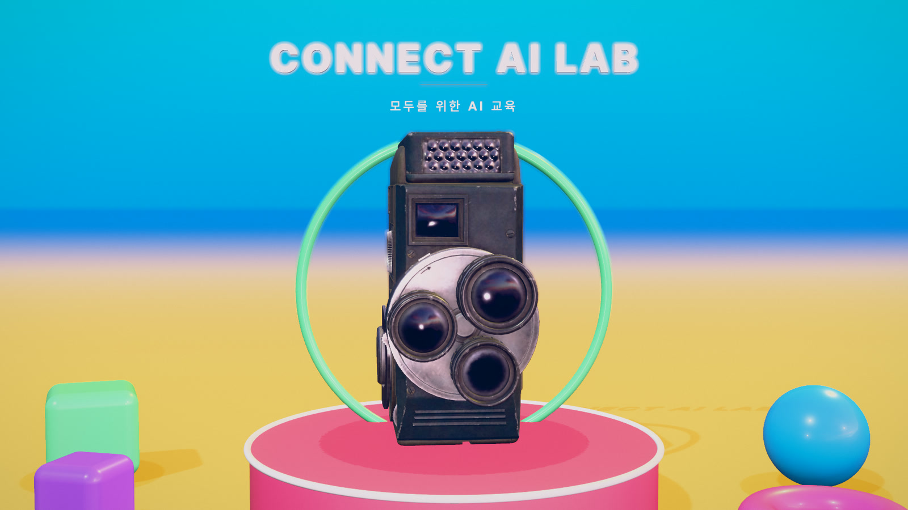

# Camera showroom in a toy world

Say it to your agent:

> Use connect-ai-three: a showroom for my vintage cine camera (assets/product.glb). A bright toy world with a blue sky and a yellow floor, the camera turning slowly on a pink stage, a few toys around it, our name above. 9 seconds, and a page I can drag.

Make it, in a copy of this repo:

    npx github:wonseokjung/connect-ai-three make examples/showroom --short

You get `out/web/index.html` (one file, the model inside), `out/video.mp4`, `out/short_9x16.mp4`, a still sheet and the check report.
Soft dark pools (`contact`) under the stage and the toys keep them on the floor instead of floating.

Model and HDRI: Poly Haven, CC0 ([licenses/assets.md](../../licenses/assets.md)).
