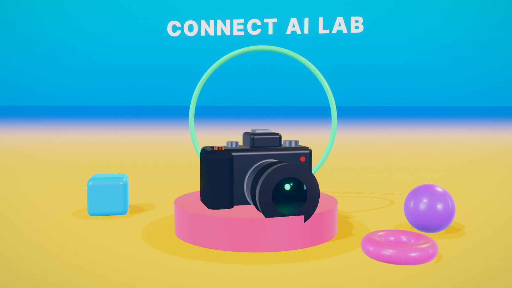

# Toy studio (the demo)

This is the scene the first command makes:

    npx github:wonseokjung/connect-ai-three

It writes `connect-ai-three-demo/` and opens the page. To make this folder yourself, in a copy of this repo:

    npx github:wonseokjung/connect-ai-three make examples/toy-studio --short

Everything here is built in code (the camera, the stage, the toys). No model files.
